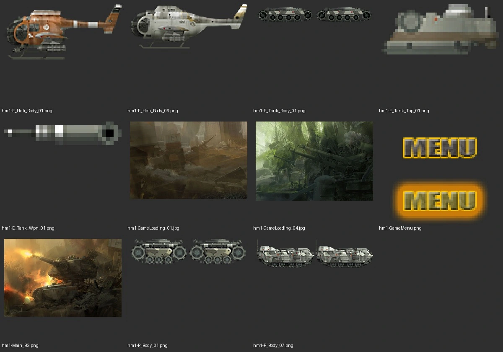
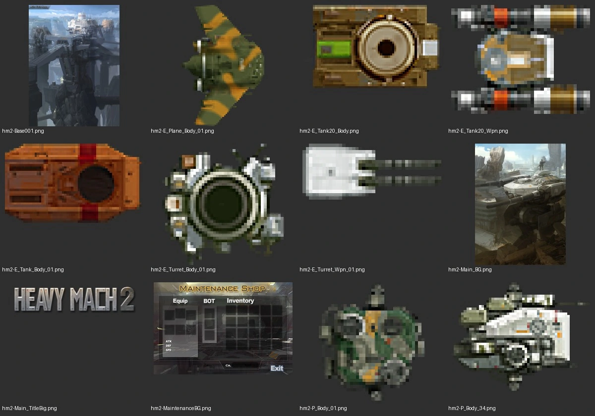
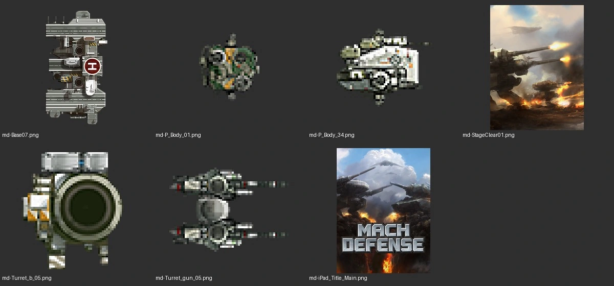

# 박재철의 Mach 시리즈 미술

2026-11-07. HeavyMach1·HeavyMach2 HD·MachDefense의 원본 이미지 30개와 작가의 공식 자료를 비교했다. 새로 생성한 포탑·전투기·VTOL은 원작 분석 표본에서 제외했다.

## 원본 그림 비교

유닛의 세부는 확대하고 일러스트는 축소한 비교표다. 게임 안 크기는 각 PNG의 캔버스·알파 범위·배율로 별도 대조한다.

## 화풍의 근간

세 작품에서 관찰되는 중심은 **군용 기계와 산업 시설을 사실적인 재질·빛·원근으로 설득하는 SF 콘셉트아트**다. 실존 군용 장비의 궤도·장갑·포신·헬기 구조와 허구의 거대 병기를 함께 사용한다. 작은 유닛은 전투 중 구별되도록 실루엣과 명암을 압축하고, 일러스트는 대기·연기·원근으로 공간을 넓힌다.

이것은 그림을 보고 정리한 조형적 분류다. 박재철이 19세기 사실주의나 낭만주의에 속한다고 선언한 자료는 확인하지 못했다. ‘사실적’은 이 보고서에서 재질과 공간 표현을 뜻한다. 거대한 기계·폐허·역광이 주는 압도감은 숭고의 표현과 비교할 수 있지만, 특정 사조의 직접 영향으로 확정하지 않는다.

작가의 [공식 소개](https://paperblue.artstation.com/resume)는 Concept Art, Environment Design, Illustration, Game Design, Prop Design, Traditional Art를 작업 분야로 밝힌다. [화집 출판사](https://designstudiopress.com/products/art-of-paperblue)는 환경 콘셉트 페인팅, 커스텀 브러시, 스머지, 색채, 구도와 기계·전투기 등의 작업을 소개한다. 회화적인 일러스트와 설계적인 기계 구조를 함께 살피는 근거다. 모든 게임 스프라이트를 손으로 한 점씩 찍었는지, 3D 렌더를 거쳤는지는 이 자료로 알 수 없다.

## 세 작품의 공통점과 차이

| 구분 | HeavyMach1 | HeavyMach2 | MachDefense |
|---|---|---|---|
| 유닛 관찰 시점 | 옆면, 약간 보이는 윗면 | 위에서 내려다보는 기계 | 위에서 내려다보는 메크·포탑·기지 |
| 형태가 읽히는 순서 | 긴 궤도와 차체, 포탑, 포신 | 중앙 장갑과 무장, 주변 구동부 | 몸체의 회전 링, 무장 쌍, 지지부 |
| 주된 표면 | 회녹색·회색 장갑, 무딘 밝은 금속 | 회녹색·백색과 적갈색 장갑, 좁은 색 표식 | 밝은 금속 경계, 패널·링·포신의 명확한 분리 |
| 일러스트 | 낮은 시점의 전차, 황토·녹색 폐허, 포화 | 기계와 큰 산업 도시, 전경과 먼 배경 | 낮은 시점의 포탑·메크, 하늘과 폭발의 대비 |
| 새 그림에 적용할 점 | 측면 실루엣과 높이 비례를 우선 | 탑뷰에서 무장 방향과 구동부를 분리 | 실제 회전축과 몸체·무장 조립, 작은 크기에서 경계를 유지 |

HeavyMach2와 MachDefense의 `P_Body_01`, `P_Body_34`는 같은 형태의 디자인을 공유한다. 그러나 이번 표본의 PNG 크기는 각각 34×39 대 32×64, 55×44 대 64×64로 달랐고 픽셀도 일치하지 않았다. 같은 디자인이라는 이유로 파일이나 회전 중심까지 같다고 가정하면 안 된다.

## 표현 방식

**기계의 무게.** 넓은 장갑 면과 어두운 접합부가 먼저 보인다. 원형 축·궤도·포신 같은 기능적 형태가 장식보다 앞선다. 여러 부품을 붙여도 지지 관계가 읽힌다. 포탑의 강화는 단순 확대보다 장갑 배열과 무장 구성의 차이로 드러난다.

**금속의 명암.** 밝은 모서리, 어두운 틈, 중간 밝기의 도장 면을 좁은 픽셀 영역에 둔다. 전체를 균일하게 반짝이게 하지 않는다. 검은 외곽선 하나로 형태를 두르는 대신 바깥면의 밝기와 배경 대비로 윤곽을 만든다. 부분적으로 어두운 윤곽이 있는 것과 모든 면에 굵은 선을 두르는 것은 다르다.

**절제된 색.** 회색·회녹색·상아색과 흙빛이 넓은 면을 차지한다. 경고선·무기 표식·불꽃에 노랑·빨강·청색을 쓴다. HeavyMach1의 헬기처럼 적갈색 도색도 있으므로 모든 유닛을 회색으로 통일하는 규칙은 맞지 않는다.

**일러스트의 공간.** `Main_BG`, `GameLoading_01`, `GameLoading_04`, `Base001`, `StageClear01`에서 가까운 기계는 명암이 강하고, 먼 도시·숲·하늘은 연기와 대기 속으로 풀린다. 디테일을 전면에 뿌리는 대신 큰 명암 덩어리와 시선의 방향을 먼저 잡는다. 따뜻한 폭발은 차가운 하늘·회색 기계와 대비된다.

**작은 래스터의 정보량.** 유닛 이미지에는 작은 금속 하이라이트와 부품별 명암, 부분 알파가 있다. 이를 제한 팔레트의 8비트 복고풍으로 바꾸면 원작과 달라진다. 고해상도 그림의 부드러운 붓결을 그대로 작은 PNG로 줄이는 것만으로도 충분하지 않다. 최종 크기에서 포신과 링·장갑 면이 분리돼 읽히는지 확인해야 한다.

**UI와 게임 세계의 연결.** 금속 패널·프레임·나사·표시창을 버튼과 HUD에도 사용한다. 원작 UI는 기계의 일부처럼 보인다. 새 버튼은 기존 버튼의 상태별 이미지, 글자, 광택, 글로우를 참조한다. 별도의 판타지 장식이나 OS 버튼을 넣을 이유가 없다.

## 피해야 할 해석

증기기관·황동 장식이 주된 문법인 스팀펑크, 일률적인 네온 사이버펑크, 애니메이션 셀 셰이딩으로 분류하면 실제 표본과 어긋난다. ‘밀리터리 SF’만으로도 모든 작품의 색과 시점을 설명할 수 없으므로, 제작할 때는 반드시 같은 게임·같은 종류의 원본을 붙인다. 작가 전체 경력의 화풍을 이 세 게임만으로 고정하지 않는다.

## 출처

- 원본 표본: `docs/research/mach-series-art/sources.json`. 패키지 안 이미지 이름과 SHA-256, 준비된 PNG의 해시를 기록했다. 원본 IPA는 포함하지 않았다.
- [Paperblue 공식 프로필](https://paperblue.artstation.com/resume), [공식 작품 목록](https://paperblue.artstation.com/).
- [The Art of PaperBlue — Design Studio Press](https://designstudiopress.com/products/art-of-paperblue). 작가의 작업 분야·책에 수록된 제작법을 확인했다.
- [위메이드의 2011년 보도자료](https://www.newswire.co.kr/newsRead.php?no=575013). HeavyMach Assault에 PaperBlue가 참여했다고 명시한다. 세 작품 모두 같은 미술 담당이라는 범위는 사용자가 제공한 정보다.

원작의 정확한 제작 프로그램·브러시 설정·3D 선행 작업 여부·특정 작가의 영향 관계는 확인하지 못했다. 새 에셋의 기준은 위 추정이 아니라 실제 게임 안의 원본 그림과 조립 구조다.
