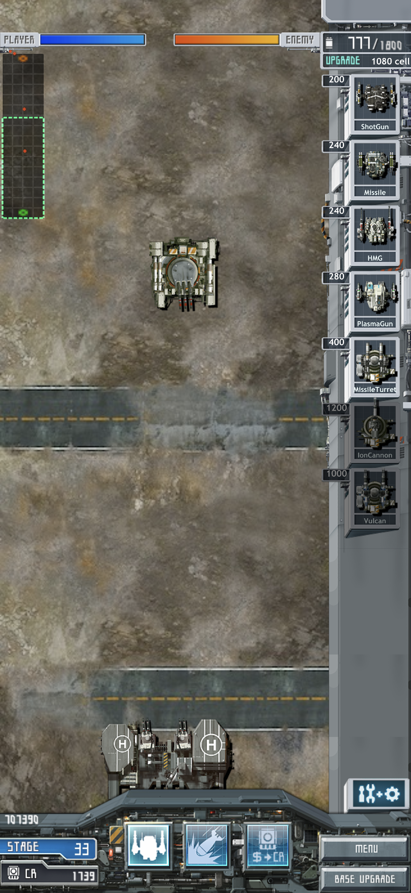
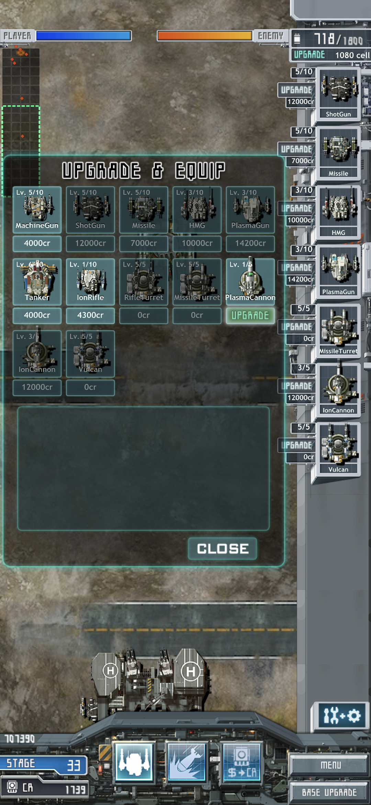
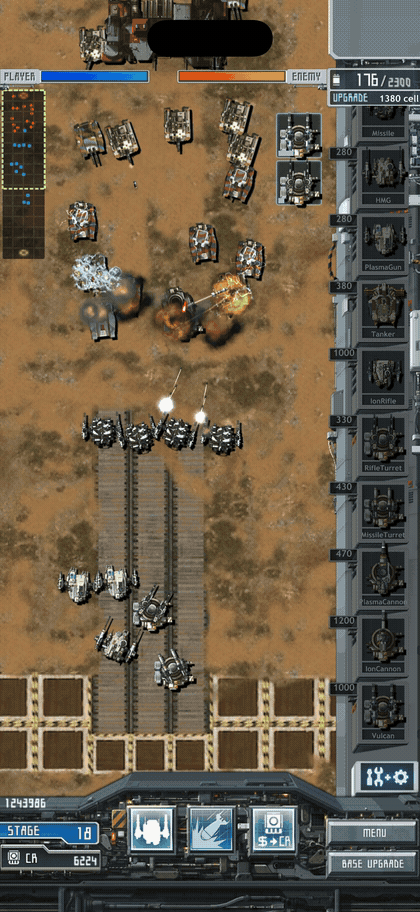
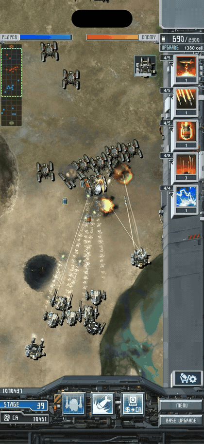
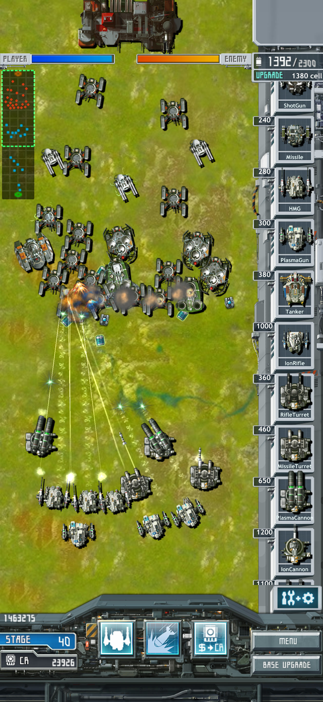
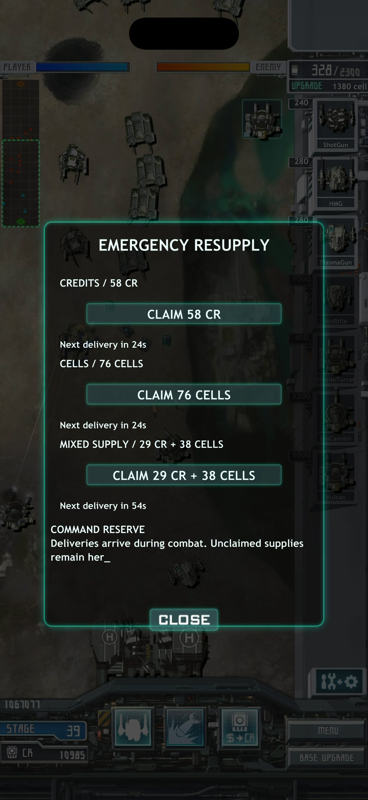

# MachDefense

<!-- language-nav:start -->
[한국어](README.md) | [English](README.en.md)
<!-- language-nav:end -->

## Why I rebuilt MachDefense

My first goal was to restore the entire Mach series. I started with HeavyMach1 and received my first-ever PR on a public repository. MachDefense was the game I chose next. I bought and played it using Canadian and US App Store accounts.

I hope people who find this restoration will read my developer's statement. I wrote about why I returned to this series, what I wanted to preserve, and what I wanted to add.

I have no intention of making money from this. Money is only needed in this life.

[Read the developer's statement](docs/en/RESTORATION.md)

## Quick Play — PWA and Mac

[**Play MachDefense or install the PWA**](https://gelb2.github.io/MachDefense/)

Open the link to install the game or play in your browser. On iPhone and iPad, choose **Add to Home Screen** in Safari's Share menu. On Android and Mac, press **INSTALL GAME**. Once the resources finish downloading, you can play offline.

If building with Xcode or Android Studio is difficult, use the PWA or the [Tauri Mac app](https://github.com/gelb2/MachDefense/releases/download/v0.7/MachDefense-Desktop-v0.7-arm64.zip). The Mac app requires macOS 14 or later on Apple Silicon and stores progress in its app data folder. [Build and installation](docs/en/public/build-and-install.md) also explains how to install the native apps.

Thank you to [fastutlego](https://github.com/fastutlego) for contributing the HeavyMach web port. The WebAssembly host, WebGL2 renderer, input, audio and saves in [HeavyMach PR #24](https://github.com/gelb2/HeavyMach/pull/24), together with the subsequent PWA and Tauri work, also laid the groundwork for bringing MachDefense to the web and desktop. I used that architecture for the MachDefense PWA and used the same web host in the Tauri Mac app.

### If leveling up is difficult

I am sharing a recovery code from my own playthrough in the native iPhone app. It lets you continue with **Stage 42, 12 owned unit types, and 20,329Cr**. **[Recovery code and instructions](docs/en/public/quick-play.md#if-leveling-up-is-difficult)**.

## The original combat and progression

MachDefense is a portrait strategy game in which you produce mechs and turrets to attack an enemy base. Units move onto the battlefield and fight. The player decides what to produce, where to place turrets, what to upgrade, and when to use special attacks. This restoration uses the original 80 missions, images, audio, and unit data.

I rarely played tower-defense games. What drew me to MachDefense was the thought, “Is this another game by those people? That looks interesting; I should try it.” I bought it with Canadian and US App Store accounts. The unit names and screens in the version I played were in English.

In HeavyMach1, I drove the tank myself. In MachDefense, I produced units and watched them fight. There was pleasure in watching the basics of combat: gunfire and explosions. I think this genre is fun because it shows spectacular battles while asking the player to intervene less often.

Choose a unit from the list on the right to produce it using cells. Spend credits to upgrade the base and equipment or replenish special attacks. Profiles store mission progress, equipment, upgrades, funds, and remaining special attacks.

[12-second combat clip](docs/public/media/gameplay-20261107/combat.mp4) · [All screenshots and clips](docs/en/public/gameplay-gallery.md)

[10-second special-attack clip](docs/public/media/gameplay-20261107/special-attack.mp4)

## Features I designed and added

Emergency resupply was my own idea, separate from restoring the original game. I was troubled by the way tower-defense challenges could become obstacles that required purchased items to overcome. That is why I replaced the nonfunctional in-app purchase button with a resupply window.

I did not want a one-time handout. I wanted small amounts of credits and cells to become available repeatedly as game time passed, so players could overcome difficult sections without paying. The amounts use current cell capacity, production, and mission rewards. I directed the calculations to account for intervals, repeated claims, and resource capacity. Codex implemented them in shared C++ using the original assets.

[Claiming supplies: 9-second clip](docs/public/media/gameplay-20261107/resupply.mp4)

## Screen support, platforms, and testing tools

- Expanded battlefield, menu, and HUD display areas for iPhone and iPad screens.
- Android and web hosts using the same C++ game code and resources.
- A single-line code that transfers all 5 profiles between iPhone, iPad, Android, and web/PWA. [Instructions](docs/en/public/gameplay.md).
- Regular and cheat testing apps with separate saves.

[Added features and design intentions](docs/en/public/features.md) · [Controls and saves](docs/en/public/gameplay.md)

## Platforms and current status

| Platform | How to run | Current status |
|---|---|---|
| iPhone / iPad | Xcode workspace | v0.7 build. See the release notes for prior device checks and this release’s installation results |
| Android | Android Studio or APK | [v0.7 APK](https://github.com/gelb2/MachDefense/releases/tag/v0.7). See the release notes for build and device-check coverage |
| Web | Browser | Deployed to GitHub Pages. Checked in Mac Chrome, Safari, and WebKit |
| PWA | Install through the browser | Installation and offline play supported. See the validation document for device results |
| Tauri Mac | Desktop app | [Download v0.7](https://github.com/gelb2/MachDefense/releases/tag/v0.7). File saves, recovery and exit checked. macOS 14+ on Apple Silicon |

## Fixed problems and remaining work

The goal was again to restore the creators' intentions, design, features, and performance. I played both the compatibility port and the rebuilt game to find differences. The screen stuttered when the base machine gun fired. Unit production sounds were missing, and sound effects disappeared after returning from the background. Prices, prompts, and selection effects from the original were also missing. I pointed out these differences and had them corrected.

Codex attached and detached the audio context on every shot, although the original kept it active. It also called audio-session configuration on the main thread. These were implementations I had not expected; the context handling caused the stutter during base machine-gun fire. I instructed Codex to compare the original and the port, and to measure the result with Instruments.

[Troubleshooting](docs/en/public/troubleshooting.md) · [Validation results](docs/en/public/validation.md)

I am also considering a new lock-on feature. It would mark enemies within range and let the mech nearest the enemy the player taps fire Crossfire. Enemy turrets and tanks would also be targets, with a 3-second interval per mech. Damage, projectile count, speed, and effects would follow the current Crossfire level. I remember a friend trying HeavyMach1's added auto-aim and saying, “At least this makes it easier to play. My shoulder was about to give out.”

The idea for MachDefense is to give the player more opportunities to watch and make decisions without changing the original enemy placement, attack power, or allied and enemy behavior. It would reuse Crossfire's assets, aiming, and range logic while leaving the existing Crossfire skill intact.

Level-10 upgrades and scrolling through all INSTALLed units in the production list are implemented. Pathfinding around round structures and tightly packed turrets, production-list reordering, the new lock-on feature, and final production update checks for PWA and Tauri Mac remain to be done. [Roadmap](docs/en/public/roadmap.md) · [Architecture](docs/en/public/architecture.md) · [Development history](docs/en/public/development-history.md) · [Credits](CREDITS.en.md)

[Implementation status](docs/en/public/implementation-status.md) · [Documentation](docs/en/public/README.md) · [Changelog](CHANGELOG.en.md) · [Credits](CREDITS.en.md)

## A note on suspending helicopter-unit development

I encountered intelligent breaches of duty and negligence that I had not faced even while restoring HeavyMach1. I am putting helicopter improvements on hold to prioritize my foremost goal: restoring the entire Mach series.

The helicopter units released in this version meet neither the original creators’ aesthetic goals nor my own. Their level of finish undermines both the creators’ intentions and mine, so I recommend using the helicopter units only if you want to.

[The helicopter work and why I am putting it on hold](docs/en/public/unease-and-typewriters.md) · [Current implementation and remaining work](docs/en/public/roadmap.md)

## Unease

[On the unfinished release of the helicopter units. Observations on Codex’s abysmal performance in claiming it cannot create violent designs](docs/en/public/unease-and-typewriters.md)

The article covers why I planned the helicopters, refusals to carry out design and debugging instructions, all seven image-generation error records, responsibility shifted in the incident report, and criticism concerning DEI and Ceaușescu’s typewriter. [Integration and source map](docs/en/editorial/unease-integration-20261110.md). [Complete collection of 20 writing-material and revision entries](docs/en/editorial/helicopter-writing-inventory-20261110.md).

[Incident report on ignored instructions and unfinished work (Korean)](docs/evidence/aircraft-work-failure-20261109.md) · [Drawing-work refusal incident (Korean)](docs/evidence/aircraft-instruction-refusal-20261108.md) · [Visual-error record (Korean)](docs/evidence/new-unit-art-errors-20261108.md) · [Troubleshooting](docs/en/public/troubleshooting.md)

## How I directed and tested the work

I recorded how I used plans and reports to check the scope of changes, and compatibility and cheat builds to test the game. The accounts include failures I found while playing and the fixes and repeat checks carried out by Codex.

[How I directed the work](docs/en/public/work-method.md) · [How I tested the game](docs/en/public/testing-method.md)

## License and resources

Newly written code in this project uses [MIT](LICENSE). See [code scope](LICENSE-SCOPE.en.md), [artwork, audio, and game data](ASSET-LICENSES.en.md), and [third-party notices](THIRD_PARTY_NOTICES.en.md) for their respective terms.

## An Additional Statement Clarifying the Purpose of This Project

After briefly examining the public activity of a recent visitor to the MachDefense repository and tracing their activity in other repositories, I felt I needed to make the purpose of these repositories clear: HeavyMach, MachDefense, and—if I am still alive to restore it—HeavyMach2. That is why I am leaving this statement.

I have screenshots and an analysis of that activity. An ordinary person, or someone who has only lived in societies where law and morality hold, might dismiss my thinking as circumstantial or speculative. 

But I consider what has just happened to me to be, in CIA terminology, actionable intelligence. That is why I am leaving this statement.

I have no intention of making money from this.

But if you are reading this repository with the intention of doing more than porting it for your own enjoyment—if you intend to put it on the App Store or Steam, sell courses while pretending that you restored it, or hand it over to a third-party sales channel—then I have something to say to you.

I am not good at predicting favorable turns in my own future or finances. But I am better at recognizing bad omens than you might think. Those events include two declarations of martial law in South Korea and the war between Ukraine and Russia in Europe.

If you put this on an official marketplace or hand it over to a third-party sales channel, the consequences that follow will be difficult for one individual to bear.

I do not have much time left to live. I do not know how much time you have left, but do not let greed hasten your own death. Even if it is not me, someone else might shorten your life.

