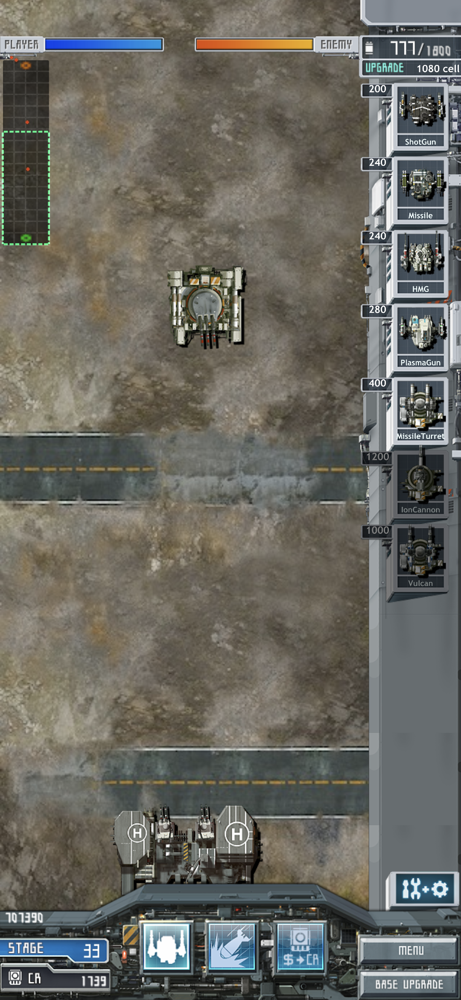
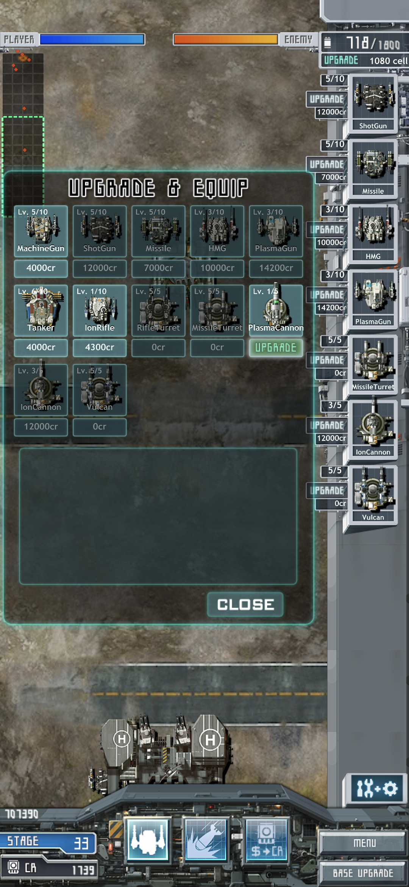

# MachDefense

## MachDefense를 다시 만든 이유

내 처음 목표는 Mach 시리즈를 모두 복원하는 것이었다. HeavyMach1부터 시작했고, 공개한 저장소에서 생애 처음으로 PR을 받았다. 다음으로 택한 작품이 MachDefense다. 나는 캐나다와 미국 앱스토어 계정으로 이 게임을 구매해 플레이했다.

이 복원판을 접한 사람이 개발자의 변을 읽었으면 한다. 왜 이 시리즈를 다시 만들었는지, 무엇을 보존하고 무엇을 더하려 했는지 적었다.

[개발자의 변 전문](docs/RESTORATION.md)

## Quick Play

웹·PWA는 현재 개발 브랜치에서 실행할 수 있다. 공개 게임 주소는 아직 없다. [웹 실행 방법](docs/public/build-and-install.md)에 따라 로컬 서버를 열면 브라우저로 플레이할 수 있다. iPhone·iPad 앱은 Xcode, Android 앱은 Android Studio로 빌드한다. Android v0.1 APK는 [Releases](https://github.com/gelb2/MachDefense/releases/tag/v0.1)에서 받는다.

## 원작의 전투와 성장

MachDefense는 메크와 포탑을 생산해 적 기지를 공격하는 세로 화면 전략 게임이다. 유닛은 전장으로 나가 이동하고 교전한다. 플레이어는 생산과 포탑 배치, 강화와 특수기술 사용을 결정한다. 원작의 80개 미션과 이미지·음원·유닛 데이터를 사용한다.

오른쪽 목록에서 유닛을 고르면 셀을 사용해 생산한다. 크레딧으로 기지와 장비를 강화하고 특수기술을 보충한다. 프로필에는 미션 진행·장비·강화·자금·특수기술 잔량을 저장한다.

## 내가 기획해 추가한 기능

긴급지원은 원작 복원과 별개로 내가 구상한 기능이다. 결제 없이 난관을 넘을 수 있도록 크레딧과 셀을 일정 간격으로 지원하게 했다. 지급 간격·반복 수령·자원 용량을 고려한 계산을 지시했고, Codex가 공통 C++ 코드와 원작 에셋으로 구현했다.

## 화면·플랫폼 확장과 검증 도구

- iPhone·iPad 화면에 맞춘 전장·메뉴·HUD 표시 영역.
- 같은 C++ 게임 코드와 자원을 사용하는 Android·웹 실행기.
- 웹판에서 전체 프로필 5개를 한 줄 코드로 내보내고 복원하는 기능.
- 저장을 분리한 일반 앱과 치트 검증 앱.

[추가 기능과 기획 의도](docs/public/features.md) · [조작과 저장](docs/public/gameplay.md)

## 플랫폼과 실행 상태

| 플랫폼 | 실행 | 현재 상태 |
|---|---|---|
| iPhone·iPad | Xcode 워크스페이스 | v0.1 출시. 실제 기기에서 일반·치트 앱 검사 |
| Android | Android Studio 또는 APK | v0.1 출시. Galaxy·에뮬레이터 검사 |
| 웹 | 브라우저 | 개발 브랜치 구현. Mac Chrome·Safari·WebKit 검사 |
| PWA | 브라우저에서 설치 | Mac Chrome 설치·실행 확인. 모바일 설치 검사 예정 |
| Tauri Mac | 데스크톱 앱 | 개발 예정 |

## 고친 문제와 남은 일

Codex는 원작에서 유지하던 오디오 컨텍스트를 발사 때마다 연결·해제했고, 오디오 세션 설정도 메인 스레드에서 호출했다. 내가 예상하지 못한 구현이었고, 기지 기관총 발사 때 화면이 끊기는 원인이 됐다. 나는 원작과 포팅판의 동작을 대조하고 Instruments로 측정하라고 지시했다. 복귀 뒤 효과음 소실과 가격·안내·아이콘 누락도 직접 발견해 수정을 요구했다.

[트러블슈팅](docs/public/troubleshooting.md) · [검사 결과](docs/public/validation.md)

원형 구조물과 포탑 밀집 구간의 길찾기, 생산 HUD 전체 유닛 목록과 순서 편집, 강화 상한 확장, 새 락온 기능은 남은 과제다. [전체 TODO](docs/usability-todo.md) · [기술 구조](docs/public/architecture.md) · [개발 과정](docs/public/development-history.md) · [크레딧](CREDITS.md)

[문서 목차](docs/public/README.md) · [변경 이력](CHANGELOG.md) · [크레딧](CREDITS.md)
