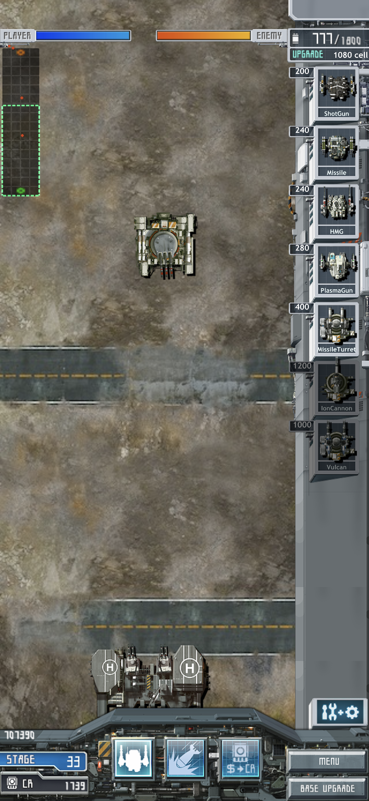
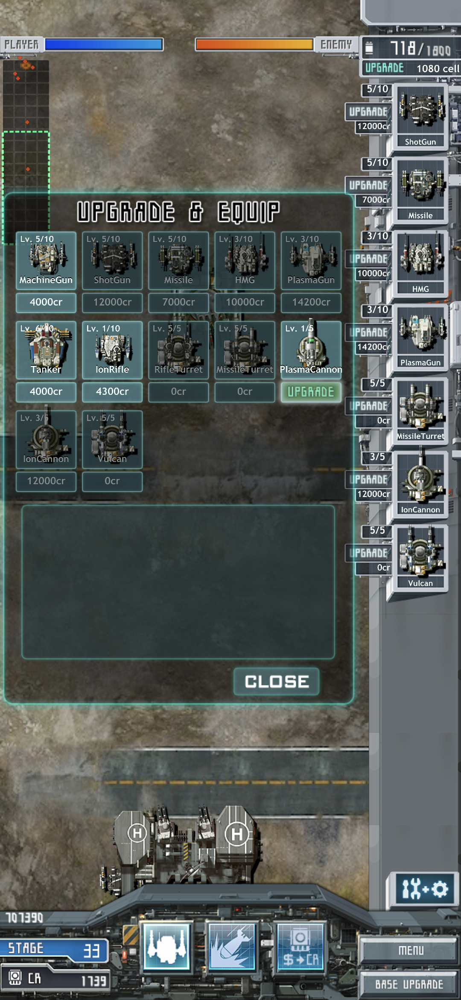

# MachDefense GitHub 원고

2026-11-06. README·개발자의 변·기능·개발 과정·기술·설치·검사·트러블슈팅·릴리스에 넣을 원고다. 현재 출시 버전은 v0.1이며, 웹·PWA는 개발 브랜치에서 검사했다. Tauri Mac은 후속 개발이다.

## 1. README

### MachDefense

**v0.1 · iOS / iPadOS / Android**  
**개발 브랜치 · Web / PWA**  
**C++20 · Objective-C++ · Kotlin · JavaScript · WebAssembly**

### MachDefense를 다시 만든 이유

내 처음 목표는 Mach 시리즈를 모두 복원하는 것이었다. HeavyMach1부터 시작했고, 공개한 저장소에서 생애 처음으로 PR을 받았다. 다음으로 택한 작품이 MachDefense다. 나는 캐나다와 미국 앱스토어 계정으로 이 게임을 구매해 플레이했다.

이 복원판을 접한 사람이 개발자의 변을 읽었으면 한다. 왜 이 시리즈를 다시 만들었는지, 무엇을 보존하고 무엇을 더하려 했는지 적었다.

[개발자의 변 전문](#2-개발자의-변)

### Quick Play

웹·PWA는 현재 개발 브랜치에서 실행할 수 있다. 공개 게임 주소는 아직 없다. [웹 실행 방법](#8-설치와-실행)에 따라 로컬 서버를 열면 브라우저로 플레이할 수 있다. iPhone·iPad 앱은 Xcode, Android 앱은 Android Studio로 빌드한다. Android v0.1 APK는 [Releases](https://github.com/gelb2/MachDefense/releases/tag/v0.1)에서 받는다.

### 원작의 전투와 성장

MachDefense는 메크와 포탑을 생산해 적 기지를 공격하는 세로 화면 전략 게임이다. 유닛은 전장으로 나가 이동하고 교전한다. 플레이어는 생산과 포탑 배치, 강화와 특수기술 사용을 결정한다. 원작의 80개 미션과 이미지·음원·유닛 데이터를 사용한다.



오른쪽 목록에서 유닛을 고르면 셀을 사용해 생산한다. 크레딧으로 기지와 장비를 강화하고 특수기술을 보충한다. 프로필에는 미션 진행·장비·강화·자금·특수기술 잔량을 저장한다.



### 내가 기획해 추가한 기능

긴급지원은 원작 복원과 별개로 내가 구상한 기능이다. 결제 없이 난관을 넘을 수 있도록 크레딧과 셀을 일정 간격으로 지원하게 했다. 지급 간격·반복 수령·자원 용량을 고려한 계산을 지시했고, Codex가 공통 C++ 코드와 원작 에셋으로 구현했다.

### 화면·플랫폼 확장과 검증 도구

- iPhone·iPad 화면에 맞춘 전장·메뉴·HUD 표시 영역.
- 같은 C++ 게임 코드와 자원을 사용하는 Android·웹 실행기.
- 웹판에서 전체 프로필 5개를 한 줄 코드로 내보내고 복원하는 기능.
- 저장을 분리한 일반 앱과 치트 검증 앱.

[추가 기능과 기획 의도](#3-추가-기능과-기획-의도) · [조작과 저장](#7-조작과-저장)

### 플랫폼과 실행 상태

| 플랫폼 | 실행 | 현재 상태 |
|---|---|---|
| iPhone·iPad | Xcode 워크스페이스 | v0.1 출시. 실제 기기에서 일반·치트 앱 검사 |
| Android | Android Studio 또는 APK | v0.1 출시. Galaxy·에뮬레이터 검사 |
| 웹 | 브라우저 | 개발 브랜치 구현. Mac Chrome·Safari·WebKit 검사 |
| PWA | 브라우저에서 설치 | Mac Chrome 설치·실행 확인. 모바일 설치 검사 예정 |
| Tauri Mac | 데스크톱 앱 | 개발 예정 |

### 고친 문제와 남은 일

Codex는 원작에서 유지하던 오디오 컨텍스트를 발사 때마다 연결·해제했고, 오디오 세션 설정도 메인 스레드에서 호출했다. 내가 예상하지 못한 구현이었고, 기지 기관총 발사 때 화면이 끊기는 원인이 됐다. 나는 원작과 포팅판의 동작을 대조하고 Instruments로 측정하라고 지시했다. 복귀 뒤 효과음 소실과 가격·안내·아이콘 누락도 직접 발견해 수정을 요구했다.

[트러블슈팅](#6-트러블슈팅) · [검사 결과](#9-검사-결과)

원형 구조물과 포탑 밀집 구간의 길찾기, 생산 HUD 전체 유닛 목록과 순서 편집, 강화 상한 확장, 새 락온 기능은 남은 과제다. [전체 TODO](../usability-todo.md) · [기술 구조](#5-기술-구조) · [개발 과정](#4-복원과-개발-과정) · [크레딧](#11-크레딧)

## 2. 개발자의 변

### Mach 시리즈를 다시 만든 이유

나는 개발자를 세 번째 직업으로 택했다. 2015년에는 잡지사에서 기자로 일했고, 2016년에는 필리핀에서 근무했다. 2017년 7월, iOS 개발자로 전업했다. HeavyMach1은 내가 그 길을 선택하는 데 약 35%의 영향을 주었다고 생각한다.

그보다 더 큰 영향을 준 사건들은 잡지사에서 겪었다. 대체하기 어려운 기술을 가진 편집디자이너들이 집단으로 항명했고, 그 결과 근무 조건이 나아졌다. 월간지 마감이 끝나는 이틀을 제외하면 정시 퇴근을 보장받았다. [「항명의 대가」](https://sass.studio/magazine/cerulean)에 적은 경험이다. 공장 자동화 기업의 임원들을 인터뷰하며 공학 기술이 만드는 편익에 관해 들은 일도 개발자를 택하는 데 영향을 주었다.

내 처음 생각은 변해준 개발자와 박재철 일러스트레이터의 Mach 시리즈를 모두 복원하는 것이었다. 내가 알고 있던 작품은 HeavyMach1, HeavyMach2, MachDefense였다. 그중 내 진로에 영향을 준 HeavyMach1부터 시작했다.

의외로 반응이 좋았다. 생애 처음으로 공개 저장소에서 PR도 받았다. 내가 복원한 게임에 다른 사람이 자기 시간을 써서 코드를 보탰다. 다음 작품도 복원하고 싶었다.

### HeavyMach2보다 MachDefense를 먼저 고른 이유

시리즈 순서대로라면 HeavyMach2가 먼저였다. 다만 내 기억 속 HeavyMach2는 챕터가 많지 않았다. 첫 챕터와 Skyway, Sea Side, 협곡과 산악지대가 떠오른다. 정확한 이름은 기억나지 않는다. 업데이트로 챕터를 더 제공하려 했던 것 같다는 생각도 들었다. 당시에는 데모게임처럼 느껴졌다.

시스템은 복잡했다. 탑뷰 전투에 락온과 점프 회피가 있었고, 레벨업도 빡빡했다. 당시의 기술과 작은 모바일 게임 안에 여러 시도가 들어 있었다. 복원을 끝낼 수 있을지 고민했다. 그래서 MachDefense를 먼저 택했다.

나에게 MachDefense는 Mach 시리즈의 황혼기 격 작품이다. 그런데 나보다 먼저 MachDefense 복원을 시도한 [mesabloo](https://github.com/Mesabloo/hm-defense)에게는 어린 시절을 장식한 게임이었다고 알고 있다. 그의 시도는 내가 HeavyMach1과 MachDefense를 복원하는 데 큰 영향을 주었다. 그가 HeavyMach1과 2도 알았는지는 모른다.

### 폭음과 폭발을 관전하는 재미

나는 타워디펜스를 자주 하던 사람이 아니었다. MachDefense에 손이 간 이유도 “그 사람들 후속작인가? 신기하니 해봐야겠다”는 마음이었다. 캐나다와 미국 앱스토어 계정으로 구매했고, 내가 플레이한 게임의 유닛 이름과 화면은 영어였다.

HeavyMach1에서는 직접 전차를 조종했다. MachDefense에서는 유닛을 생산하고 교전을 지켜봤다. 폭음과 폭발이라는 전투의 기본을 관전하는 재미가 있었다. 나는 사용자의 개입을 줄이면서 교전의 화려함을 보여주는 것이 이 장르의 재미라고 생각한다.

이번에도 목표는 원작자의 의도와 기획, 기능과 성능을 되살리는 것이었다. 포팅판과 재개발판을 직접 플레이하며 차이를 찾았다. 기지 기관총이 발사될 때 화면이 끊기고, 생산 완료음이 빠지고, 백그라운드에서 돌아오면 효과음이 사라졌다. 원작에서 보던 가격과 안내, 선택 효과도 빠져 있었다. 그런 차이를 지적하며 수정을 시켰다.

개발자의 변을 쓸 때 나는 내 생각을 쭉 쓰는 한편, Codex에게 나를 인터뷰해 보라고 하는 방법도 택한다. Codex가 복원한 게임에서 어떤 장면이 예전 기억을 되살렸느냐고 물었다. 내 답은 “모든 것”이다.

### 결제 대신 긴급지원

타워디펜스의 난관이 결국 결제로 산 아이템을 써야 넘어갈 수 있는 것으로 바뀌는 것이 마음에 걸렸다. 작동하지 않는 인앱결제 버튼을 긴급지원 창으로 바꾼 이유다.

한 번 받고 끝내는 지원을 원한 것은 아니었다. 게임 시간에 따라 소량의 크레딧과 셀을 반복해서 받도록 했다. 사용자가 결제 없이 난관을 돌파할 수 있게 하고 싶었다. 지급량은 현재 셀 용량과 생산량, 미션 보상을 기준으로 계산했다.

새 락온 기능도 생각하고 있다. 일정 시간이나 무작위 조건으로 적을 락온하고, 사용자가 그 적을 터치하면 일격에 처치하는 방식이다. HeavyMach1에 넣은 자동조준을 보고 지인이 “아 이거라도 있으니 게임 쉽게 할 수 있다. 어깨 빠지는 줄 알았네”라고 했던 기억이 있다.

MachDefense의 락온은 원작의 적 배치와 공격력, 적과 아군의 행동을 바꾸지 않으면서 화면을 보고 판단할 기회를 더하려는 구상이다. 기존 크로스파이어의 에셋과 조준·사거리 로직을 쓰되, 크로스파이어 자체는 그대로 둘 생각이다.

### 이 복원판으로 돈을 벌 생각은 없다

나에겐 시간이 얼마 없다. 나는 이것으로 돈을 벌 생각이 없다. 이해관계자가 연락한다면, 이 레포지토리는 미련없이 내릴 것이다.

이 프로젝트로 돈을 벌 생각을 한다면, 나에게 개발자의 길이라는 새로운 길을 알려준 소프트웨어와 그것을 제작한 개발자와 일러스트레이터의 업을 능멸하는 꼴이 된다. 그러므로 이것으로 돈을 벌 생각은 더더욱 하면 안 된다.

## 3. 추가 기능과 기획 의도

### 반복 긴급지원

원작의 결제 버튼에 긴급지원 창을 연결했다. 크레딧·셀·혼합 지원을 각각 게임 시간 30·45·60초마다 준비한다. 지원을 받지 않고 지나간 주기에도 준비된 금액은 남는다. 셀 용량이 부족하면 들어갈 만큼만 받고 나머지는 창에 보관한다.

크레딧에는 셀과 같은 적재 한도가 없다. 따라서 크레딧은 미션 완료 보상, 셀은 현재 용량과 자연 생산량을 기준으로 계산했다. 미션1의 기본 조건에서는 크레딧 지원 20Cr, 셀 지원 48셀, 혼합 지원 10Cr와 24셀을 준다.

| 항목 | 주기 | 지급식 |
|---|---:|---|
| 크레딧 | 30초 | 미션 완료 보상의 4%, 소수 버림 |
| 셀 | 45초 | 현재 용량의 10%와 자연 생산 4초분 중 작은 값, 소수 버림 |
| 혼합 | 60초 | 미션 보상의 2%와 셀 지원량의 절반, 각각 소수 버림 |

게임이 멈추면 지원 시간도 멈춘다. OS 타이머를 따로 만들지 않고 공통 게임 시간으로 계산한다. 창·글자·버튼은 원작 에셋과 게임 렌더링으로 그린다.

나는 지급 간격과 반복 수령, 용량을 고려한 지원을 지시했다. Codex가 산식을 제안했고, 내가 채택한 금액을 공통 C++ 코드에 구현했다. 실제 앱에서 지원이 들어오는 것을 확인했다. [계산과 예시](../emergency-resupply-economy.md) · [구현과 기기 검사](../evidence/emergency-resupply-20261105.md)

### 화면 확장

작은 원작 화면을 현재 기기에 맞추기 위해 전장과 HUD의 표시 범위를 조정했다. 오른쪽 HUD 위의 월드 표시와 원형 구조물 주변 길찾기는 별도로 남아 있다. 아이폰 상단의 검은 노출부는 원본 HUD 조각으로 덮었고, 아이패드의 외형은 유지했다. [화면 수정](../evidence/iphone-hud-top-20261106.md)

### 플랫폼과 복원 코드

Android를 추가할 때 Apple 앱이 쓰는 파일을 바꾸지 말라고 지시했다. 게임 규칙은 공통 C++에 두고 Android의 화면·입력·음향·저장 연결을 만들었다. 웹판도 같은 게임 코드를 WebAssembly로 빌드했다.

웹판의 GET CODE는 프로필 5개 전체를 한 줄 문자열로 내보낸다. ENTER CODE로 입력하고 확인하면 같은 슬롯 상태를 복원한다. 서버와 계정을 만들지 않고 게임의 저장 데이터를 옮기는 방식이다. Apple·Android 앱의 복원 메뉴 연결은 남아 있다.

### 개발 예정인 락온

특정 조건에서 적을 락온하고, 플레이어가 해당 적을 터치하면 처치하는 기능을 구상했다. 기존 크로스파이어의 에셋·조준·사거리 로직을 재사용한다. 원작의 스폰·공격력·행동과 기존 크로스파이어는 유지한다. 발동 간격과 유지 시간, 적용할 표적 범위는 앞으로 정한다. [기능 TODO](../usability-todo.md#md-lockon-strike-01--락온한-적을-터치해-처치)

## 4. 복원과 개발 과정

### 원본을 구한 곳

HeavyMach1 복원을 시작할 때 구글 검색의 Gemini가 [Internet Archive](https://archive.org)를 알려줬다. 그곳의 [HeavyMach 시리즈 모음](https://archive.org/details/heavy-mach-archive_202406)에서 원본을 받았다. MachDefense 원본도 같은 모음에서 확보했다.

### 원본 실행과 새 소스 대조

먼저 원본을 호환 실행기로 구동했다. 나는 아이폰에서 생산·교전·적 기지 파괴·승리·실패·미션 복귀를 확인했다. 그다음 Codex가 새 C++ 코드에 원작 자원을 연결했다. 같은 조건에서 생산비·강화·이동·저장과 화면·음향을 대조했다.

내가 설치본을 플레이하면서 찾은 차이도 수정했다. 가격과 생산 안내가 빠졌고, 유닛 아이콘은 오른쪽으로 돌아가 있었다. 기관총 발사 때 프레임이 떨어졌고, 복귀 뒤 효과음이 멈췄다. 기존 검사에서 빠졌던 출력과 전환 조건을 추가했다. [트러블슈팅](#6-트러블슈팅)

### 자동 실행과 치트 앱

나는 포팅판과 재개발판을 비교할 때 자동 실행과 치트 앱을 쓰도록 지시했다. Codex가 자금·해금·강화·미션 조건을 직접 바꾸고, 플레이에 필요한 조건을 곧바로 만들어 모든 기능을 검사하게 하려는 목적이었다.

포팅판과 새 소스판에는 같은 시험 저장을 넣었다. 기지 강화 6종, 초기 유닛 4종, 특수기술 3종을 구매한 뒤 가격·잔액·레벨·장착 순서와 저장 값을 대조했다. 이 관측값을 자동검사의 기대값으로 사용했다. [포팅판 대조](../evidence/port-source-parity-20261104.md)

재개발판의 TEST 화면에서는 프로필, 80개 미션, 크레딧과 셀, 장비 레벨·장착, 특수기술 수량, 아군·적 생성과 체력, 기지 파괴를 조절한다. 일반 앱과 같은 게임 코드를 실행하며 저장 공간은 따로 둔다.

자동검사는 80미션의 실패·재도전·승리·보상·다음 미션·저장 재읽기를 연속 실행했다. 레벨 10 장비와 셀 보충을 사용하는 교전 검사에서는 실제 유닛 AI·탄환·피해로 80미션의 적 기지를 파괴했다. 생산 정의 110개와 특수공격 27단계를 폰·패드 화면 조건으로 실행하고, 실기기에서는 입력·프레임·오디오·앱 복귀를 검사했다. [치트 앱과 캠페인 검사](../evidence/source-cheat-campaign-20261104.md) · [Apple 자동검사](../evidence/apple-automated-sweep-20261104.md)

### 모듈화와 Android

Core에는 전투·이동·생산·강화·진행·저장·메뉴·HUD를 두고, 효과음 처리는 Audio로 분리했다. 플랫폼은 그리기 명령을 받아 화면을 출력하고 OS 입력·음향·파일 저장을 연결한다. 분리 전후 160조건, 144,000틱의 실행 결과를 비교했다.

Android는 Kotlin·JNI 실행기를 추가했다. 이때 기존 Apple·공통 코드·자원·검사 파일 2,978개는 같은 해시를 유지했다. 아이폰의 Stage33 진입 저장을 Galaxy로 옮겨 장비와 강화·자금·재실행 보존을 확인했다. [Android 기록](../evidence/android-native-20261106.md)

### 웹·PWA

같은 C++를 Emscripten으로 빌드하고 WebGL2 출력, 브라우저 입력·음향, IndexedDB 저장과 PWA 캐시를 연결했다. HeavyMach1에서 웹판 기여를 받아 PWA·Tauri로 확장했던 구조와 절차를 참고했다.

복원 코덱과 메뉴를 연결하면서 기존 파일 4개에 서비스 계약·버튼·연결 코드를 추가했다. 게임 계산과 기존 플랫폼 실행기는 유지했다. 수정 전후 네이티브 실행 결과를 대조하고, 네이티브와 Wasm에서도 같은 게임 상태와 저장 결과를 확인했다. [웹 구현과 검사](../evidence/web-pwa-20261106.md)

## 5. 기술 구조

### 공통 게임 코드와 플랫폼 실행기

| 영역 | 소스 위치 | 하는 일 |
|---|---|---|
| Core | `Sources/Core/` | 피해·이동·사거리·생산·경제·강화·미션·저장·게임 메뉴와 HUD |
| Audio | `Sources/Audio/` | 효과음 버퍼·재생 소스·컨텍스트 재사용 |
| SaveTransfer | `Modules/SaveTransfer/` | 복원 코드 생성·해석·검증 |
| 자원 | `Resources/` | 이미지·음원·맵·표 |
| Apple | `Apple/`, `Sources/Platform/Apple/` | 워크스페이스·렌더링·입력·오디오 세션·저장 경로 |
| Android | `Android/` | Kotlin·JNI·EGL·오디오 출력·앱 생명주기 |
| 웹 | `Web/`, `Distribution/Web/` | Wasm·WebGL2·브라우저 입력·음향·IndexedDB·시작 화면·PWA |

Core는 플랫폼 SDK를 직접 부르지 않는다. `ResourceAccess`와 `HostServices`를 통해 자원 읽기·저장·음향·텍스트 입력을 요청한다. 게임 화면은 Core가 만든 `Frame`을 각 실행기가 그린다. 메뉴와 HUD 버튼도 이 경로를 쓴다.

### 렌더링과 음향

Apple은 OpenGL ES 1 fixed-function, Android는 EGL/OpenGL ES 1.1, 웹은 WebGL2로 화면을 출력한다. 텍스처를 업로드해 재사용하며 발사마다 이미지를 새로 만들지 않는다.

Apple의 효과음은 OpenAL Soft, 음악은 AudioFile·AudioQueue로 재생한다. Android 음악은 MediaPlayer를 사용한다. 웹 효과음은 기존 코드의 Emscripten OpenAL 연결, 음악은 Web Audio 출력으로 처리한다. 어떤 소리를 언제 재생할지는 게임 코드가 결정한다.

### 저장과 복원

기준 판본의 저장은 5슬롯·42,496바이트다. 복원 코드는 버전·길이·CRC32를 검사하고 PackBits와 Base64url로 데이터를 옮긴다. 손상되거나 지원하지 않는 코드는 적용하지 않는다.

웹은 게임 저장을 IndexedDB에 기록하고 트랜잭션 완료 뒤 성공을 반환한다. 자원은 Cache Storage에 둔다. 자원 캐시를 다시 받아도 진행 데이터는 유지된다. 두 창에서 같은 진행을 열었을 때 오래된 창이 최신 저장을 덮지 않도록 저장 버전을 대조한다. 사용자가 사이트 데이터를 삭제하면 복원 코드로 진행을 다시 가져올 수 있다.

복원 적용 전에는 기존 저장의 백업을 남긴다. 현재 메뉴는 전체 5슬롯을 교체한다. 단일 슬롯 선택과 Apple·Android의 복원 UI 연결은 후속 작업이다.

## 6. 트러블슈팅

### 기관총 발사 시 프레임 저하

아이패드에서 기지 기관총이 발사될 때 화면이 끊겼다. 적 탱크 포탄에는 같은 끊김이 보이지 않았다. 나는 발사 때 저장 파일을 쓰는지, 탄환을 계속 할당하는지, 에셋을 다시 만드는지 확인하고 Instruments로 측정하라고 지시했다.

Codex가 만든 Apple 오디오 코드는 효과음을 재생할 때마다 OpenAL 컨텍스트를 설정하고, 함수가 끝나면 이전 컨텍스트로 되돌렸다. 초기화 뒤 이전 컨텍스트가 비어 있었기 때문에 발사마다 컨텍스트를 연결했다가 해제했다. 원작은 초기화한 컨텍스트를 유지했다.

Time Profiler에는 `MDAudio play → Scope → AudioUnitGraph → RemoteIO Start/Stop` 경로가 남았다. 게임의 메인 스레드가 오디오 출력 시작·중단의 시스템 응답을 기다리고 있었다. 반복 발사 효과음에 넣은 처리가 화면 갱신까지 지연시킨 것이다.

게임이 활성 상태일 때 컨텍스트를 유지하고, 이미 연결돼 있으면 다시 설정하지 않게 고쳤다. 효과음 버퍼와 재생 소스도 재사용했다. 수정 뒤 248.82초·14,912프레임에서 효과음 644회를 기록했다. 효과음이 있는 프레임의 오디오 호출 합계 p99는 0.204ms, 최대는 0.340ms였다. 게임 저장 쓰기는 0회였다.

25ms를 넘는 프레임은 7회 남았다. 가장 긴 93.083ms 구간에는 텍스처 35개의 최초 업로드가 있었고 오디오 호출은 0.135ms였다. 이 첫 자원 준비 지연은 반복 발사 문제와 따로 남겼다. [측정과 수정 기록](../troubleshooting.md#기지-기관총-효과음마다-오디오-출력을-중단한-오류--2026-11-04)

### 오디오 세션의 메인 스레드 호출

Codex는 발사 경로를 고친 뒤에도 `MDSceneDelegate`와 `MDGameView`의 화면 연결·활성 전환·오디오 중단 처리에서 `AVAudioSession.setCategory`와 `setActive`를 메인 스레드로 호출하고 있었다. OS 오디오 서비스가 응답할 때까지 입력과 그리기가 함께 기다릴 수 있는 코드였다. Xcode에서 메인 스레드 호출 경고가 나왔다.

세션 설정·활성화·비활성화를 직렬 작업 큐로 옮겼다. 요청에 세대 번호를 붙여 늦게 끝난 활성화가 최신 비활성 상태를 덮지 않게 했다. 플레이어를 먼저 멈춘 뒤 세션을 비활성화하고, 활성화 성공 뒤에 음악과 효과음을 재개한다. 게임 입력은 세션 완료를 기다리지 않는다.

실제 iPad에서 오디오·복귀·전투 검사 6개가 통과했고 실행 경고는 0건이었다. 1,800프레임의 대기·기관총·강화 무장·동시 교전 구간에서 프레임 간격 p99는 16.667ms, 25ms 초과는 0회였다. [메인 스레드 호출 수정](../evidence/audio-session-20261105.md)

### 백그라운드 복귀 후 효과음 소실

위 수정본에서도 백그라운드에서 돌아오면 음악만 들리고 기관총·생산 완료음은 나지 않았다. 내가 플레이하면서 발견했다.

Codex는 `alcSuspendContext`와 `alcProcessContext`로 출력이 멈추고 다시 시작한다고 처리했다. 사용한 OpenAL Soft 설정에서는 두 함수가 즉시 반환했고 출력 장치를 재시작하지 않았다. `alSourcePlay` 호출은 늘어났지만 효과음은 진행하지 않았다. 기존 검사는 호출 횟수만 확인해 이 상태를 통과시켰다.

효과음의 `AL_SEC_OFFSET`을 읽는 검사로 실패를 재현했다. 복귀 뒤 기관총과 생산 완료음의 재생 위치는 0초에 머물렀다. `alcDevicePauseSOFT`와 `alcDeviceResumeSOFT`를 연결한 뒤 같은 검사에서 0.2초 대기 후 재생 위치가 0.192~0.213초 진행했다. [재현과 수정](../evidence/effects-resume-20261105.md)

### 안내·효과음 누락과 아이콘 오류

포탑의 설치 안내, 자금 부족 때 생산 아이콘을 어둡게 하는 효과, 생산 완료음, 다음 미션 일러스트와 여러 패널 효과음이 누락됐다. 생산·승패·저장 중심 검사에는 해당 출력의 확인이 빠져 있었다.

생산·보상 아이콘 방향과 완료 표시도 잘못 연결했다. Codex가 원작 함수의 조건·자원·좌표·효과음 호출을 새 코드와 대조해 수정했다. 기지 강화도 원작처럼 체력과 무장은 먼저 반영하고 차체·레이더는 다음 스테이지에서 갱신하도록 고쳤다. [화면·음향 수정](../evidence/source-ui-audio-lifecycle-20261104.md) · [강화 외형과 복귀 처리](../evidence/base-audio-followup-20261104.md)

### Android 화면·오디오 오류

Android 첫 구현에서 화면 객체 생성 전 시스템 바 설정, 오디오 재개 때 해제된 버퍼 접근, 그림이 없는 연결용 부품 처리를 고쳤다. 수정 위치는 Android 실행기와 Android 빌드용 출력부였다. 기존 Apple·공통 게임 코드는 변경하지 않았다. [Android 구현 기록](../evidence/android-native-20261106.md)

### 웹 저장·오프라인 검사

웹판에는 저장 완료를 기다리는 처리, 오래된 창의 덮어쓰기 거부, 복원 전 백업을 넣었다. 닫힌 DB 쓰기 실패와 잘못된 복원 코드에서 기존 진행이 유지되는지 검사했다. PWA 자원이 손상되면 설치 완료로 처리하지 않고 다시 받도록 했다. 자원 캐시 삭제·업데이트 뒤 진행 보존과 오프라인 재실행도 확인했다. [웹 검사](../evidence/web-pwa-20261106.md)

## 7. 조작과 저장

프로필을 만들거나 슬롯을 선택한 뒤 미션을 고른다. 오른쪽 목록에서 생산할 유닛을 누른다. 포탑은 설치할 위치를 한 번 더 누른다. 전장을 드래그해 다른 구간을 본다. 브라우저에서는 같은 화면을 마우스로 클릭하고 드래그할 수 있다.

하단 버튼으로 유닛과 특수기술 목록을 전환한다. UPGRADE & EQUIP은 장비 강화와 생산 목록 편집, BASE UPGRADE는 기지 강화다. MENU에서 일시정지·재개·저장 후 나가기를 선택한다.

자금 버튼이 빛나면 긴급지원 창에서 CLAIM을 눌러 지원을 받는다. 창을 닫으면 전투를 계속한다. 앱에서 나갔다 돌아온 뒤에는 일시정지 메뉴의 Resume Game을 누른다.

웹판에서 진행을 옮길 때는 슬롯 화면의 GET CODE로 코드를 복사한다. 다른 웹판의 ENTER CODE에 붙여넣고 확인하면 전체 5슬롯을 교체한다. 진행 중인 전투 상태는 복원 대상에 포함되지 않는다. Apple·Android 앱의 코드 메뉴는 아직 연결하지 않았다.

## 8. 설치와 실행

Xcode나 Android Studio에서 프로젝트를 열고 실행할 수 있다. IDE에서 기기와 실행 대상을 선택하면 된다.

### 소스 받기

```sh
git clone https://github.com/gelb2/MachDefense.git
cd MachDefense
```

현재 저장소는 비공개이므로 접근 권한이 있는 계정으로 받는다. v0.1은 Apple·Android 릴리스다. 웹·PWA는 `feat/web-pwa` 브랜치에 있다. 게임 코드와 이미지·음원·맵을 함께 받는다.

### iPhone·iPad

Apple Silicon Mac의 Xcode에서 `Apple/MachDefense.xcworkspace`를 연다. 일반 앱은 `MachDefense`, 치트 앱은 `MachDefenseCheat` 스킴을 선택한다. 시뮬레이터나 연결한 기기를 고른다. 실기기에서는 자신의 개발 팀으로 서명한다. 최소 배포 대상은 iOS·iPadOS 15.0이다.

### Android

[Releases](https://github.com/gelb2/MachDefense/releases/tag/v0.1)의 APK를 설치하거나 Android Studio에서 `Android/`를 연다. 빌드 환경은 SDK36·NDK26.3.11579264·CMake3.22.1·JDK17이다. `normalDebug` 또는 `cheatDebug`와 연결한 기기를 선택한다. Android8(API26) 이상 arm64를 대상으로 한다.

### 웹·PWA

`feat/web-pwa`에서 Emscripten6.0.13 SDK 환경을 불러온 뒤 실행한다.

```sh
emcmake cmake -S Web -B build/web-normal -DMD_WEB_CHEAT=OFF -DCMAKE_BUILD_TYPE=Release
cmake --build build/web-normal -j6
python3 Web/tools/package.py build/web-normal/dist
python3 -m http.server 8941 --bind 127.0.0.1 --directory build/web-normal/dist
```

Mac 브라우저에서 `http://127.0.0.1:8941/`를 연다. 자원 다운로드가 끝나면 PLAY IN BROWSER로 시작한다. 다른 기기에서 PWA로 설치하려면 그 기기에서 접속할 수 있는 HTTPS 배포 주소가 필요하다. 공개 게임 배포는 아직 하지 않았다. [웹 빌드와 검사](https://github.com/gelb2/MachDefense/blob/feat/web-pwa/Web/README.md)

## 9. 검사 결과

일반 앱과 별도 저장을 쓰는 치트 앱으로 조건을 만든다. 전체 유닛·강화·무장·미션을 자동 검사하고, 실제 버튼 입력과 기기의 중단·복귀를 함께 확인한다.

| 검사 | 결과 |
|---|---|
| Apple 모듈화 | 분리 전후 160조건·144,000틱 대조. iPhone·iPad 시뮬레이터와 실제 iPad 검사 |
| 반복 긴급지원 | C++35개, iPhone 시뮬레이터27개, 실제 iPhone·iPad 지원·프레임 검사 |
| Android | Galaxy·에뮬레이터 각각 C++35개와 앱 검사13개. 에뮬레이터80미션 로딩·렌더 |
| 아이폰→Android | Stage33 진행·장비·강화·자금 이전과 재실행 보존 |
| 웹 공통 코드 | 네이티브·Wasm 각각37개. 80미션×2화면의160조건 게임 상태 대조 |
| 웹 화면 명령 | 144,000프레임의 이미지·순서 등 메타데이터 일치. 실수 값 최대 차이0.00006103515625 |
| Chrome·WebKit | 생산·전투·치트 승패 전환·다음 미션·코드 복원·저장 실패·오프라인·GPU 복구 |
| 아이폰→웹 | Stage36 저장 복사본의 전체42,496바이트 복원·전투·재실행. 아이폰 원본 전후 일치 |
| Mac 직접 조작 | Safari 타이틀·슬롯·복원 버튼, Chrome 설치형 PWA 실행·종료 |

실제 iPhone·iPad·Galaxy의 설치형 PWA, 120Hz와 장시간 성능, 원작 출력음 녹음 대조는 남아 있다. [Apple 검사](../public/validation.md) · [웹 검사](../evidence/web-pwa-20261106.md)

## 10. 다음 릴리스 노트

### 웹·PWA와 복원 코드

기존 C++ 게임을 WebAssembly로 빌드해 브라우저에서 실행한다. WebGL2 화면 출력, 브라우저 입력·음향, IndexedDB 진행 저장을 추가했다. PWA는 자원을 내려받아 오프라인으로 실행하고 업데이트 뒤에도 진행을 유지한다.

슬롯 화면에 GET CODE와 ENTER CODE를 추가했다. 같은 공용 코덱으로 전체 프로필 5개를 내보내고 복원한다. 버튼은 원작 에셋으로 그린다. 코드 입력과 복사만 브라우저 기능으로 연결한다.

Apple·Android 실행기와 전투·이동·강화 계산은 유지했다. 기존 공통 파일4개에 복원 서비스와 메뉴 연결을 추가했다. 네이티브 수정 전후160조건 추적은 같았고 iOS 시뮬레이터·Android 일반/치트 빌드도 성공했다.

Mac Chrome·Safari·WebKit에서 실행했다. 아이폰의 진행된 저장 복사본을 웹으로 옮겨 재실행까지 확인했다. 모바일 PWA 검사와 배포 주소는 릴리스 준비 중이다. Tauri Mac과 Apple·Android 복원 메뉴 연결은 후속 작업이다.

## 11. 크레딧

MachDefense의 원작과 그림·음악·게임 설계는 원작 제작진의 작업이다. 이 복원은 당시 게임을 다시 실행하고 다른 플랫폼에서 플레이할 수 있도록 만드는 프로젝트다.

나는 게임을 직접 플레이하며 복원 방향과 보존할 조건, 추가 기능을 정했고 잘못된 동작의 수정을 지시했다. 새 소스와 플랫폼 연결은 Codex로 구현했다.

HeavyMach1에서 사용한 복원 절차와 스킬, 공통 코드·플랫폼 실행기 구성, 웹·PWA 확장 과정을 참고했다. HeavyMach1의 웹판 외부 기여와 후속 수정 기록은 해당 저장소에 남아 있다. [HeavyMach1](https://github.com/gelb2/HeavyMach)

[mesabloo](https://github.com/Mesabloo/hm-defense)는 나보다 먼저 MachDefense 복원을 시도했다. 그의 시도는 HeavyMach1과 MachDefense 복원에 큰 영향을 주었다.

OpenAL Soft·stb 등 포함한 외부 코드의 출처와 라이선스 파일은 각 소스와 함께 보존한다. 원작 제작진·유통사와 사용 코드의 출처는 [CREDITS.md](../../CREDITS.md)에 모은다.
