# MachDefense 판본 비교와 복원 진행

2026-11-04 · 위메이드판 비교와 C++ 소스 재개발

## 정식 앱 피드백 수정과 iPad 검사 {#feedback-20261104}

2026-11-04 23:40 기준. 생산 안내·생산 불가 표시·효과음·미션 전환·완료 표시의 누락과 잘못된 연결을 수정했다. 실제 iPad 치트 앱에서 화면 검사 4개와 강화·핵폭탄·오디오 복구 검사 3개가 통과했다. iPhone 정식 앱은 사용자가 플레이 중이므로 이번 후속 수정본을 설치하지 않았다.

### 고친 부분

| 사용자 관측 | 원인과 수정 | 확인 |
| --- | --- | --- |
| 포탑 구매 후 설치 안내가 없음 | 원본 TapToTurretPos와 MessageBox 표시 조건 복구 | iPad 안내 표시·터치 설치 검사 |
| 생산할 수 없는 유닛이 어두워지지 않음 | 원본 BuildMach_Cover 표시 조건 복구 | 셀 부족·충족 상태 GPU 캡처 |
| 생산 후 소리가 없음 | 생산 완료 이벤트에 BuildMachComplete.wav 연결 | 완료 시점·재생 파일 검사 |
| 하단 스킬 버튼 소리가 다름 | 일반 확인음을 UIType_SpAttack.wav로 교체 | 원본 버튼 번호·음원 번호·파일 해시 대조 |
| 미션 사이 일러스트와 소리 누락 | StageClear01과 Title_TitleIn.wav 연결 | iPad 전환 화면 검사 |
| 완료 표시가 잘림 | 없는 원본 파일을 다른 도장으로 임의 대체한 코드 제거 | 포팅판은 도장 없이 파란 해금 글자·선택 테두리를 표시 |
| 사진 촬영 후 메뉴·음향 정지 | 게임 입력과 음향 중단을 분리. 복귀 뒤 도착하는 이전 중단 알림 처리 수정 | iPad 중단·복귀 3회, 지연 알림, 오디오 재설정 후 재생 시간 증가 검사 |
| 강화 후 외형 변경 시점 차이 | 전투 중에는 체력·무장만 갱신. 차체·레이더는 다음 스테이지에서 변경 | iPad 외형 전환 30조건 |

하단 버튼 글로우는 원본 밝은 타일이 이미 연결돼 있었다. iPad GPU 캡처에서 누름 상태를 확인했다. 사용자가 본 누락은 이번 검사에서 재현하지 못했다.

### iPad에서 확인한 화면

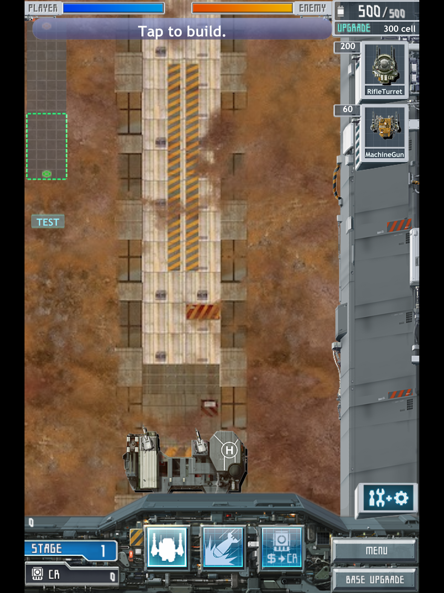

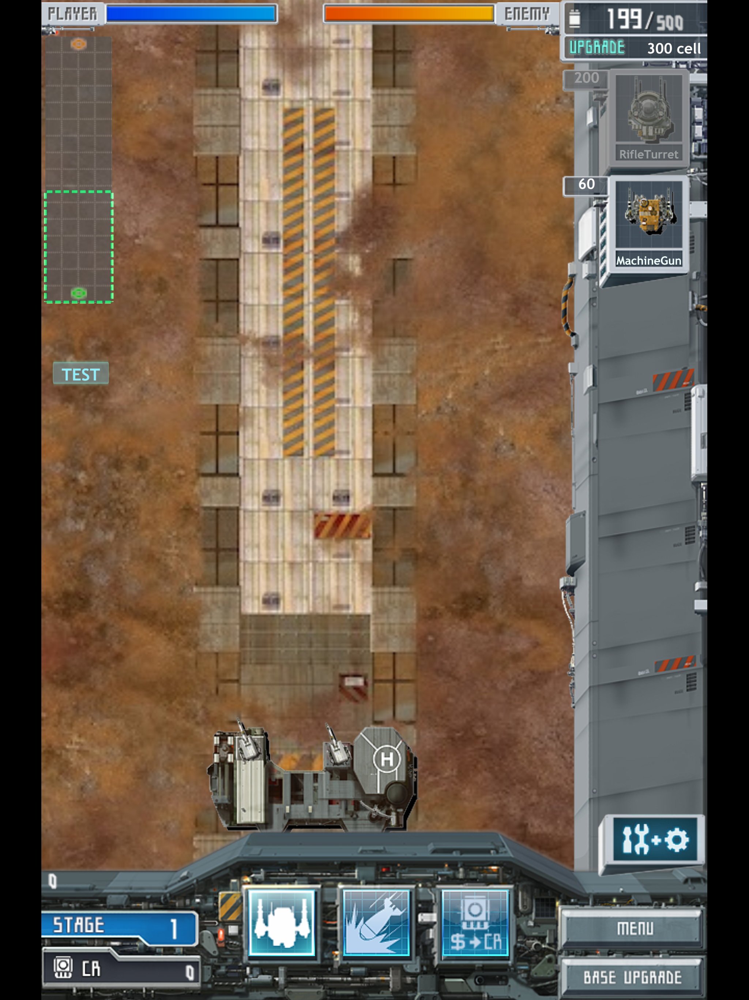

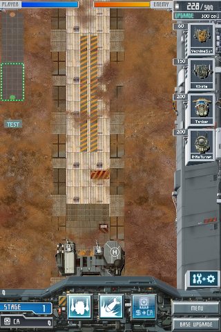

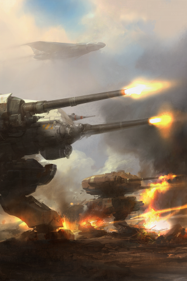

### 기지 강화 6종의 실제 효과

구매한 레벨뿐 아니라 전투 중 소비되는 값을 검사했다. phone·pad 좌표 108조건, 구매 456회, 크레딧 수집 40회, 셀 수집 40회, 용량 상한 20조건, 외형 전환 30조건을 iPad에서 통과했다. 검사는 임시 프로필을 사용하며 사용자 저장에 쓰지 않았다.

| 강화 | 실제 효과 |
| --- | --- |
| Cannon | 기지 무장의 피해·발사 수·간격·재장전 변경 |
| Defense | 최대 체력 증가와 구매 직후 체력 회복 |
| BuildTime | 이후 생산 대기열에 넣은 유닛의 생산 시간 단축 |
| CrResearch | 떨어진 크레딧의 수량 증가. 드롭 확률이나 셀 수량은 바꾸지 않음 |
| CellResearch | 시간에 따른 셀 생성량 증가. 수집하는 광물의 수량은 바꾸지 않음 |
| CellStorage | 셀 최대 보관량 증가. 전투 중 임시 확장 단계와 함께 계산 |

### 핵폭탄을 맞아도 살아남는 경우

핵폭탄은 원본에서도 범위 안의 모든 적을 즉사시키지 않는다. 기본 피해는 레벨별 1500·2000·2700·3700·5000이다. 폭발 중심에서 반경 절반까지 전부 적용하고, 더 멀어지면 피해가 줄어든다. 반경 75% 지점의 1레벨 피해는 1125다. 체력 1200인 적은 이때 체력 75가 남는다.

원본은 유닛 표의 체력에 2를 곱한다. 실제 체력 1200인 E_Tank_01은 이번 공습 중심부 검사에서 5개 레벨 모두 파괴됐다. 실제 체력 7600인 E_Plane_03은 최고 레벨 중심 명중 뒤에도 체력 2600이 남았다. 첫 적 기지의 체력은 40000이다.

5개 레벨·좌표 2종·거리 7개의 70조건과 실제 공습 10회를 검사했다. 피해 계산은 원본 함수와 일치해 변경하지 않았다. iPad에서 재고 1개 소비, 적 피해, 아군 피해 0도 확인했다.

### 이번 검사가 걸린 시간

| iPad 치트 앱 안의 검사 | 실행 시간 |
| --- | ---: |
| 기지 강화 실제 효과 | 1.745초 |
| 오디오 중단·복귀·재설정 | 2.386초 |
| 핵폭탄 피해·처치 | 0.144초 |
| 세 검사 합계 | 4.275초 |

설치와 검사 도구 준비를 포함한 이번 실행은 21.115초였다. 별도로 진행한 UI·생산 안내 검사 4개는 3.285초에 통과했다.

### 구현이 원작에서 달라진 이유

필요한 스킬은 있었다. 원본 분석, 아트 연결, 자동 검사, 기기 검증 지침도 복사돼 있었다. 그러나 일부 구현에서 원본의 개별 호출을 빠뜨렸고, 일반 확인음이나 비슷한 이름의 이미지로 대신 연결했다. 효과음마다 OpenAL 컨텍스트를 해제한 구현도 원본과 달랐다. 이 동작은 기관총 발사 때 오디오 출력을 다시 시작하며 게임 스레드를 지연시켰다.

기존 80미션 검사는 진행·승패·저장을 확인했다. 생산이 됐다는 결과만 검사하면 안내 그림이나 완료음이 빠져도 통과한다. 음원 재생 횟수가 증가했다는 검사도 맞는 소리가 나왔는지는 알려주지 않는다. 이번에는 동작별 원본 함수·이미지·음원·소비 코드와 실제 효과를 연결해 검사했다.

HeavyMach 1과 오류 개수를 같은 범위로 집계한 자료는 없다. 현재 확인한 실패는 스킬 파일의 부재보다 적용 누락과 검사 범위의 누락에서 발생했다. 앞으로 버튼·생산·강화·결과 전환마다 원본 자원과 호출 조건을 검사하고, 화면 캡처와 실제 음향 출력도 비교한다.

### 피격음 추가 복구와 실시간 검사

23:48 추가 검사에서 피격음 3종과 지속 피해음을 복구했다. 피격음은 원본의 난수 선택 순서까지 맞췄다. 지속 피해음은 원본의 고정 OpenAL 핸들 15를 포팅판 초기화 순서와 대조해 Missile06.wav로 연결했다. 음원 파일은 원본과 바이트가 같다. iPad에서 72조건과 핵폭탄 회귀 검사를 통과했다.

기지 기본 무장·최고 무장·유닛 추가 조건으로 1800프레임을 실행했다. 각 교전 구간의 화면 갱신 간격 p95는 16.67ms였고 25ms를 넘은 프레임은 없었다. CPU 처리 p95는 기본 무장 2.36ms, 최고 무장 2.55ms, 유닛 추가 3.40ms였다. 효과음 410회, 저장 쓰기 0회를 기록했다. 최신 수정 후 전체 코어 검사 33개도 184.48초에 통과했다.

### 계속 확인할 부분

- 미션 3 구덩이 위 포탑 설치와 미션 4 적 정체를 포팅판의 같은 위치에서 직접 대조한다. 지상 유닛끼리 겹침을 해소하는 누락은 복구했으나, 미션 4 정체 해결은 아직 확인하지 못했다.
- 공간 음향의 위치 전달을 대조한다. 피격·지속 피해음은 위 추가 검사에서 복구했다.
- 실제 사진 촬영·홈 복귀 뒤 출력음을 녹음해 비교한다. 이번 iPad 검사는 재생 상태와 재생 시간 진행까지 확인했다.
- iPhone 정식 앱에 후속 수정본을 반영하고 같은 행동을 확인한다.
- 화면 확장은 원본 기능 대조 뒤 진행한다. 현재 레터박스는 남아 있다.

[원본 대조와 검사 절차 점검 전문](machdefense-process-audit.md) · [핵폭탄 계산 기록](machdefense-nuclear-damage.md) · [지형·이동 대조 기록](machdefense-terrain-audit.md)

## 소스 재개발 진행

**치트 앱을 구현했고, 80개 미션의 진행·저장 검사와 자동 교전 검사를 통과했다.** iPhone·iPad 시뮬레이터에서 치트 화면과 승리·실패·다음 미션을 직접 조작했다. 원래 난이도의 플레이, 포팅판과의 동일 조건 대조, 장시간 성능 검사를 이어간다.

위메이드 실행 파일의 메서드 1,232개와 필드 732개를 분석했다. 원본 게임 코드에서 화면과 전투 규칙을 확인한 뒤 C++20으로 작성했다. 이미지 1,109개·음원 80개·고유 데이터 표 94개·MCB 3개를 공용 자원으로 준비했다. 새 앱은 이 자원과 소스로 빌드한다. IPA나 원본 실행 파일을 실행하지 않는다.

### 기술 구성

| 구분 | 구현 | 확인한 범위 |
| --- | --- | --- |
| 공용 코어 | C++20 저장·표·메뉴·전투·생산·강화·보상 | 구성 요소·캠페인·저장 실패 검사 31종 통과 |
| Apple 실행기 | Objective-C++·OpenGL ES GPU 렌더링·OpenAL 음향 | iPhone·iPad 시뮬레이터 메뉴·첫 전투 실행 |
| 게임 버튼 | 원본 스프라이트와 C++ 터치 판정 | 프로필·생산·공습·일시정지·강화 화면 연결 |
| 글자 | 원작 Trebuchet MS Bold의 준비된 글리프 이미지 | 영문 이름·가격·스테이지 표시 |
| 이름 입력 | OS 텍스트 입력창 | NEW→영문 입력→OK 확인 |
| 제품 앱 | Apple workspace의 일반·치트 앱 | 두 앱의 시뮬레이터 빌드 성공 |
| 웹·PWA·Tauri | 같은 C++ 코어·자원을 사용할 후속 플랫폼 | Apple 플레이 비교 이후 구현 |

게임 화면과 버튼은 공통 C++ 코드에서 만들고 GPU로 그린다. 텍스처와 음원 버퍼를 재사용한다. 저장은 프로필 변경, 전투 결과, Save & Exit에서 실행한다. 전투 갱신·발사·피격 때 파일을 쓰지 않는다.

### 새 소스로 그린 화면

iPhone 시뮬레이터의 새 소스판이다. 오른쪽에 영문 생산 이름과 가격이 표시되고, 아래에 Menu·Base Upgrade 버튼이 보인다. 현재 원본 논리 화면을 유지해 위아래 여백이 있다.

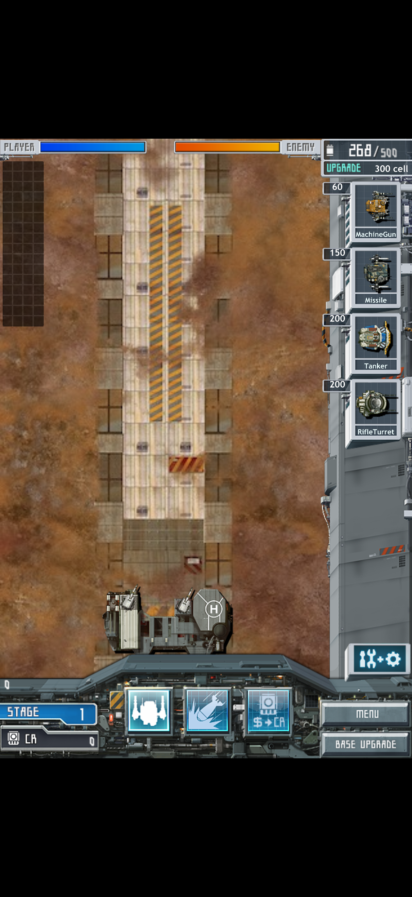

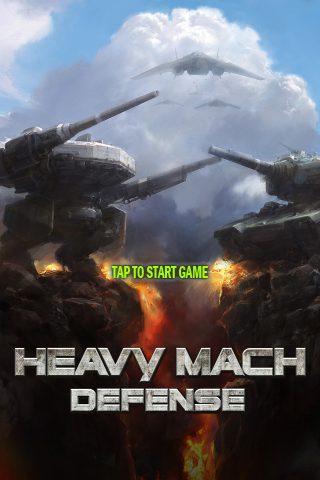

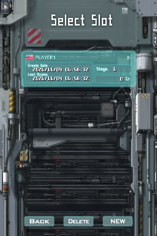

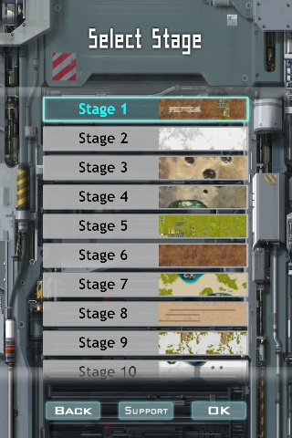

### 검사 결과

- 원본 저장 3개를 읽고 다시 인코딩했을 때 바이트가 일치했다. 새 프로필의 기본 장비·필살기·5개 슬롯 구조도 대조했다. 새 프로필은 영어 전용 지역값 `us`를 사용한다.
- 원본 표에서 80개 맵·126개 유닛 조립 모델·463개 부품을 읽었다. 부품의 연결 좌표와 스프라이트 범위를 검사했다.
- 원본의 고정 시간 증가, 셀 증가, 생산 비용·기간·동시 생산 제한, 적 생성 위치·웨이브, 사거리·발사 간격·피해량 계산을 검사했다.
- 기지 강화 6종을 구매하면 3,900 Cr가 차감된다. 포팅판에서 검사한 동일 조건과 일치했다. 최고 레벨과 자금 부족 조건도 검사했다.
- GameSession 통합 검사에서는 프로필 생성→미션→도움말 종료→생산→일시정지→강화창→결과창→다음 미션을 실행했다. 이 검사의 승리는 적 기지를 직접 파괴해 발생시켰다.
- 전투 중 셀 확장은 5단계까지 검사했다. 셀을 소비해 용량을 늘리며, 영구 기지 강화와 Cr에는 영향을 주지 않는다. 다음 전투에서 임시 단계는 초기화된다.
- 공습·집중사격, 셀 확장, 결과 처리 순서는 AddressSanitizer·UndefinedBehaviorSanitizer 검사도 통과했다.
- iPad에서 공습 사용 후 Save & Exit, 앱 종료·재실행을 확인했다. 저장 파일을 다시 읽어 폭탄 1개·미사일 2개·핵폭탄 1개가 보존됐음을 검사했다.
- Apple 검사에서는 이미지 방향·알파·클립·터치 좌표·텍스처 재사용·음원 80개·중단과 복귀를 확인했다. 배경음악 3곡은 효과음과 별도 재생한다.

### 치트 앱과 80개 미션 검사

TEST 화면 5쪽에서 미션·Cr·셀·기지 강화·장비·특수공격·유닛 체력을 조절한다. 일반 앱과 같은 전투 코드를 사용한다. 값은 메모리에서 바꾸고 SAVE를 누르면 별도 시험 슬롯에 저장한다. 버튼과 글자는 원작 이미지·글리프를 공통 게임 렌더러로 그렸다.

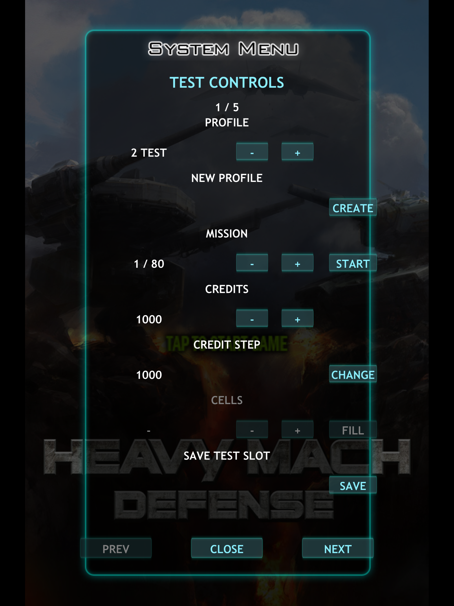

80개 미션의 실패→재도전→승리→보상→다음 미션을 검사했다. 각 미션이 끝날 때 저장을 다시 읽고 앱의 게임 세션을 새로 만들었다. 마지막 미션을 다시 완료했을 때의 기록도 확인했다. 이 검사의 승패는 기지를 강제로 파괴해 발생시켰다.

별도 자동 교전 검사에서는 레벨 10 장비 7종과 셀 보충, 아군 기지 체력 보강을 사용했다. 적 기지 체력은 바꾸지 않았다. 생산한 유닛이 이동하고 사격해 80개 미션 모두 승리했다.

| 검사 | 결과 |
| --- | --- |
| 생산 정의 110개 | 폰·패드 좌표에서 220회 검사 |
| 운반봇 | 목적지 이동 후 포탑 전환 60회 검사 |
| 활성 특수공격 27레벨 | 폰·패드 좌표에서 54회 검사 |
| 파일 쓰기 | 생산·발사·피해·효과 갱신 중 0회 |
| 저장 실패 | 기존 파일 보존, 재시도, 재실행, 보상 중복 방지 통과 |
| Apple 렌더·음향·메뉴 | XCTest10건 통과 |

직접 누른 iPhone 치트 앱에서는 MachineGun 레벨 1→2, Bomb 수량 2→3, 적 기지 파괴와 보상 500Cr·EMP, 다음 눈 지형 미션을 확인했다. iPad에서는 별도 슬롯 생성·Cr1000·저장·미션 진입, 아군 기지 파괴·실패창·미션 선택 복귀를 확인했다.

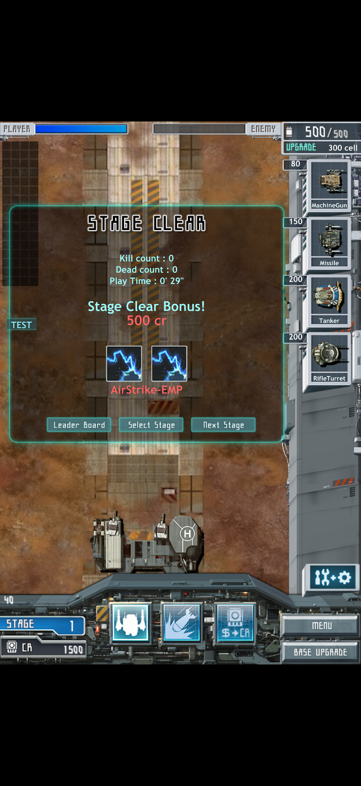

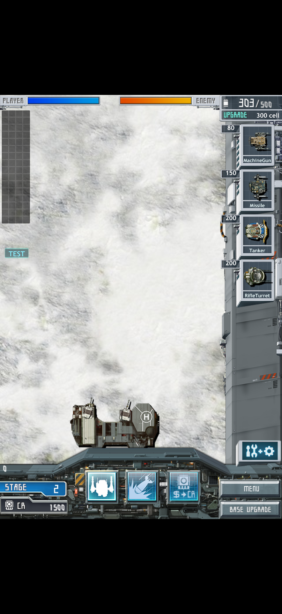

추적 파일만 별도 빈 폴더에 풀고 새 빌드 캐시로 일반 iOS 앱을 빌드했다. 원본 IPA·기존 빌드 산출물·호환 실행기를 복사하지 않은 상태에서 빌드가 성공했다.

### 전투 효과와 추가 수정

총구섬광·탄피·직격선·충돌폭발·미사일 궤적·피격 연기를 연결했다. 원본의 파괴 처리는 부품을 제거하고 차체를 3~5초 남겨 연기를 낸 뒤 없앤다. 이 절차도 연결했다. 원본에 없는 파편 효과는 추가하지 않았다.

치트에서 셀 20을 100 줄이면 음수가 되어 앱이 종료되는 문제를 고쳤다. 전투 중 다른 프로필의 값을 바꿀 수 있던 명령도 현재 슬롯을 사용하도록 수정했다.

저장 실패 검사에서는 결과창이 보상을 저장하지 못해도 다음 미션으로 넘어가는 문제를 찾았다. Next·Retry·Select Stage는 저장 성공 후 이동하게 고쳤다. TEST 오류창 뒤의 버튼이 눌리는 문제도 수정했다. 연속 저장 실패와 재시도, 앱 재실행에서 기존 저장과 새 보상이 유지되는지 확인했다.

### 실행하면서 고친 문제

**이름 입력창에서 앱이 종료되는 문제:** 입력창을 열면서 터치를 취소했는데, 그 과정에서 순회 중인 터치 목록이 바뀌었다. 이벤트를 전달하기 전에 목록을 갱신하고, 취소 처리는 사본을 순회하도록 수정했다. 프로필을 다시 만들어 확인했다.

**맵과 하단 HUD 사이 검정 빈칸:** 원본의 화면 위치 갱신 연결이 빠져 있었다. 원본은 World의 초기 여백을 설정한 뒤 HUD 위치에 맞춰 다시 바꾼다. 이 연결을 복원했고 iPad 시뮬레이터에서 빈칸이 사라진 것을 확인했다.

**생산 패널이 Menu·Base 버튼을 덮는 문제:** 원본은 슬롯 배경을 레이어 5, 메뉴·기지 버튼을 레이어 9에 그린다. 새 코드에서 배경을 뒤늦게 그려 버튼을 덮었다. 배경을 먼저 그리도록 고치고 세 패널의 순서와 두 버튼의 터치를 검사했다. iPhone 시뮬레이터에서 두 버튼의 표시를 확인했다. 후속 iPad 검사에서도 메뉴와 생산·결과 화면을 확인했다.

**강화 비용과 보상 그림:** 특수공격 강화비에는 기본 강화비뿐 아니라 보유 탄약 수량에 따른 가격 차이가 붙는다. 폭탄 2개를 가진 경우 첫 강화비가 600 Cr임을 검사했다. 결과창의 보상 그림도 원본 ItemId로 찾도록 수정했다.

### 남은 구현과 검증

- 같은 저장·난수 조건으로 포팅판의 교전·강화·특수공격·연출을 대조한다. 총구·탄피·피격·잔해·궤적은 연결했고, 원본 진형 아이콘은 명령을 실행하지 않음을 확인했다.
- 일반 난이도의 미션 진행과 장시간 저장·재실행을 검사한다. 치트 조건 80개 교전과 실패·복귀·저장 전환 검사는 통과했다.
- 현재 논리 화면 320×480을 기준으로 연결했다. iPhone·iPad의 넓은 화면 배치는 전체 검증을 마친 다음 구현한다.
- iPad 시뮬레이터에서 문 전환이 느려지는 현상이 있다. 실행 샘플의 대부분이 OpenGL 소프트웨어 래스터라이저에 머물렀다. 시뮬레이터 렌더 부하와 게임 갱신 시간을 나눠 측정한다.
- Game Center·옛 구매 서비스·지원 이메일은 연결하지 않았다. 광고는 추가하지 않는다.

기존 아이폰 포팅판과 사용자 저장은 변경하지 않았다. 작업 브랜치는 `feat/source-reimplementation`이다. develop·main 병합은 하지 않았다.

## 기준과 순서

**기존 indieapps 포팅판을 보존하고, 위메이드판을 별도 앱으로 검사한 뒤 소스 재개발에 들어간다.** 사용자가 확인한 기존 판의 승리·실패·생산·교전은 비교 자료로 남긴다. 위메이드판의 미션과 에셋을 재개발 기준으로 삼는다.

위메이드판은 미션 목록이 80개로 늘었고 새 배경과 보스 수치 변경이 있다. 최초 포팅에 쓴 indieapps 1.0.5보다 뒤에 나온 판본이라는 판단과 일치한다. 서로 다른 번들에 붙은 1.0.3과 1.0.5는 숫자만으로 선후를 정할 수 없다.

## 확보한 판본

| 항목 | indieapps 1.0.3 | indieapps 1.0.5 | WeMade 1.0.3 |
| --- | --- | --- | --- |
| 번들 | kr.indieapps.MachDefense | kr.indieapps.MachDefense | com.wemadeent.HeavyMachDefence |
| 최소 iOS | 4.2 | 4.1 | 4.3 |
| 빌드 SDK | 4.2 | 4.3 | 5.0 |
| 실행 코드 | ARMv6·ARMv7 | ARMv6·ARMv7 | ARMv7 |
| 지원 기기 선언 | iPhone·iPad | iPhone·iPad | iPhone·iPad |
| 앱 내부 파일 | 1,264 | 1,266 | 1,295 |
| PNG / JPG | 936 / 153 | 942 / 152 | 948 / 161 |
| 데이터 표 | 84 | 84 | 94 |
| 미션 목록 | 70 | 70 | 80 |
| WAV / MP3 | 77 / 3 | 77 / 3 | 77 / 3 |

[Internet Archive 시리즈 모음](https://archive.org/details/heavy-mach-archive_202406)에서 위 세 파일을 확인했다. 별도 1.0.5 항목의 파일도 같은 SHA-1과 크기다. 현재 확보한 파일 중 별도 HD 패키지는 없다. [TouchArcade의 Mach Defense 페이지](https://toucharcade.com/games/mach-defense)는 HD와 Universal을 함께 표시한다. 따라서 확보한 판본은 모두 유니버설 선언을 가진 앱이며, 별도 HD판의 존재와 전체 출시 빌드 목록은 추가 확인 항목이다.

[2011년 5월 위메이드 발표](https://www.inven.co.kr/webzine/news/?news=35584)는 인디앱스 인수를 알린다. [2011년 10월 위메이드 발표](https://www.newswire.com/news/heavy-mach-assault-and-battle-games-for-ios-devices-get-major-updates-and-91125)에는 Defense 출시 예고가 있다. 확보한 위메이드판의 SDK와 콘텐츠 증가도 이 순서에 부합한다.

## 에셋·미션·수치 차이

indieapps 1.0.3과 1.0.5는 데이터 표 84개, 지도 파일 3개, 음원 전체가 같다. 1.0.5에는 진형 아이콘이 추가됐고 일부 시작 화면과 적 체력 게이지 그림이 달라졌다. 데이터가 같아도 실행 코드 전체가 같다는 뜻은 아니다. Objective-C 메서드 목록과 추가 기능을 따로 비교했다.

위메이드판과 indieapps 1.0.5 사이에서는 공통 PNG 939개 중 934개가 같다. 음원 80개는 모두 같다. 유닛 그림 대부분을 이어 쓰면서 아래 내용을 추가하거나 변경했다.

- `ESpawn71`부터 `ESpawn80`까지 적 배치 표 10개를 추가했다.
- `BG26`, `BG27` 배경과 미리보기, 새 타이틀·지원 화면을 추가했다.
- `Boss01`의 체력은 25,000에서 33,000, 경험치는 900에서 30,000으로 바뀌었다. 속도와 반경 값도 달라졌다.
- 무기 표 211행, 부품 목록 445행, 기지 업그레이드 54행, 생산 이름 40행, 부품 표 70행과 기존 적 배치 1~70은 같다.
- 생산 메뉴 그림에는 상점 관련 아이콘 행이 추가됐다. 배너와 크레딧 구매 관련 코드도 추가됐다.

**광고는 모든 복원판에서 표시하지 않는다.** 위메이드판의 광고 요청·배너 갱신·광고 열기 호출을 호환 실행기에서 차단했다. 원본 패키지는 그대로 보관한다.

## 한글 이름과 HD 에셋

세 판본에는 한국어·영어 설명 표가 모두 있다. 도움말 그림도 한국어·영어, 세 크기로 들어 있다. 원본은 기기 언어보다 지역 코드에 따라 `kr` 또는 `us`를 선택한다. 영어를 우선 언어로 지정해도 한국 지역에서는 한글 이름과 도움말이 나왔다.

따라서 이름을 그림에만 박아 놓은 구조로 볼 수 없다. **표에서 고르는 텍스트와 언어별 도움말 이미지가 함께 쓰인다.** 신규 앱에서는 영어 표와 영어 도움말을 사용한다.

일부 배경은 iPhone용 256×512, iPad용 512×1024로 나뉜다. 반면 비교한 유닛 스프라이트에는 25×18, 55×32처럼 작은 그림이 그대로 남아 있다. 위메이드판으로 바꾼 것만으로 유닛 해상도가 높아지지는 않는다. 자글거림은 원본 크기·텍스처 필터·화면 배율을 나눠 비교한다. 유닛 그림을 임의로 다시 그리는 작업은 시작하지 않았다.

## iPhone 시뮬레이터 검사

iPhone Air·iOS 26.5에서 위메이드판을 별도 앱으로 실행했다. 사용자 아이폰에 설치한 기존 포팅판과 저장은 변경하지 않았다.

| 검사 | 확인한 결과 |
| --- | --- |
| 타이틀·문 전환 | 통과 |
| 프로필 생성 | `1234` 생성. 입력칸이 아래로 움직이는 표시 문제는 남음 |
| 스테이지 선택·도움말 | 첫 스테이지 진입. 한국 지역에서 한글 도움말 표시 |
| 유닛 생산 | 네 생산 버튼 조작, 에너지 차감, 아군 출격 확인 |
| 전투 | 이동·사격·폭발·적 파괴·크레딧 증가 확인 |
| 전장 스크롤 | 적 기지까지 이동 확인 |
| 기지 강화 6종 | 각 1회 구매. 모두 레벨 2, 합계 3,900 Cr 차감. 앱 재실행·전투 재진입 후에도 유지 |
| 저장·재실행 | 점수 274, 164 Cr, 프로필 `1234` 유지 확인 |

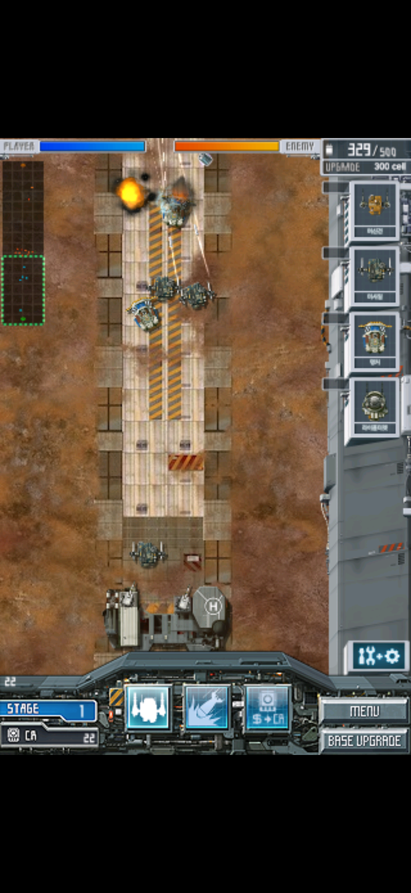

위 화면은 위메이드판의 첫 미션이다. 우측 생산 버튼에서 출격한 아군과 적이 교전한다.

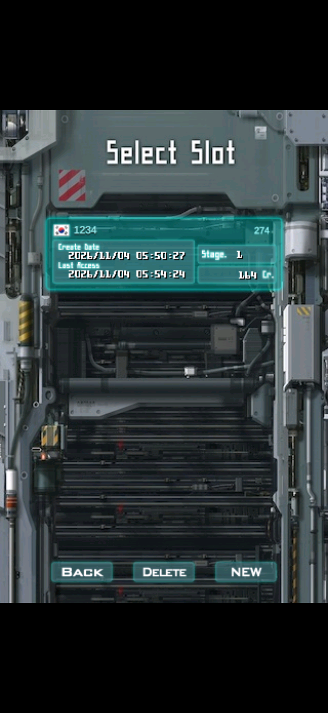

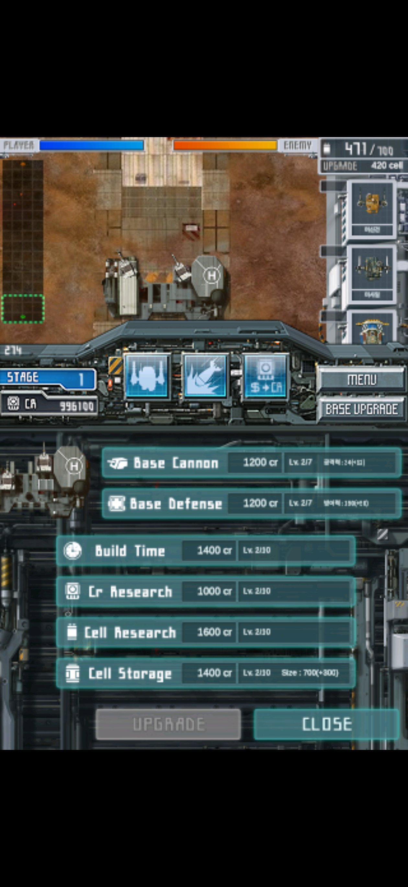

기지 포·방어·생산 시간·크레딧 연구·에너지 연구·에너지 저장량을 각각 한 단계 올렸다.

### 실행 중 고친 두 오류

첫 오류는 위메이드판이 화면 갱신 간격을 0으로 설정할 때 발생했다. 호환 실행기가 1 이상만 허용하고 중단했다. iOS 26.5 시뮬레이터의 작은 네이티브 검사 앱에서 0과 -1을 넣었을 때 1로 읽히는 동작을 확인한 뒤 호환 처리를 맞췄다. 수정 후 타이틀이 열렸다.

두 번째 오류는 슬롯 선택 뒤 배너 코드가 다운로드를 시작하면서 발생했다. 구현되지 않은 스트림·연결 처리를 거쳐 잘못된 객체 참조로 종료됐다. 사용자 지시대로 위메이드 `GuiBanner`의 광고 진입점을 차단한 뒤 스테이지 선택과 전투가 진행됐다.

### 저장 형식

indieapps 1.0.5 저장은 42,476바이트, 위메이드 1.0.3 저장은 42,496바이트다. 슬롯 간격도 각각 8,288바이트와 8,292바이트다. 두 앱의 저장을 따로 보관하고, 판본에 맞는 테스트 저장을 만든다. 자금만 1,000,000 Cr로 늘린 시험 저장에서 강화 6종을 구매했다. 구매 후 잔액은 996,100 Cr였다.

## 다음 검사와 재개발 계획

포팅판 대조 → 인게임 일러스트 앱 아이콘 제작 → 아이콘 방향·가격·회전 재검사 → 치트앱 전체 기능 연속 검사 → 성능·음향·메모리·생명주기 검사 → iPhone·iPad 화면 확장 계획 수립 순서로 진행한다. 화면 확장에서는 HeavyMach 1처럼 뷰포트를 키워 기존 월드를 더 보여주는 방법을 우선 검토한다. 세로 전장·맵 경계·카메라·HUD·터치를 함께 조사하고 원작 전투 수치를 보존한다. 웹·PWA·Tauri는 Apple 화면 대응과 재검사 이후다.

세부 기준은 [소스 재개발 계획](../source-reimplementation-plan.md)과 [TODO](../usability-todo.md)를 따른다.

## 공용 코드 분리와 원작 오디오 복원

원본·포팅판을 기준으로 오디오와 텍스처 차이를 먼저 고쳤다. 효과음은 원래 PCM 형식과 source 재사용을 보존하고 음악은 AudioFile/AudioQueue로 되돌렸다. 피격음 위치와 이미지 패딩·알파 처리도 원본과 대조했다.

그다음 이동·표적·지형·피해·생산·저장·메뉴·그리기 명령을 역할별 파일로 나눴다. 게임 UI는 C++ 코어에 남겼고 플랫폼은 화면 출력·파일·오디오·생명주기를 연결한다. Android·웹/PWA·Tauri의 실행기는 이 구조를 이어서 사용할 계획이다.

[구현 파일·원본 근거·검사 결과](../evidence/module-work-20261105.md). 이후 원고 작성 때 이 실행 기록의 최신 결과를 사용한다.
