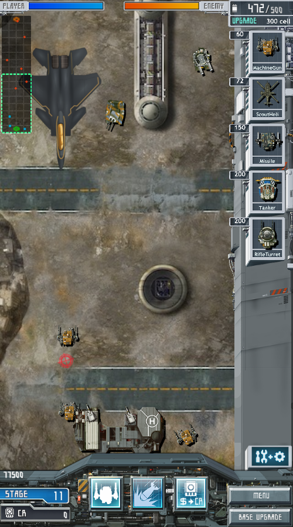
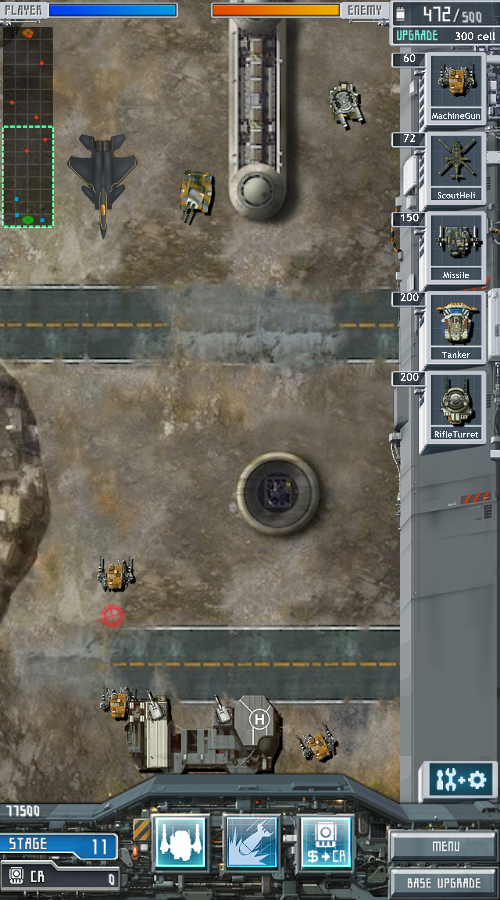

# Why I added enemy air raids

<!-- language-nav:start -->
[한국어](../../public/enemy-air-raids.md) | [English](enemy-air-raids.md)
<!-- language-nav:end -->

## Moonlight and Lux Lunae

The original game had an allied air strike. When I added enemy raids to MachDefense, we reused the allied aircraft’s flight and explosion effects. The enemy jets target my mechs. A red reticle shows where the cluster bombs will fall.

I gave the jets the Lux Lunae livery I used in my HeavyMach 1 restoration. I traveled around Korea by motorcycle in 2025. On roads without streetlights, I used the moonlight and my headlight to see the way. After that trip, moonlight took on a personal meaning for me. HeavyMach influenced my decision to become a developer, and Ace Combat 8 gave me a release to look forward to during a difficult period. Lux Lunae, Latin for “moonlight,” is an enemy squadron in that game. I brought its black and gold livery to the F-22, Su-57, and MiG-31 in the HeavyMach 1 restoration. [HeavyMach 1 restoration essay, “Why Lux Lunae?”](https://github.com/gelb2/HeavyMach/blob/e6be24957d8ca12db6c9e2846b41fee88c800fcc/docs/en/public/lux-lunae-intent-20261028.md)

## The F-15 STOL/MTD and candidate 09

I started with the F-15E as a reference and chose the experimental F-15 STOL/MTD with canards ahead of the main wings. I asked for a black airframe, gold stripes, and a gold canopy. Codex drew the canards and rectangular exhaust nozzles so they would show from above, and used the original allied aircraft as a reference for the shading and edges.

The early aircraft looked gray-green, and the gold faded at gameplay size. I chose design 09, where I could see the airframe shape, the black paint, and the gold details together. The upper surface still looked like stacked panels. We softened the shading to make it look like a painted aircraft and kept the approved outline and stripe placement. In v0.8.1, we halved the gold canopy’s length in the artwork and halved the aircraft’s on-screen width and height. [Design 09 and the size adjustment](../../../Art/EnemyAirStrike/README.md) · [Design comparisons (Korean)](../../research/enemy-airstrike-art-20261127.md)

## Gameplay comparison

Both shots show Stage 11 at 61.6 seconds, at the same screen size. The enemy jet entering from the upper left is half as wide and half as tall in v0.8.1. Select either image to see it at full size.

| v0.8 · Before | v0.8.1 · After |
| --- | --- |
|  |  |

## When the raids appear

Raids appear in Stages 11 through 80. The first comes 60 seconds into battle. Further raids come 20 to 45 seconds apart. Each raid’s aircraft count was drawn in advance from one, two, or three with equal odds and stored in the schedule. When two or three jets arrive, they come one at a time, 1.5 seconds apart. In Stage 11, the second raid sends one jet each at 81, 82.5, and 84 seconds. Retrying a stage uses the same schedule. [Raid schedule by stage](../../../Resources/Tables/EnemyAirRaidSchedule.tsv)

Each jet targets the lead allied mech’s position at launch. The jet skips its turn if no allied mech is alive. Once the reticle appears, the cluster bombs fall at that marked spot even if the mech moves. Pausing stops the battle clock. The end of the battle cancels any remaining raids. [Combat code](../../../Sources/Core/Simulation/WorldCombat.cpp) · [Flight and scheduling code](../../../Sources/Core/Simulation/SpecialAttack.cpp)

## How damage is set per aircraft

I first set the damage so the weakest mech would keep at least half its health after taking every cluster bomb. I later raised the cap per jet to 80% and then to 95% of the weakest mech’s maximum health in v0.8.4. The game compares the maximum health of every fieldable combination of model, upgrade level, and equipment. The player’s current roster does not change the damage.

The lowest maximum health is currently 300 for `MachineGun_01`. One jet can deal up to 142 damage in Stage 11 and up to 285 in Stage 80. The damage starts at half of 285, rises by a fixed amount per stage, and rounds down. For the weakest mech’s maximum health `H` and stage number `s`, the cap is `C = floor(95H / 100)` and the maximum damage per jet is `floor(C × (69 + s − 11) / 138)`.

The game divides each jet’s damage among ten cluster bombs and gives one extra point to each of the first few bombs until the remainder is used. Where the bombs land can reduce the damage. The 95% cap applies to each jet individually. Taking hits from several jets can add up to more than 95%. [Design and limits (Korean)](../../game-design.md#적-공습기) · [Cluster bomb collision tests](../../../Tests/WorldSpecialTests.cpp)
