# Gameplay captures and clips

<!-- language-nav:start -->
[한국어](../../public/gameplay-gallery.md) | [English](gameplay-gallery.md)
<!-- language-nav:end -->

I recorded these battles on my iPhone on November 6–7, 2026. The Galaxy screenshot is from November 6. The two recordings run for 4:12 and 4:16. The clips below keep their original speed and full screen, including the HUD.

## Combat clips

### Turret fire and mech combat

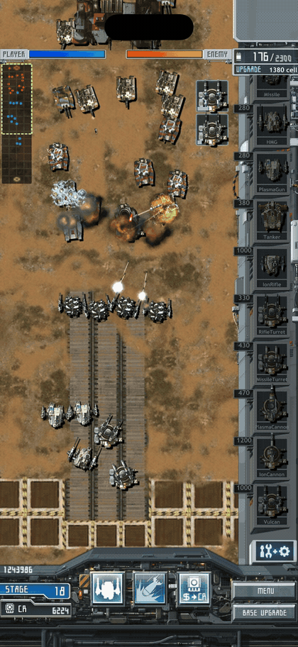

[MP4 clip](../../public/media/gameplay-20261107/combat.mp4) · [Still frame](../../public/media/gameplay-20261107/combat.jpg) · 12s · ScreenRecording_11-07-2026 02-25-50_1.mov: 02:38–02:50

### Selecting a special-attack target and firing missiles

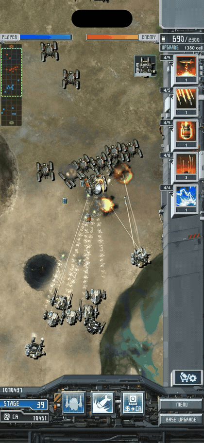

[MP4 clip](../../public/media/gameplay-20261107/special-attack.mp4) · [Still frame](../../public/media/gameplay-20261107/special-attack.jpg) · 10s · ScreenRecording_11-06-2026 09-56-15_1.mov: 03:52–04:02

This shows the existing special attack. The separately proposed tap-to-lock-on feature has not been implemented.

### Claiming emergency supplies and the English message

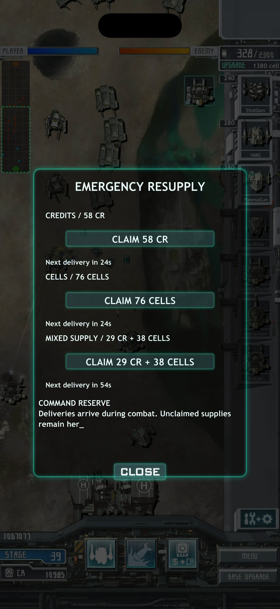

[MP4 clip](../../public/media/gameplay-20261107/resupply.mp4) · [Still frame](../../public/media/gameplay-20261107/resupply.jpg) · 9s · ScreenRecording_11-06-2026 09-56-15_1.mov: 00:40–00:49

## Screenshots

### Stage 11: fighting near the enemy base

<a href="../../public/media/gameplay-20261107/iphone-stage11.jpg">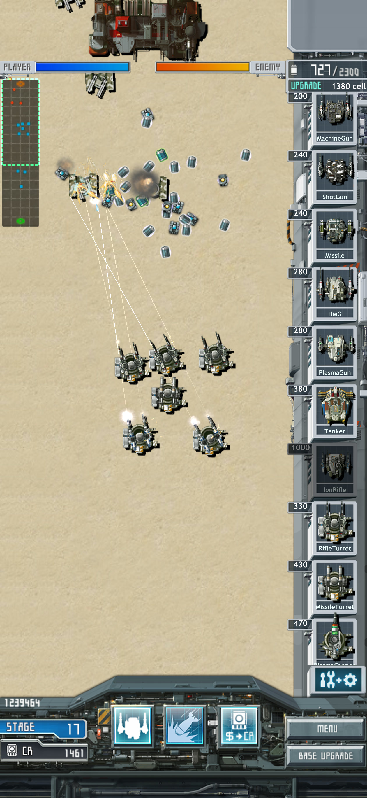</a>

### Stage 23: turrets and mechs in combat

<a href="../../public/media/gameplay-20261107/iphone-stage23.jpg">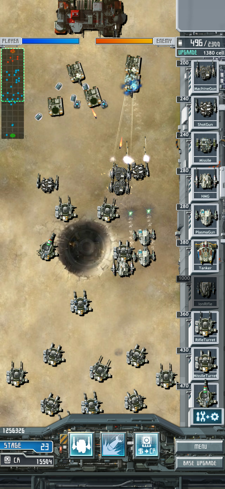</a>

### Stage 46: units around a long structure

<a href="../../public/media/gameplay-20261107/iphone-stage46.jpg">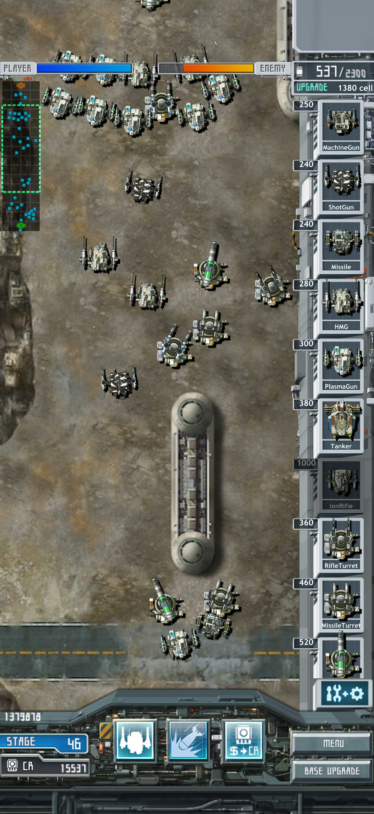</a>

### Stage 40: several weapon types firing together

<a href="../../public/media/gameplay-20261107/iphone-stage40.jpg">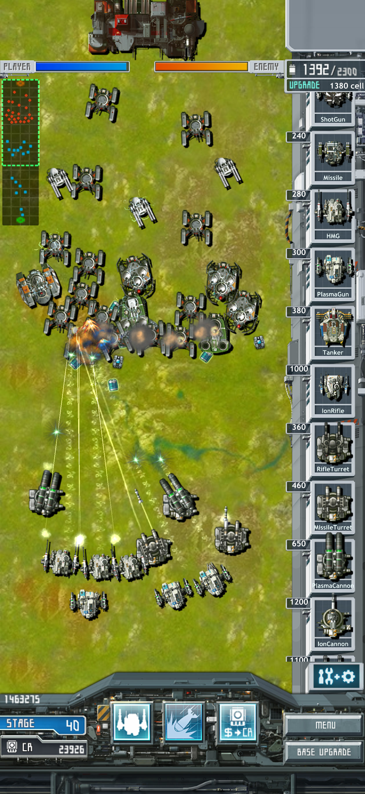</a>

### Galaxy Stage 1: battlefield and production list

<a href="../../public/media/gameplay-20261107/android-stage1.jpg">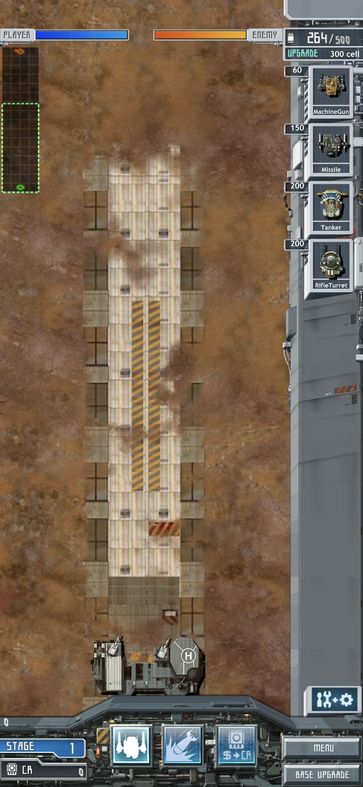</a>

### Equipment upgrades and INSTALL / UNINSTALL

<a href="../../public/media/gameplay-20261107/upgrade.jpg">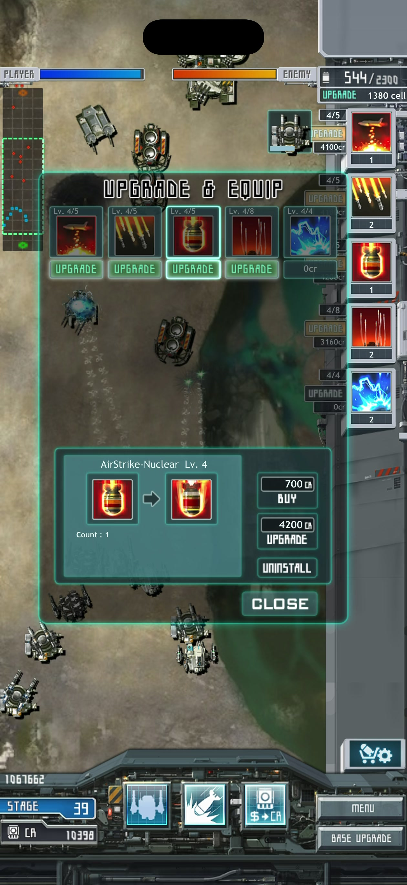</a>

## Captures used to report problems

These show the screen at the time of the report. The iPhone HUD cover has since been changed; the pathfinding report remains under investigation.

Stage 23: combat and the HUD at the time

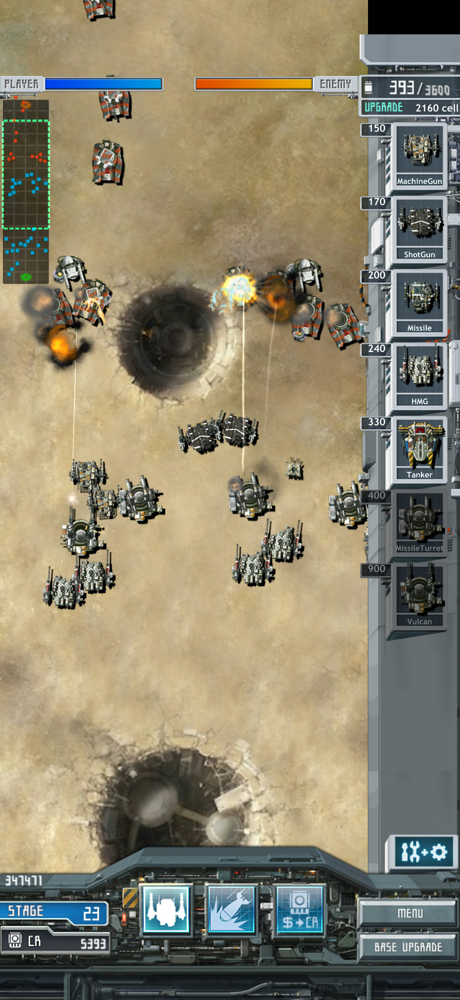

Reported unit congestion near a circular structure

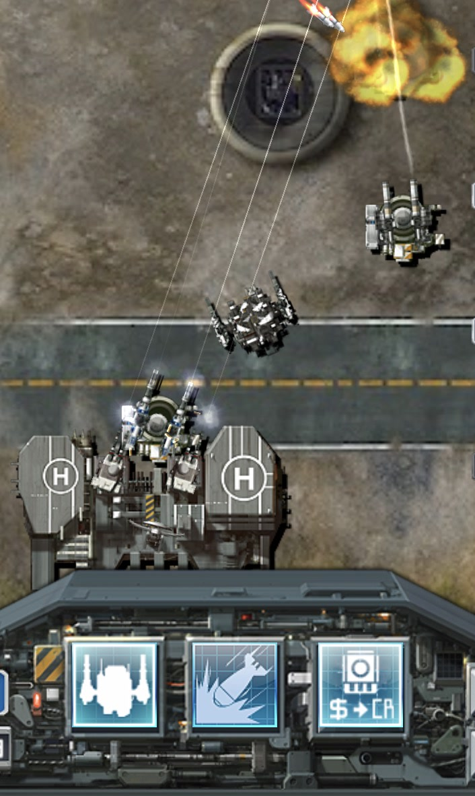

## Files and sources

The exact build IDs were not recorded. These are gameplay captures from their recording dates, not a comparison of the current release across platforms. The second copy of IMG_1129 was identical and is listed once.

[Scene times, source hashes and exported files](../../public/media/gameplay-20261107/scenes.json)

[Game overview](../../../README.en.md) · [Documentation](README.md)
