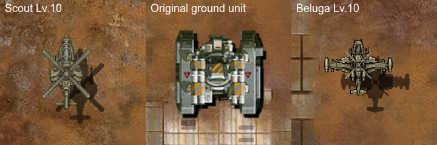
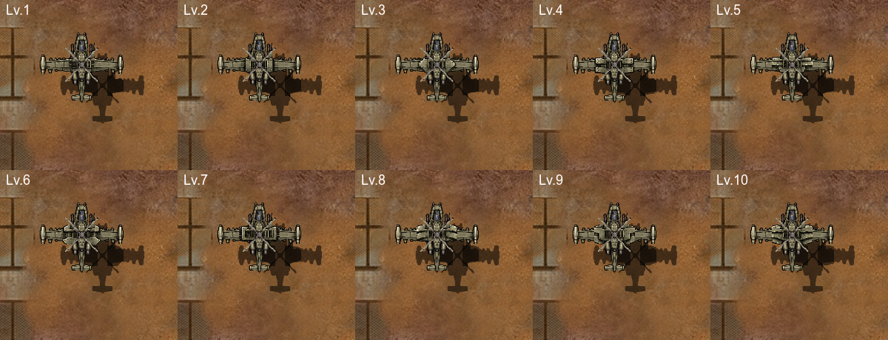

# 스카웃 Lv.10·벨루가 V5 게임 적용

2026-11-09 사용자가 채택한 시안을 게임 자원에 연결했다. 스카웃 Lv.10과 벨루가 Lv.1–10을 변경했다. 스카웃 Lv.1–9, 샤이엔, AH-10은 이번 변경 대상에서 제외했다.

스카웃은 몸체 7자세·기관포·미사일·4엽 로터를 분리했다. 벨루가는 몸체·좌우 날개·엔진·레벨별 좌우 장갑 20개·기관포·미사일·4엽 로터로 조립한다. 새 이미지 31개를 Apple pngcrush의 CgBI 형식으로 준비했다. 변환 전후 알파와 불투명 픽셀 RGB를 대조했다. 원본 생성 그림, 변환 자원, 소켓 정의와 해시는 `Art/Aircraft/scout-v5-20261109/`와 `Art/Aircraft/beluga-v5-20261109/`에 보존했다.

기존 무장 파츠 이름과 WeaponInfo 행을 유지했다. 새 그림의 실제 포신 위치에 맞춰 부착점과 총구를 옮겼다. 기존 MCB 로더와 파츠 조립을 사용하며, 실행 중 레벨별 모델을 복제하지 않는다. 스카웃 전체 가로폭은 제작 기준 59px, 벨루가 중립 조립 가로폭은 기존과 같은 127px이다. 길이는 채택 그림 비율을 따른다.

두 그림은 같은 배율의 실제 웹 프레임을 잘라 배치했다. 레벨 표기만 추가했다. 이 문서의 WebP는 무손실이며, 보고 사이트 표시본은 용량에 맞춰 별도 압축한다.

## 확인한 동작

- 코어 검사 3개 통과. 기존 자세 174개, V5 조립 66개, AH-10 총구 1,260개 사례를 확인했다.
- Chrome·WebKit 각각 10레벨×7자세를 표시했다. 사용 이미지·선회 타일·독립 무장·독립 로터를 검사했고, 반복 표시 중 텍스처 추가 업로드는 0회였다.
- 정식 웹 치트 패키지에서 스카웃·벨루가 각각 Lv.1·10의 생산창·강화 목록·상세창을 확인했다.
- 4종×10레벨 전투에서 피해·사운드·회피·플레어 발생을 확인했다. DB 쓰기 0회, AudioContext 생성 수 2→2, 폐기 0회였다. 자기 표적과의 최소거리는 스카웃 123.62, AH-10 104.05, 샤이엔 104.07, 벨루가 60.96이었다. 이 검사는 지정 사거리에서 항상 정지한다는 증명은 아니다.
- 기존 Resources 이미지 1,294개·OriginalImages 1,109개·오디오 80개, 비헬기 정의 77노드, 비헬기 표 행을 보존했다. 이동·표적·전투·회피 코드, MachList·WeaponInfo도 그대로다. 원작 지상 유닛·샤이엔·AH-10·스카웃 Lv.1–9 및 변경 기체 영역 밖 비교 화면의 RGB 픽셀이 같다.

[검사 요약](aircraft-v5-integration-20261109/summary.json) · [파일 보존](aircraft-v5-integration-20261109/preservation.json) · [화면 보존](aircraft-v5-integration-20261109/screen-preservation.json) · [전투](aircraft-v5-integration-20261109/combat.json) · [실제 정의 소비](aircraft-v5-integration-20261109/consumption.json)

## 확인된 차이와 남은 작업

벨루가 -8° 자세에서 기관포와 조종석 사이에 가는 지면 노출이 보인다. 뒤쪽 장착부는 연결되어 있다. 이 표현과 기존 시안의 광택·레벨 간 구별 문제를 미술 완료로 판정하지 않았다. [화면 검수](aircraft-v5-integration-20261109/visual-review.json).

플레어 계산은 알파 외곽 대신 파츠 캔버스 크기를 사용한다. 새 캔버스 때문에 스카웃 Lv.10의 계산폭은 59→64(+8.47%), 벨루가는 83.853363→94.0950012(+12.21%)가 된다. 출발점 간격과 초기속도가 이 폭에 비례한다. 벨루가 실제 중립 그림폭은 보존됐다. 새 총구 위치 때문에 탄도 출발점·이동 거리·포연과 탄피 위치도 달라진다. 공격 수치와 이동 로직은 변경하지 않았다. [폭 측정](aircraft-v5-integration-20261109/flare-bounds.json).

이 결과는 작업 브랜치와 웹 치트빌드 검사다. 최종 40·100기 CPU/GPU 성능 대조, 아이폰 설치, main·운영 웹 배포는 이번 검사에 포함하지 않았다. 이전의 대량 전투 성능 과제는 유지한다.
