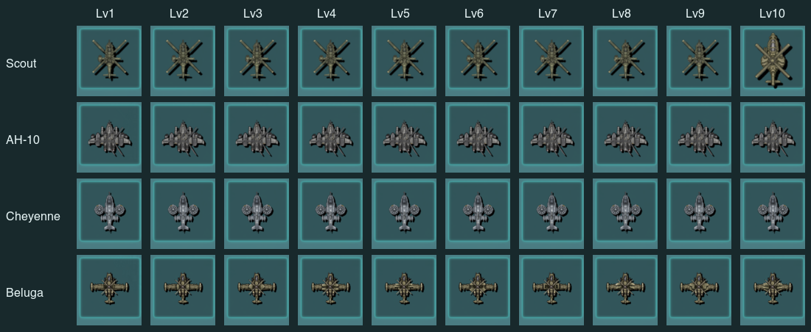

# Android 치트앱 헬기 레벨 검사 — 2026-11-09

Galaxy SM-S731N에 새 치트 APK를 설치했다. 네 기체 Lv.1–10의 실제 업그레이드 36회와 생산 40회를 검사했다. 강화비용·실제 체력/사거리/SPD·APK 무장표로 계산한 ATK·파츠 및 그림 연결과 Lv.10 상한이 일치했다.

iOS와 Android는 같은 Core C++ 41파일과 Resources를 사용한다. 헬기의 레벨별 수치·파츠 선택·생산·전투 규칙을 플랫폼별로 나누는 분기는 없다. OS 입력·렌더러·음향·파일 접근은 플랫폼 어댑터다. APK 안의 자원 1,607개는 현재 공통 자원과 바이트가 같고, 헬기가 소비하는 이미지 125개는 모두 CgBI다. [공통 소스 대조](android-aircraft-20261109/shared-core.json), [APK 대조](android-aircraft-20261109/apk-audit.json).

APK: `Android/app/build/outputs/apk/cheat/debug/app-cheat-debug.apk`. SHA256: `eb42d761b5e83bddded206245940a0d8ab7a645688d2b7b5de419833f02d2eb5`. 게임 코드·그림 기준 커밋은 `8175092`다. 이후 추가한 Android 검사용 진단 코드만 APK에 함께 포함했다. 일반 앱에는 해당 진단 실행문이 들어가지 않는다.

| 기체 | 검사한 레벨 | 실제 구매 | 총 강화 비용(cr) | Lv.10 상한 |
|---|---:|---:|---:|---|
| Scout | 10 | 9 | 153,240 | 통과 |
| AH-10 | 10 | 9 | 613,200 | 통과 |
| Cheyenne | 10 | 9 | 306,560 | 통과 |
| Beluga | 10 | 9 | 459,880 | 통과 |

실제 강화창의 Upgrade 버튼을 눌렀다. 레벨을 바로 올리는 치트 명령 203은 사용하지 않았다. 매 레벨 미션을 새로 시작한 뒤 생산 버튼으로 해당 기체를 만들었다. 새로운 기체의 실제 maxHP·range·파츠·무장 인스턴스를 읽었다. 공격력은 그 무장 이름에 대응하는 APK의 WeaponInfo를 공통 phone 파서로 읽어 합산했으며, 비공개 live 무장 객체를 직접 읽었다고 표현하지 않는다. SPD는 실제 moveSpeed와 공통 `int(moveSpeed/0.0166f)` 계산으로 40개 모두 대조했다. 업그레이드 중 게임 저장 쓰기 횟수는 늘지 않았다.

[40개 레벨의 검사 결과](android-aircraft-20261109/level-results.json), [전체 수치](android-aircraft-20261109/level-stats.json), [SPD 40개 대조](android-aircraft-20261109/speed-results.json). 테스트 저장은 42,496바이트이며 공통 SaveData 디코더로 네 기체의 저장 레벨 9(표시 Lv.10)를 확인했다. 개인 저장과 전체 기기 로그는 공개하지 않는다.

강화는 이후 생산 요청에 적용된다. 이미 전장에 있는 기체와 기존 생산 대기열의 정의를 소급 교체하지 않는다. 두 플랫폼이 같은 처리를 사용한다.

이번 소스 변경은 Android 치트앱의 명시적 스냅샷에 헬기 파츠·무장·메시·저장 레벨 진단을 추가한 것이다. 매 프레임 진단 파일을 쓰거나 DB·음향 컨텍스트를 바꾸지 않았다. 공통 게임 코드와 원작·헬기 자원은 변경하지 않았다. 첫 진단 APK에서 발생한 숫자 출력 오류와 재컴파일 과정은 [재실행 기록](android-aircraft-20261109/retest.md)에 남겼다.

Android 검사 후 사용자 추가 지시에 따라 같은 공통 코드·자원의 iPhone 정식 Release 앱도 설치했다. develop·main·운영 PWA 배포는 하지 않았다. 도색·입체감과 단계별 외형 차이의 완성도, 벨루가 -8° 분리 표현, 새 캔버스로 달라진 플레어 폭, 최종 40/100기 성능은 기존 후속 과제다.

4종 Lv.10을 각각 실제 생산해 전투를 관측했다. 네 기체에서 좌·우 선회와 이에 맞는 몸체 메시의 그림 좌표, 무장의 총구 순서 전환, 전장 발사체 및 효과음 호출 증가를 확인했다. AH-10은 기관포·미사일의 총구 전환을 관측했으며 이 짧은 관측으로 모든 무장의 개별 발사와 실제 출력음까지 확정하지 않는다. 채프·플레어 14개 방출과 표적과의 최단 간격은 이번 Android 검사에서 따로 계측하지 않았다. [전투 관측](android-aircraft-20261109/combat-results.json).

40개 강화창을 직접 시각 검수했다. 빈 텍스처나 몸체·로터·무장 누락은 보이지 않았다. AH-10·샤이엔의 인접 레벨 간 외형 차이는 실제 UI 크기에서 작다. 아래 그림은 실제 Android 현재 미리보기를 잘라 같은 비율로 줄인 것이다. 게임 에셋을 다시 그린 그림이 아니다. [시각 검수 근거](android-aircraft-20261109/review.json).

검사 후 기존 치트앱 저장 42,496바이트를 정확히 복원했고 재실행 뒤에도 같았다. 일반 앱 저장도 변경되지 않았다. 새 APK는 기기에 유지했으며 검사 앱 종료와 홈 화면 복귀를 확인했다. [저장 복원 결과](android-aircraft-20261109/restore-result.json).

아이폰 정식 앱은 Xcode의 MachDefense / Build For Profiling(Release)으로 빌드했다. 기존 팀의 서명을 검증하고 테스트 플러그인이 없음을 확인했다. 앱 안 자원 1,607개도 공통 자원과 같았다. 무선 설치 후 타이틀과 시작 입력, 기존 Stage 55 선택 화면을 확인했다. iPhone에서 40레벨 강화 검사를 반복한 것으로 기록하지 않는다. 메뉴 진입 때 최근 접속 시각과 체크섬 4바이트가 바뀌었고 진척·자금·보유·강화 수치는 같았다. 검사 후 원래 저장 42,496바이트를 정확히 복원하고 앱 종료·홈 복귀를 확인했다. 임시 로컬 서명 설정은 원래 추적 파일로 복원했다. [아이폰 설치 근거](android-aircraft-20261109/iphone-install.json).
