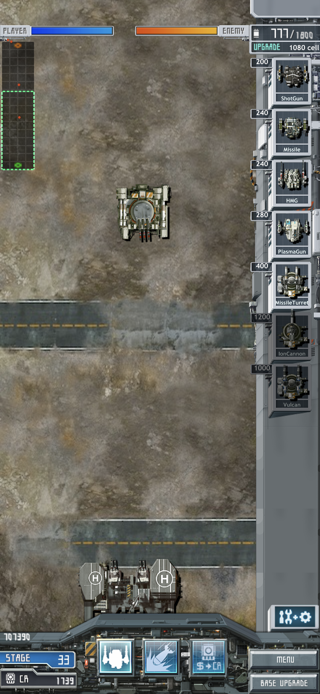
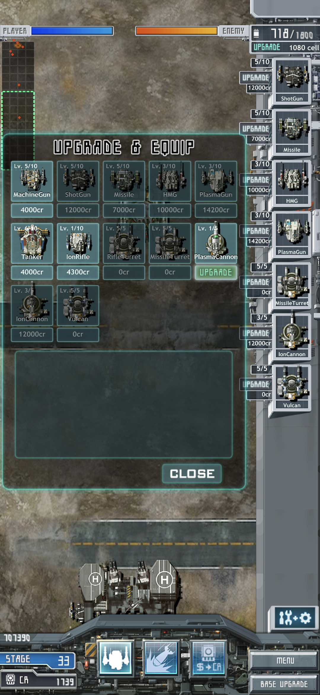

# Android 구현과 아이폰 저장 이전 — 2026-11-06

`develop`의 `5bc233e`에서 `feat/android-native`를 만들었다. 별도 worktree에서 작업했다. 기존 `fix/hud-title-presentation` 작업과 미커밋 문서는 원래 checkout에 보존했다. develop/main 병합과 원격 배포는 수행하지 않았다.

## 구현 범위

[Android 프로젝트](../../Android/README.md)는 기존 C++ Core와 Audio를 그대로 링크한다. 탄도·피해·유닛 이동·생산·경제·강화·해금·저장·메뉴·HUD·긴급지원은 같은 소스다. 새 플랫폼 코드는 EGL/OpenGL ES 1.1 출력, AAssetManager 자원 접근, 터치 전달, Surface/Activity 생명주기, 오디오 포커스, MediaPlayer 음악과 파일 저장을 담당한다.

게임 UI는 기존 Frame의 스프라이트·메시와 입력을 쓴다. Android UI는 프로필 이름 입력창에만 사용한다. WAV 77개는 초기화 시 PCM 버퍼에 올리고 재사용한다. MP3 음악은 MediaPlayer가 담당한다. 전투 갱신은 Choreographer에서 최대 1회씩 실행하며 늦은 프레임을 누적해 재실행하지 않는다. 저장은 원래 GameSession의 저장 지점에서만 요청한다.

[보존 기준](../../Android/protected-baseline.json)의 Apple·Sources·Modules·Resources·Tests·루트 CMake 2,978개 파일은 검사 시 SHA-256이 모두 일치했다. 새 Android 빌드 설정만 기존 타깃을 소비한다. APK에 들어간 자원 1,387개도 저장소 파일과 바이트가 같았다. 원본 패키지는 빌드 입력에 없다.

## 검사

| 환경 | 실행한 검사 | 결과 |
|---|---|---|
| API 36 arm64 에뮬레이터 | 기존 C++ 검사 35개를 NDK로 빌드해 기기 안에서 실행 | 35개 통과, 24.79초 |
| Galaxy SM-S731N, USB | 같은 C++ 검사 35개 | 35개 통과, 46.35초 |
| 양쪽 치트 APK | 생산, 메뉴 정지/재개, 기지·유닛 강화창, 긴급지원 수령, 승리, 다음 미션, 패배, 재도전 | 환경별 13개 실행 검사 통과 |
| 양쪽 치트 APK | 오디오 포커스 조건 주입 5회, 실제 홈 왕복 3회, EGL 컨텍스트 재생성 | 게임 상태·일시정지·효과음 샘플 진행 확인 |
| 양쪽 치트 APK | Activity destroy/recreate | 동일 월드 유지, 일시정지, 저장 쓰기 증가 없음. Galaxy 실제 RESUME·효과음 재생 확인 |
| 에뮬레이터 치트 APK | 80개 미션 진입·자원 로딩·실제 렌더 | 80개 통과 |
| 양쪽 일반 APK | 아이폰 저장으로 프로필·미션 선택·Stage 33 진입 | 실행 확인 |
| Galaxy 일반 APK | 12종 장비의 강화 표시, 생산 HUD, 재실행 후 저장 읽기 | 원본 저장의 진행·자금·점수·해금·강화·잔량 일치 |

C++ 검사는 80개 캠페인 진행·승패·보상·저장, 강화·생산·무장·경제·게임 UI 계약을 포함한다. APK 80미션 검사는 각 미션의 진입과 렌더 검사다. 80개 미션을 사람이 끝까지 플레이한 결과는 아니다. 효과음 검사는 호출 횟수에 더해 OpenAL 소스 재생 위치가 진행하는지 확인했다. 출력음을 녹음해 원작과 대조하는 과제는 남아 있다.

### Galaxy 전투 측정

디버거 없이 치트 APK를 약 65초 실행했다. 미션 2에서 아군 생산과 적 교전을 진행했다.

| 지표 | 중앙값 | 95백분위 | 99백분위 | 최대 |
|---|---:|---:|---:|---:|
| 프레임 간격(ms) | 16.672 | 16.749 | 16.850 | 33.372 |
| 게임 갱신(ms) | 0.499 | 0.652 | 0.757 | 2.043 |
| 그리기 명령(ms) | 2.708 | 3.105 | 3.238 | 19.129 |
| 버퍼 교체(ms) | 1.461 | 1.731 | 1.967 | 3.250 |

3,935프레임 중 25ms 초과는 1회였다. 효과음 1,230회, 새 텍스처 업로드 5회, 게임 저장 쓰기 0회였다. Native Heap 사용량은 39.12MiB에서 39.17MiB로 변했고 전체 PSS는 152.2MiB에서 139.6MiB로 줄었다. 이 측정은 짧은 전투 구간이며 장시간 발열·누수 검사는 후속 과제다.

## 아이폰에서 Galaxy 일반 앱으로 저장 이전

사용자 지시로 아이폰 일반 앱의 저장을 읽어 로컬에 백업했다. 아이폰 앱과 저장은 변경하지 않았다. Android 대상 저장도 먼저 백업했다. 42,496바이트를 Galaxy 일반 앱에 넣고 다시 읽어 전체 일치를 확인했다.

- 완료 미션 32개, 다음 진입 미션 Stage 33.
- 크레딧 1,739, 누적 점수 707,390.
- 생산 유닛 12종. 장착된 7종의 순서와 모든 강화 단계를 보존했다.
- 특수기술 5종. 강화 단계·장착 여부·남은 횟수를 보존했다.
- Base Upgrade 6항목과 미션별 클리어 횟수를 보존했다.

일반 앱에서 Stage 33에 진입해 생산·장비 창을 확인했다. 종료 후 읽은 저장을 기존 C++ SaveData로 해석해 위 항목 전체가 같은지 대조했다. 재실행 프로필도 확인했다. 검사 뒤 Galaxy 저장을 처음 복사한 아이폰 바이트로 다시 맞췄다. 최신 APK 재설치·타이틀 실행·종료 후에도 같은 바이트임을 확인했다. 작업 전후 아이폰 저장도 같은 해시임을 확인했다. 실제 사용자 저장 파일과 상세 프로필 원문은 Git에 넣지 않는다.

### Galaxy 일반 앱 화면

## Android 어댑터에서 고친 문제

1. 최초 실행에서 DecorView 생성 전에 insetsController를 조회해 예외가 났다. DecorView 생성 뒤 시스템 바를 숨기도록 순서를 고쳤다.
2. OpenAL Soft의 OpenSL ES backend가 stop에서 ring buffer를 해제하고 다음 start에서 그 포인터를 사용했다. 중단·재개 시 null 접근이 났다. Android 빌드용 사본에서 buffer 객체를 유지하고 읽기·쓰기 위치만 초기화했다. 원본 파일 해시를 확인하고 해당 한 지점만 바꾸며 Apple이 쓰는 소스는 그대로 뒀다.
3. Android 이미지 크기 조회가 `DummyParts.png` 부재를 오류로 처리했다. 이 이름은 화면에 그리지 않는 부품 연결점이며 Apple은 크기 0을 반환한다. 같은 규칙으로 맞췄다. 오류 처리 중 두 번째 예외가 JNI 밖으로 나가지 않도록 예외 경계도 고쳤다.

## 근거와 재실행

로컬 `.local/`에 빌드 로그, NDK 검사 결과, 기기별 app-checks, frame-audit.csv, 메모리 덤프, 스크린샷, 저장 전후와 해시를 보관했다. 일반 APK에는 TestReceiver가 없고 치트 APK에만 있다. 두 APK의 zipalign 16KB 검사가 통과했다. APK 해시는 `apk-audit.json`에 있다.

- [Android 빌드·도구](../../Android/README.md)
- [현재 상태](../current-status.md), [TODO](../usability-todo.md), [트러블슈팅](../troubleshooting.md)
- [Android MediaPlayer 상태](https://developer.android.com/media/platform/mediaplayer/state-resources)
- [Choreographer](https://developer.android.com/reference/android/view/Choreographer)
- [16KB 페이지 지원](https://developer.android.com/guide/practices/page-sizes)

## 남은 일

- 기존 공통 게임 과제: 길찾기, 생산 HUD 7개 제한·순서, 오른쪽 HUD·타이틀 그림, 강화 상한 확장, 사용자용 복원 코드.
- Android 후속: 장시간 발열·메모리, 실제 녹음 비교, 알람·통화에 의한 실제 오디오 포커스 중단, 더 많은 OS/기기와 두 세로 방향 검사, 무선 ADB 연결 확인, 공개 배포용 서명·버전 정책.
- 무선 ADB 검색에서는 서비스를 찾지 못했다. 이번 설치·실기기 검사는 USB로 수행했다.

## 사용자 플레이 확인

2026-11-06 사용자는 Galaxy 일반 앱에서 첫 미션 시작과 클리어에 문제가 없었다고 확인했다.
