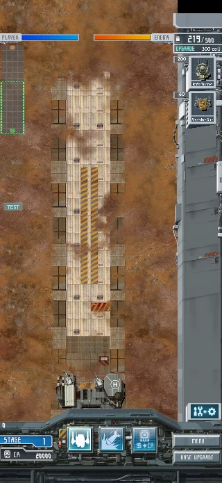
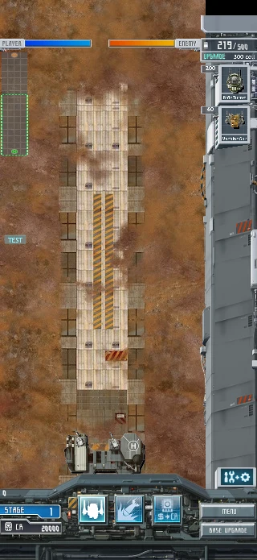
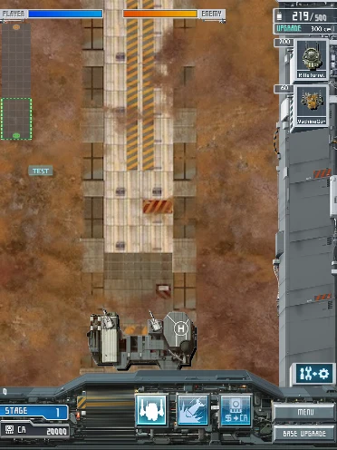
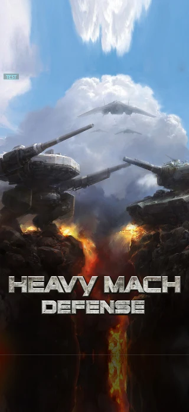
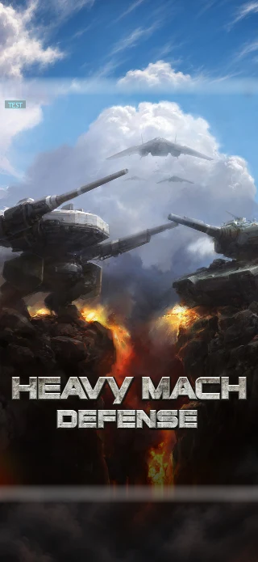
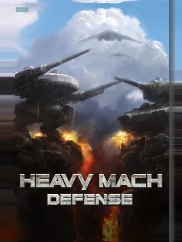

# 오른쪽 HUD·타이틀 수정 — 2026-11-05

## 브랜치와 범위

모듈화·오디오 수정·반복 긴급지원은 `feat/emergency-resupply` → `refactor/shared-core-audio` → `develop` 순서로 병합했다. 원격 develop은 `5bc233e`다. 병합 전 원격 develop/main의 추가 커밋이 없음을 확인했다. 병합 후 Sources·Resources·Modules·Apple·CMakeLists.txt는 모듈화 브랜치와 같았다.

화면 수정은 develop에서 분기한 `fix/hud-title-presentation`에서 했다. main과 기기의 설치 앱은 변경하지 않았다. 화면 밖 적 반격은 사용자 지시로 보류했다. 한 줄 복원 코드는 [MD-SAVE-CODE-01](../usability-todo.md#md-save-code-01--한-줄-복원-코드)에 기록했다.

## 오른쪽 HUD

긴 화면에서 `GameUI_MachSlot.png`의 아래쪽 128픽셀을 반복했다. 이 부분은 원본의 평평한 회색 꼬리여서 iPhone의 추가 높이를 채울 때 입체감이 사라졌다.

원본 이미지를 헤더·입체 금속 몸통·하단 연결부로 나눴다. 헤더와 하단은 원래 크기를 유지하고, 긴 화면에서는 몸통의 세로 길이만 늘린다. 명암·경사 테두리·볼트는 원본 이미지에서 가져온다. 생산 아이콘·글자·버튼·터치 좌표는 늘리지 않는다. iPad와 원본 320×480 조건의 기존 표시도 유지한다.

## 타이틀

이전 코드는 원본 가장자리 1픽셀을 옆으로 늘리고 구름·불꽃을 반사해 위아래를 채웠다. 새 코드는 `TitleOutpaint.png`의 바깥 풍경을 사용한다. 중앙 320×480에는 원래 `Title.jpg`를 그대로 그린다. 원본 로고와 Tap to Start 버튼도 유지한다.

첫 두 생성 시안은 중앙 그림의 크기와 색을 바꿔 실제 합성에서 경계가 드러났다. 게임 렌더러로 원본의 위치를 고정한 참고 화면을 만든 뒤 바깥 풍경을 다시 생성했다. 생성 이미지의 중앙과 글자는 사용하지 않는다. 경계 바깥에만 위아래 최대 24, 좌우 최대 4 논리 픽셀의 색 혼합을 적용했다. 원본 파일·프레임 안쪽 픽셀은 바꾸지 않는다. 생성 도구·프롬프트·해시는 [자원 기록](../../Resources/Generated/TitleOutpaint.json)에 있다.

## 검사 결과

| 검사 | 결과 |
|---|---|
| Menu·GameHUD·GameSession C++ 검사 | 3개 통과 |
| iPhone Air 시뮬레이터의 GPU 화면·입력 검사 | 통과. 이후 가장자리 크롭 조정은 아래 최종 iPad 실행에서 같은 iPhone 화면 조건으로 재검사 |
| iPad Air 11 시뮬레이터 최종 GPU 화면·입력 검사 | 통과. 원본·iPhone·iPhone Air·iPad Air·iPad 5개 화면 조건 |
| 타이틀·슬롯·미션·게임·강화창·맵 상단 | 조건별 GPU 캡처, 30장 |
| 생산·포탑 배치·메뉴·재개·강화 구매·닫기·레이더·복귀 | 5개 화면 조건에서 통과 |
| 화면 크기별 600틱 전투·저장·난수 상태 | 동일 |
| 원본 320×480 타이틀·전투 화면 | 수정 전후 모든 픽셀 동일 |
| iPhone Air·iPad Air 타이틀 중앙 원본 영역 | 경계 1픽셀 안쪽 비교에서 변경 픽셀 0개 |
| 타이틀 120틱 갱신·슬롯 화면 전환 | 메시 개수 증가 없음, 슬롯 진입 뒤 타이틀 메시 제거 |
| 정식 앱 Release 시뮬레이터 빌드 | 성공 |
| 모듈 경계·문서 참조 검사 | 통과 |

Mac 창 목록이 도구에 나오지 않아 이번에는 직접 마우스 클릭 검사를 하지 못했다. 입력 검사는 실제 게임 터치 처리로 실행했다. 실제 iPhone·iPad 설치와 사용자의 그림 확인은 아직 하지 않았다.

## 수정 전후

### iPhone 오른쪽 HUD

수정 전:

수정 후:

### iPad 오른쪽 HUD

### iPhone 타이틀

수정 전:

수정 후:

### iPad 타이틀

수정 전:

수정 후:

로컬 원본 캡처·로그: `.local/hud-title-20261105/`. 보고서의 WebP는 크기를 줄인 표시용이며 픽셀 대조에는 원본 PNG를 사용했다.
