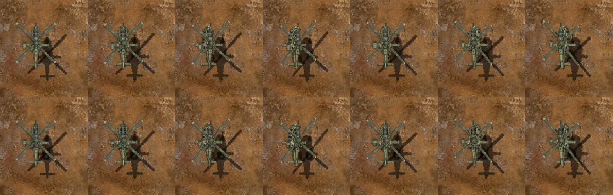
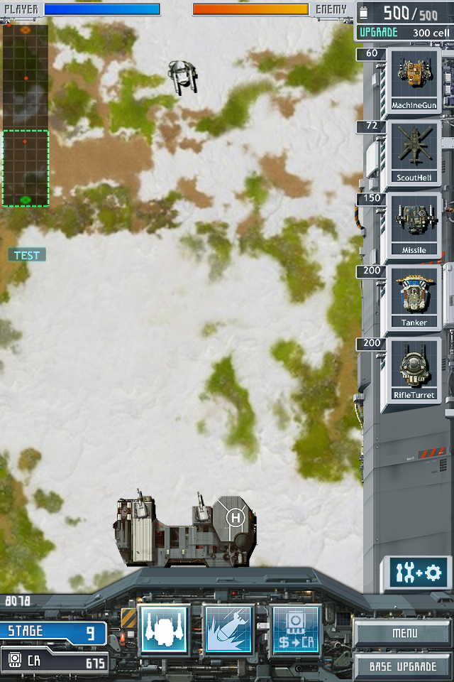
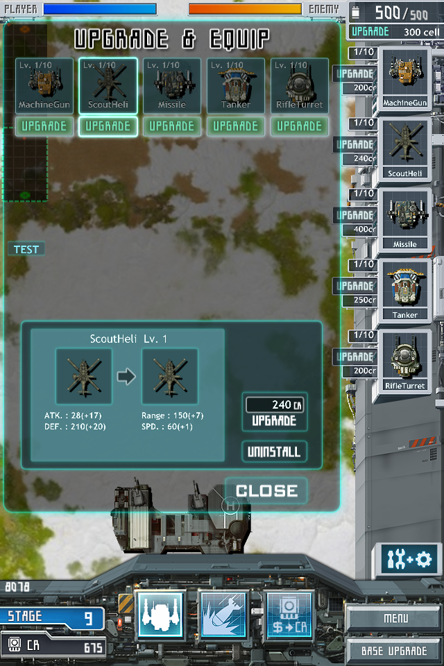

# 스카웃 기본 장갑과 무장 하우징

2026-11-09. 기준 `10ae41c`에 스카웃 Lv.1 장갑 한 개와 기관포·미사일 후방 하우징을 연결했다. 기본 기체와 `AircraftLight_01`이 같은 새 그림을 사용한다. Lv.2–10의 그림과 위치, 원작 유닛, 이동·선회·회피·무장 수치는 보존했다.

장갑은 16×17 셀의 7자세 시트다. 기존 몸체 위에 두 장갑 면과 연결부를 올리고 로터 아래에서 표시한다. 기관포 14×7·미사일 13×8은 후방 하우징을 바꿨다. 몸체·로터 PNG와 무장 전방 픽셀·알파는 그대로다. [준비 그림·출처·선회 등록](../../Art/Aircraft/upgrades-20261109/scout/base-README.md).

준비 PNG 세 개를 기존 Apple PNG 최적화 경로로 CgBI로 포장했다. MCB와 PartsList·TileList를 통해 공통 조립과 렌더러가 읽는다. 레벨별 명시 이미지가 기본 무장 텍스처를 우선하도록 생성기를 수정해 기존 Lv.2–10 그림을 보존했다. 제품 C++ 소스는 수정하지 않았다.

## 실제 화면

아래 위 행은 기준, 아래 행은 적용본이다. 왼쪽부터 정면·좌우 선회 7자세다. 동일 웹 실행 코드와 900×900 화면에서 스카웃 영역만 잘랐다.

중앙의 짧은 밝은 모서리와 어두운 접합부, 후방 하우징이 표시된다. 로터 중심은 기존처럼 장갑 위를 지난다. 생산·획득·강화 화면에서 새 세 이미지의 실제 소비를 확인했다. 아래는 생산 화면과 Lv.1→2 강화 비교다.

## 검사 결과와 범위

- [코어 10검사](scout-base-surface-20261109/core.json): 40레벨 조립·무장, 240자세, AH-10 고정 무장 총구 1,260조건, 접근·회피·전투·캠페인 검사가 통과했다. 초기 검사에서는 기본 스카웃 노드·스프라이트 개수가 이전 값으로 남아 실패했다. 장갑 한 개와 그림자 한 개의 실제 추가량으로 기대값을 수정했다. [초기 실패](scout-base-surface-20261109/initial-core.json).
- [보존 대조](scout-base-surface-20261109/preservation.json): 기존 파일 2,762개를 대조했다. 제품 소스와 모든 기존 이미지, 스카웃 Lv.2–10 준비 그림, 나머지 39레벨 명세, 스카웃 이외 표 행이 같다. 새 CgBI 무장의 전방 픽셀과 전체 알파도 기존 CgBI와 같다.
- [웹 화면 비교](scout-base-surface-20261109/pixel-comparison.json): Chrome·WebKit 각 70화면을 검사했다. Lv.2–10은 기준과 전체 픽셀이 같다. Lv.1은 7자세 모두 375–451픽셀이 바뀌었고 스카웃 바깥 차이는 0이다. 두 브라우저 화면 차이도 0이다. 기준·적용본 WASM 해시가 같다.
- [웹 소비·전투](scout-base-surface-20261109/web-summary.json): 두 브라우저에서 각각 획득·생산·강화 8상태, 4기체×10레벨 실제 전투를 확인했다. 준비 후 반복 텍스처 업로드와 전투 중 저장 쓰기는 0이었다. 기존 오디오 컨텍스트 2개가 유지됐고 반복 생성·종료는 없었다.

새 세 텍스처의 계산상 POT RGBA 메모리는 합계 17KiB다. 기본 스카웃에는 장갑 스프라이트와 그림자가 하나씩 늘었다. 40·100기 부하 관측에서 일부 긴 프레임도 기록됐다. Chrome 40기 플레어 켬의 CPU 호출 p99는 64.7ms, WebKit 100기 플레어 켬의 RAF p99는 72ms였다. 이 관측은 GPU 시간 측정이나 성능 무저하 판정이 아니다. 전체 성능 조사는 별도 기록과 대조한다.

이 작업은 스카웃 기본 표면 연결이다. 다른 기체의 후속 장갑 작업, 아이폰 설치 또는 운영 배포를 이 검사로 완료 처리하지 않는다.
