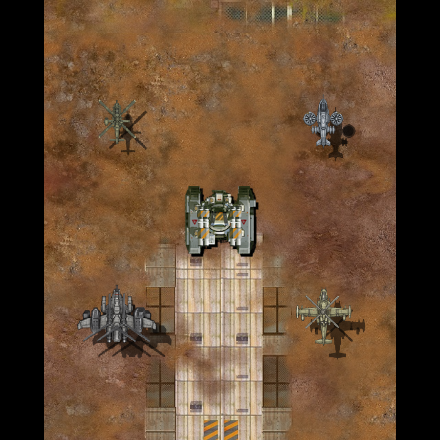
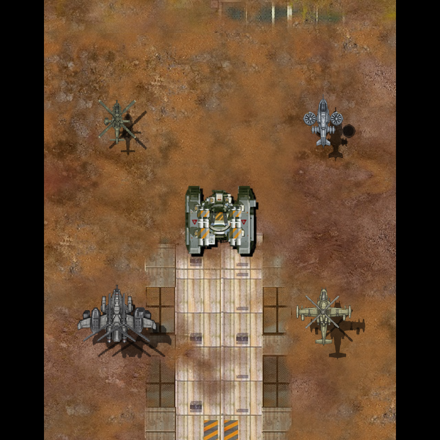
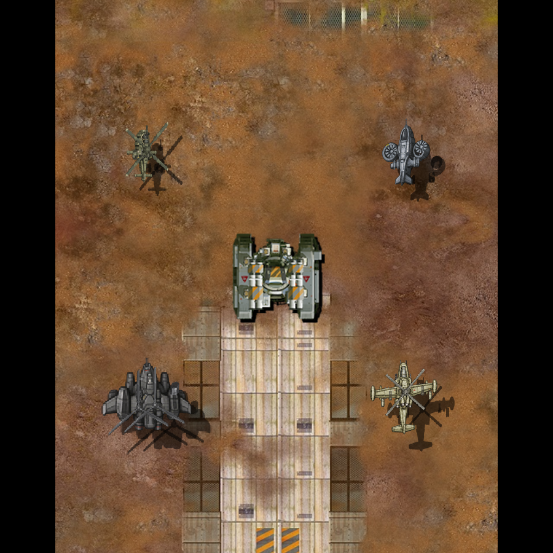

# 스카웃 레벨별 파츠

2026-11-09. 스카웃 Lv.2–10에 장갑 덮개 9종과 기관총·미사일 하우징 18개를 연결했다. 각 덮개에는 정면과 좌우 6자세가 있다. Lv.1은 기존 그림과 조립을 유지한다. 강화 단계의 몸체·무장 구조를 바꾸며 전체 크기나 주색 변경으로 단계를 구분하지 않는다.

## 실제 연결

[작성 정의](../../Art/Aircraft/runtime/assembly.json)의 9개 레벨 조립이 해당 덮개를 직접 참조한다. 기존 기관총·미사일 별칭과 무장 수치를 유지하고 각 레벨 그림만 선택한다. [자원 준비 도구](../../tools/prepare_aircraft_upgrades.py)는 게임 크기의 그림을 변경 없이 CgBI로 준비한다. 기존 MCB·파츠 표·타일 표·공통 조립과 그림자 경로를 사용한다.

기본 스카웃은 표시 파츠 4개, Lv.2–10은 5개다. 로터·동체·포신·발사관·총구·기체 크기와 기존 움직임은 보존한다. 새 장갑은 서로 다른 판·틈·보강대·밝은 모서리로 묘사했다. 이번 변경에는 다른 세 기체의 강화 외형과 네 기체의 기본 표면 개선이 포함되지 않는다.

## 배치와 보존 검사

제작용 비교는 몸체의 위 45행을 사용했지만 실제 몸체 높이는 47픽셀이다. 이 차이를 대조하는 과정에서 덮개의 실제 위치가 제작 기준보다 1픽셀 아래임을 발견했다. 덮개의 연결점을 수정하고 실제 PartPose·appendSprites에서 제작 기준의 시작점 (25,14)과 일치시켰다. [63자세 등록 대조](scout-upgrades-20261109/scout-cover-registration-check.json).

[코어 6검사](scout-upgrades-20261109/scout-final-core-tests.log)가 통과했다. 기존 총구·조립 좌표, 실제 덮개 표시·선회 타일, 무장·발사 효과·회피·기수 회전을 검사했다. [보존 대조](scout-upgrades-20261109/scout-final-preservation.json)에서 기존 PNG 변경은 0이고 기존 파츠 정의 133개는 바이트가 같다. 기체 정의 변경은 스카웃 Lv.2–10의 9개다. 원작 표 구간도 그대로다.

소비 감사는 기본 기체뿐 아니라 레벨별 기체까지 합친 44개를 읽도록 수정했다. 레벨에서만 쓰는 정상 파츠를 미사용으로 잘못 분류하지 않는다. 실제로 어느 조립에서도 쓰지 않는 정의를 남긴 검사 사례로 이 차이를 확인했다. [전체 소비 결과](scout-upgrades-20261109/scout-final-consumption.json).

새 텍스처 27개의 POT RGBA 크기는 합계 153KiB다. 강화 스카웃 한 기마다 그림자 포함 제출이 2개 늘어난다. 기존 무장 2개는 그림만 교체하므로 노드가 늘지 않는다. 이 계산을 GPU 성능 측정으로 취급하지 않는다.

캠페인 검사의 기존 실행 파일에는 이전 실행 중 복제 코드가 남아 있어 첫 실행이 `Duplicate machine variant`로 실패했다. 현재 소스로 해당 실행 파일을 다시 빌드한 뒤 [캠페인 검사](scout-upgrades-20261109/scout-campaign-current.log)가 통과했다. 최초 실패 로그도 보존했다. 제품 코드를 바꿔 실패를 숨기지 않았다.

## 웹 확인

Chrome·WebKit에서 각각 10레벨×7자세와 4종×10레벨 전투를 실행했다. [140장 보존 대조](scout-upgrades-20261109/scout-web-preservation.json)에서 Lv.1 14장은 기준과 전체 픽셀이 같고, 모든 화면에서 스카웃 영역 밖 픽셀 차이는 0이다. 두 브라우저 모두 신규 그림 27개를 실제로 읽었다. 준비 뒤 70자세를 다시 전환할 때 추가 텍스처 업로드는 0이었다. [웹 패키지 33개 항목](scout-upgrades-20261109/scout-web-package.json)이 최종 Resources와 같다.

위 그림은 같은 웹 검사 장면이며 사용자 아이폰 캡처가 아니다. 웹 생산·강화 UI 아이콘을 따로 연 검사는 아직 하지 않았다. 새 강화 파츠의 GPU 비용 계측은 최종 4종 비교에 포함한다. 게임 main·운영 PWA·아이폰에는 이번 변경을 배포하지 않았다.
