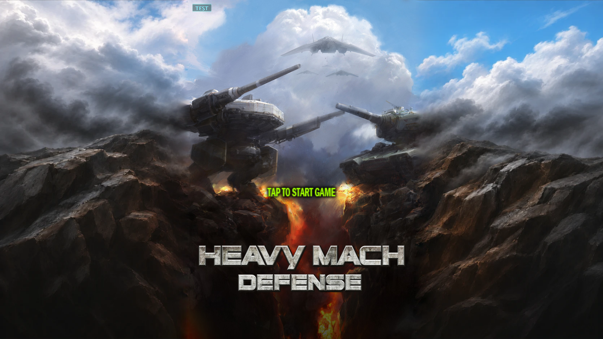
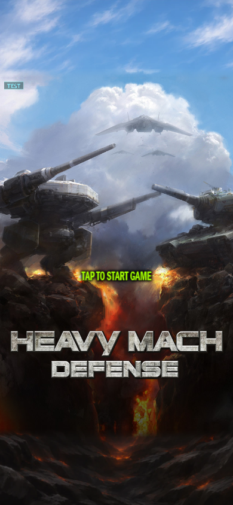

# 채택 타이틀의 공통 게임 화면 적용

2026-11-10. [사용자가 채택한 가로·세로 시안](../research/title-joins-20261110.md)을 공통 `Menu`에 연결했다. 좌우 1픽셀 늘이기와 상하 반전 채우기를 제거했다. 원본 `Title.jpg`는 바꾸지 않았으며 중앙에 전체 비율로 표시한다. 원본 유닛·헬기 소스와 에셋은 변경하지 않았다.

## 준비와 소비

승인 보고서의 실제 WebP 입력과 Canvas 합성 코드를 [준비 도구](../../tools/prepare_title_art.mjs)에서 재사용했다. 가로 1600×900 합성 영역을 픽셀 그대로 보존하고, 더 넓은 화면에 필요한 자연물만 양옆에 추가해 3200×900으로 준비했다. 세로는 승인된 390×844 배치다. Apple `pngcrush -iphone -f 0`을 적용했고 최적화 전후 RGBA가 같다. [자원 명세](../../Art/Title/20261110/runtime-art.json).

게임은 `Resources/Generated/Title`의 원본 사각형 바깥만 읽는다. 중앙은 원본 JPEG에서 그린다. 색 연결은 준비 PNG에 들어 있으며 매 프레임 픽셀 계산·이미지 업로드·파일 기록을 하지 않는다. 같은 Frame과 자원 폴더를 Apple·Android·Web이 소비한다. 타이틀만 전체 화면에 맞추고 프로필 이후에는 기존 안전 영역과 입력 배치를 유지한다.

첫 게임 검사에서 투명 POT 패딩을 샘플링하는 1픽셀 검은 선을 확인했다. 원본 사각형을 3×3로 나눠 바깥 반 텍셀만 끝 픽셀에 고정했다. 내부 좌표·크기는 유지하며 전역 렌더러는 변경하지 않았다. 세로 하단과 가로 오른쪽의 문제 픽셀은 수정 뒤 양옆과 같은 색이다. [수정 전](title-integration-20261110/seam-before.json) · [수정 후](title-integration-20261110/seam-after.json).

## 검사

- [Menu C++ 검사](title-integration-20261110/menu-test.txt): 7개 화면 비율과 비대칭 안전 영역 3조건에서 원본 비례·외곽 소스 영역·수직 정렬·모서리 채움·탭 전환·기존 프로필 배치를 검사했다.
- [Chrome](title-integration-20261110/chromium.json) · [WebKit](title-integration-20261110/webkit.json): 각각 320×480, 390×844, 820×1180, 1280×800, 1600×900, 3440×1440에서 게임 타이틀·슬롯 진입을 확인했다. 저장 쓰기와 페이지 오류는 0이다. 검은 선 회귀 지점의 인접 RGB 차이는 0이다.
- [독립 픽셀 대조](title-integration-20261110/approved-pixels.json): 승인 보고서 합성과 준비 가로의 중앙 1600×900이 같다. CgBI 변환 전후도 같다. [초광폭 게임 화면](title-integration-20261110/ultrawide.png)에서 원본과 인접 벼랑·구름의 수직 정렬을 확인했다.
- [원본·변경 소스 해시](title-integration-20261110/source-hashes.json). 원본 JPEG 두 경로는 기존 `50ce101b…`와 같다.

이 기록은 공통 코드·준비 자원과 로컬 웹 치트 검사 결과다. 정식 앱 설치·원격 병합·운영 배포 여부는 릴리즈 기록에서 구분한다. 실제 기기 전체의 프레임 성능이나 무충돌을 이 검사로 보증하지 않는다.
