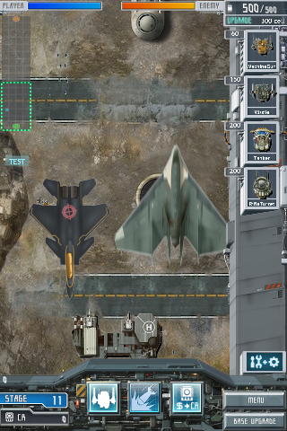

# 적 공습기를 만든 이유

<!-- language-nav:start -->
[한국어](enemy-air-raids.md) | [English](../en/public/enemy-air-raids.md)
<!-- language-nav:end -->

## 달빛과 럭스루나에

HeavyMach 1 복원 작업을 시작한 글쓴이는 바이크로 전국을 돌며 낯선 밤길을 달린 뒤 달빛이 개인적인 상징이 됐다고 썼다. 글쓴이에게 원작 HeavyMach는 개발자가 되는 데 영향을 준 작품이었고, 에이스컴뱃 8은 어려운 시기에 출시를 기다리고 싶은 이유가 됐다. 라틴어로 달빛을 뜻하는 럭스루나에는 두 기억을 이어 주었다. HeavyMach 1 복원판의 F-22·Su-57·MiG-31에는 검은 동체와 금색 장식뿐 아니라, 직접 상대했을 때의 위협과 긴장을 담고자 했다. [HeavyMach 1 원고 「왜 럭스루나에인가」](https://github.com/gelb2/HeavyMach/blob/e6be24957d8ca12db6c9e2846b41fee88c800fcc/docs/public/lux-lunae-intent-20261028.md).

MachDefense에서는 그 도장을 적 공습기에 이어 썼다. 플레이어에게 익숙한 아군 공습의 진입, 투하, 폭발이 적 진영에서 돌아오는 장면이다. 검은 동체, 금색 선과 조종석은 작은 전투 화면에서도 양쪽 기체를 구별할 수 있게 한다. 옆에서 보기 익숙한 공습이 이번에는 내 메크를 향한다는 사실은 표적 위에 뜨는 빨간 조준점으로 알린다.

## F-15 STOL/MTD와 9번 시안

F-15E 계열을 출발점으로 잡고 F-15 STOL/MTD 실험기의 형상을 적용했다. 위에서 봤을 때 조종석 뒤의 카나드, 가늘고 긴 복좌 캐노피, 주익과 수평 꼬리날개 사이의 틈, 사각형 배기 노즐이 드러나도록 했다. HeavyMach 1의 채택 그림은 도장 배치에, MachDefense의 아군 공습기 그림은 작은 크기에서 읽히는 명암과 가장자리 질감에 사용했다.

초기 시안에서는 동체가 회녹색으로 보였고 게임 크기에서 금색 선과 조종석이 흐렸다. 검은색과 금색이 화면에서 읽히도록 수정하고, 형상·도장·조종석을 함께 비교해 9번을 채택했다. 이후 사용자가 상판이 합판처럼 겹쳐 보인다고 지적했다. 최종 편집에서는 승인한 외곽과 금색 위치를 유지하고, 상판만 현용 기체에 도료를 칠한 듯 부드럽게 이어지는 무광 표면으로 다듬었다. [채택 시안과 편집 지시](../../Art/EnemyAirStrike/README.md) · [시안별 비교와 게임 적용](../research/enemy-airstrike-art-20261127.md).

## 언제 공습하는가

1~10스테이지에는 적 공습이 없다. 11~80스테이지는 전투 시간 60초에 첫 회차를 열고, 다음 회차까지 20~45초 간격을 둔다. 회차마다 1·2·3대를 같은 확률로 뽑아 시각과 함께 표에 적어 두었다. 2·3대가 배정되면 1.5초 간격으로 한 대씩 들어온다. 예를 들어 11스테이지의 두 번째 회차에는 81초, 82.5초, 84초에 한 대씩 들어온다. [출격표](../../Resources/Tables/EnemyAirRaidSchedule.tsv).

출격할 때마다 살아 있는 아군 메크 중 가장 전방에 있는 기체의 위치를 표적으로 삼는다. 메크가 없으면 그 기체의 출격을 건너뛴다. 조준점은 고정된 표적에 나타난다. 이후 메크가 움직여도 집속탄이 따라가지 않는다. 사전 표를 쓰므로 재도전에서는 같은 시각과 대수를 다시 확인할 수 있다. 전투를 일시정지하면 시계도 멈추고, 전투가 끝나면 남은 출격은 취소한다. [전투 코드](../../Sources/Core/Simulation/WorldCombat.cpp) · [공용 비행과 출격 시각](../../Sources/Core/Simulation/SpecialAttack.cpp).

## 한 대의 집속탄 피해를 어떻게 정했는가

처음에는 집속탄을 모두 맞아도 가장 약한 메크의 체력이 절반 이상 남도록 했다. 후속 조정에서는 사용자가 상한을 **기체 한 대당 최저 최대 체력의 80%**로 정했다. 가장 약한 메크는 사용자의 현재 전투 편성이 아니라 게임에서 출전 가능한 기종·레벨·부품 조합을 기존 최대 체력 계산에 넣어 찾는다. 덕분에 고레벨 편성으로 열어 본 미션과 기본 메크로 다시 도전한 미션에 같은 상한을 적용한다.

최저 최대 체력을 `H`, 스테이지 번호를 `s`라고 하면 `C = floor(4H / 5)`가 기체당 상한이다. 11~80스테이지에서 기체 한 대의 최대 피해는 `floor(C × (69 + s − 11) / 138)`이다. 첫 공습 스테이지는 `C`의 절반에서 시작하고 마지막 스테이지에서 `C`에 도달한다. 현재 가장 약한 메크는 `MachineGun_01`의 300 HP다. 기체당 최대 피해는 11스테이지 120, 80스테이지 240이다.

기체 한 대에 할당한 피해를 기존 집속탄 10발에 나눈다. 나머지는 앞선 탄부터 1씩 더한다. 명중 위치에 따라 실제 피해가 줄어든다. 여러 대가 같은 메크를 노리면 기체마다 피해를 계산하므로 합산 피해는 80%를 넘을 수 있다. [기획과 기준](../game-design.md#적-공습기) · [실제 충돌 검사](../../Tests/WorldSpecialTests.cpp).
