# 플레이 캡처와 짧은 영상

<!-- language-nav:start -->
[한국어](gameplay-gallery.md) | [English](../en/public/gameplay-gallery.md)
<!-- language-nav:end -->

아이폰과 Galaxy에서 직접 플레이하며 찍은 화면이다. 영상은 2026년 11월 6일과 7일 아이폰에서 녹화했다. 원본 영상 두 개는 4분 12초, 4분 16초다. 아래 클립은 재생 속도와 HUD를 포함한 화면 전체를 유지했다.

## 전투 영상

### 포탑 사격과 메크 교전

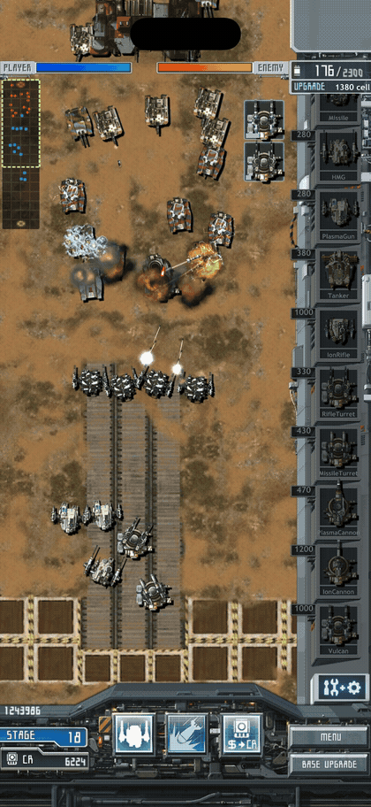

[MP4 영상](media/gameplay-20261107/combat.mp4) · [정지 이미지](media/gameplay-20261107/combat.jpg) · 12s · ScreenRecording_11-07-2026 02-25-50_1.mov: 02:38–02:50

### 특수공격 표적 지정과 미사일 발사

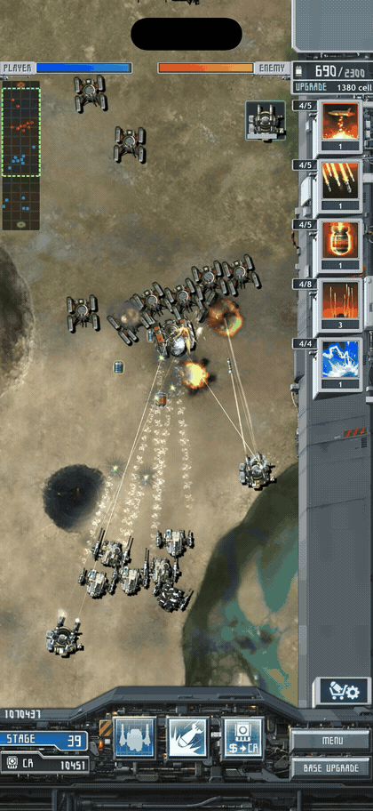

[MP4 영상](media/gameplay-20261107/special-attack.mp4) · [정지 이미지](media/gameplay-20261107/special-attack.jpg) · 10s · ScreenRecording_11-06-2026 09-56-15_1.mov: 03:52–04:02

기존 특수공격을 사용한 장면이다. 별도로 구상한 터치 락온 처치 기능은 아직 구현하지 않았다.

### 긴급지원 수령과 영문 메시지

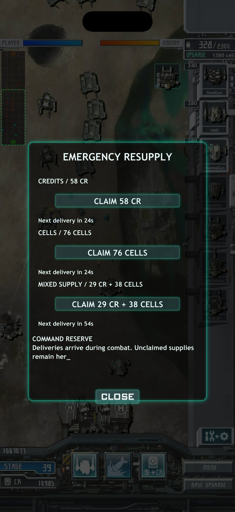

[MP4 영상](media/gameplay-20261107/resupply.mp4) · [정지 이미지](media/gameplay-20261107/resupply.jpg) · 9s · ScreenRecording_11-06-2026 09-56-15_1.mov: 00:40–00:49

## 캡처 모음

### Stage 11: 적 기지 앞 교전

<a href="media/gameplay-20261107/iphone-stage11.jpg">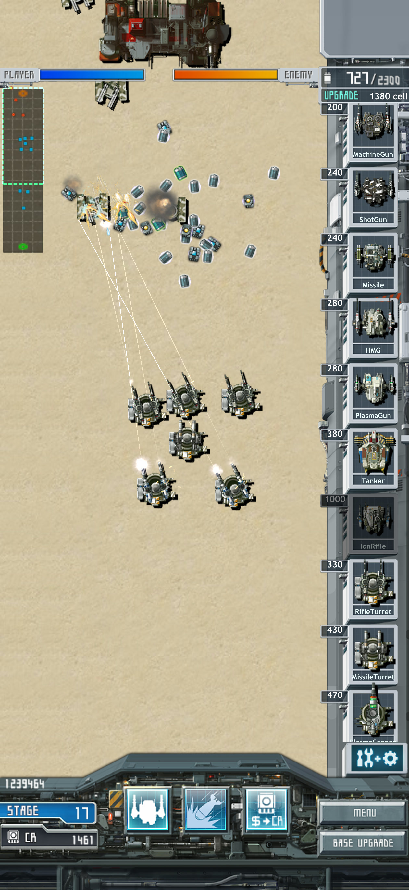</a>

### Stage 23: 포탑과 메크의 교전

<a href="media/gameplay-20261107/iphone-stage23.jpg">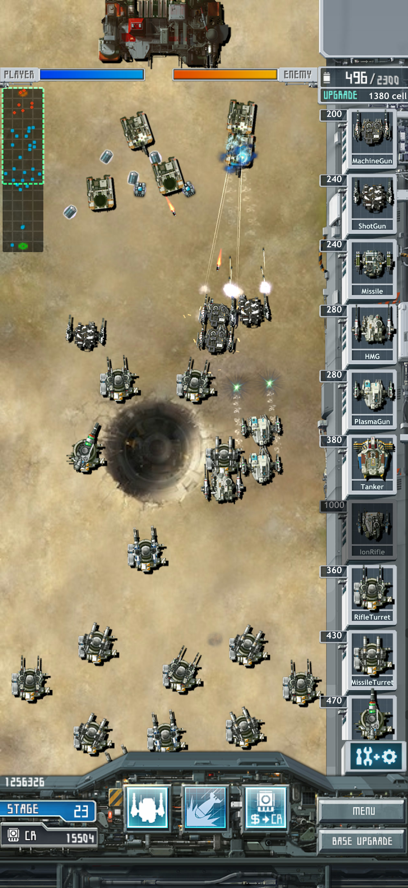</a>

### Stage 46: 긴 구조물 주변의 병력 배치

<a href="media/gameplay-20261107/iphone-stage46.jpg">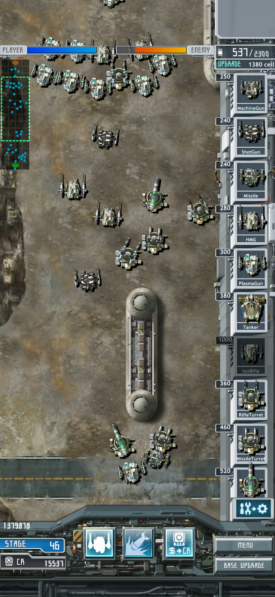</a>

### Stage 40: 여러 무장이 동시에 교전하는 장면

<a href="media/gameplay-20261107/iphone-stage40.jpg">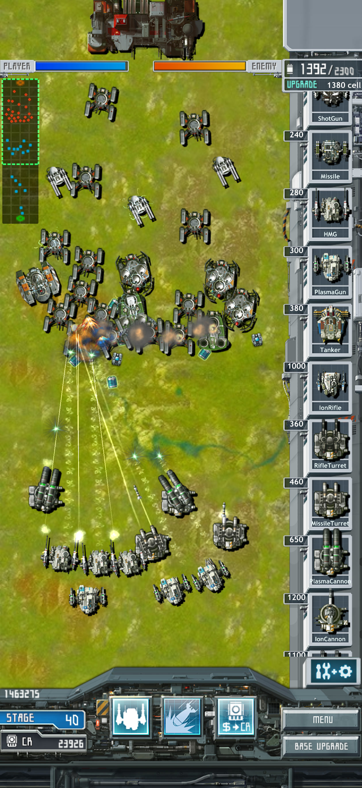</a>

### Galaxy Stage 1: 전장과 생산 목록

<a href="media/gameplay-20261107/android-stage1.jpg">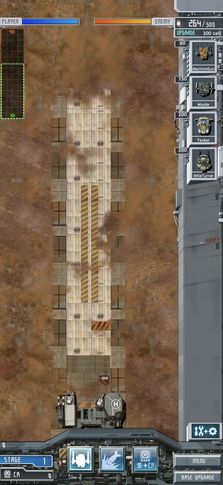</a>

### 장비 강화와 INSTALL·UNINSTALL

<a href="media/gameplay-20261107/upgrade.jpg">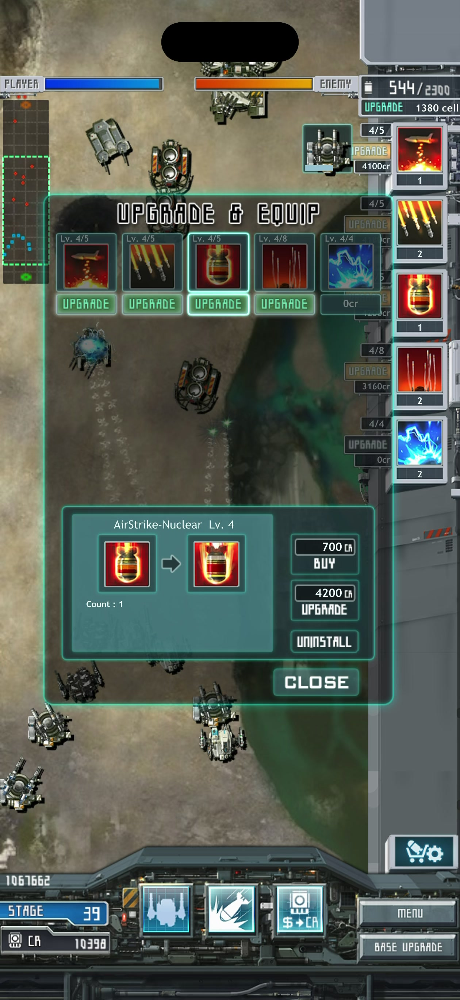</a>

## 문제 제보에 사용한 캡처

제보 당시 화면이다. 아이폰 HUD 덮개는 이후 수정했고, 길찾기 제보는 후속 조사에 남아 있다.

Stage 23: 전투와 당시 HUD 상단 표시

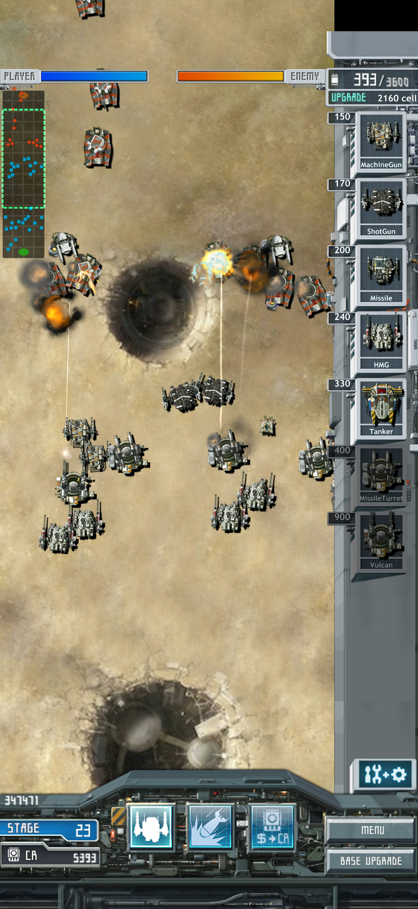

원형 구조물과 유닛 정체 제보

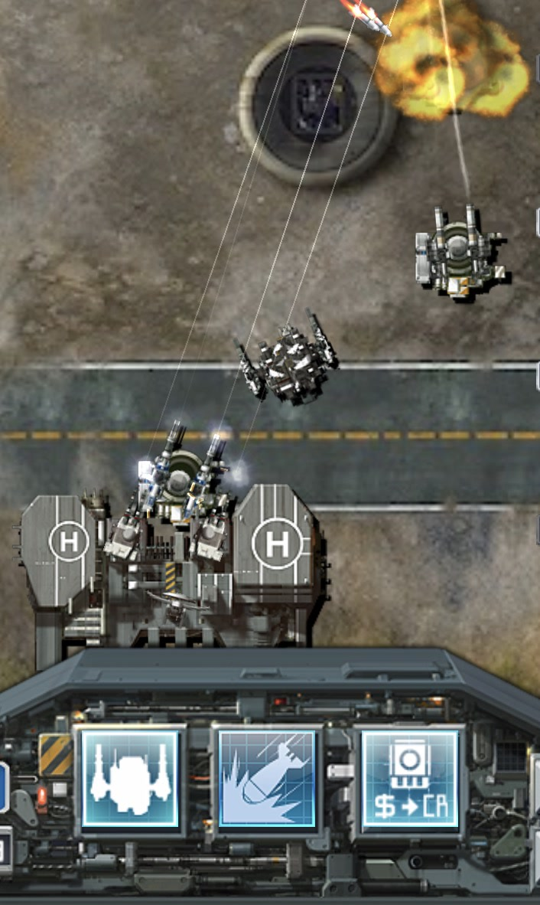

## 파일과 출처

촬영본의 정확한 빌드 번호는 기록되지 않았다. 촬영 당시의 플레이 자료이며 최신 릴리스의 플랫폼 비교 자료로 쓰지 않는다. IMG_1129의 두 파일은 같아서 한 장만 실었다.

[장면 시각·원본 해시·추출 파일](media/gameplay-20261107/scenes.json)

[게임 소개](../../README.md) · [문서 목차](README.md)
