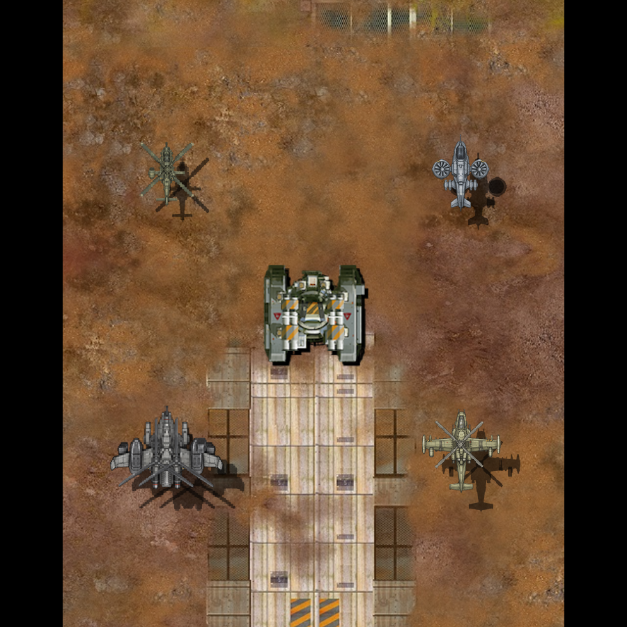
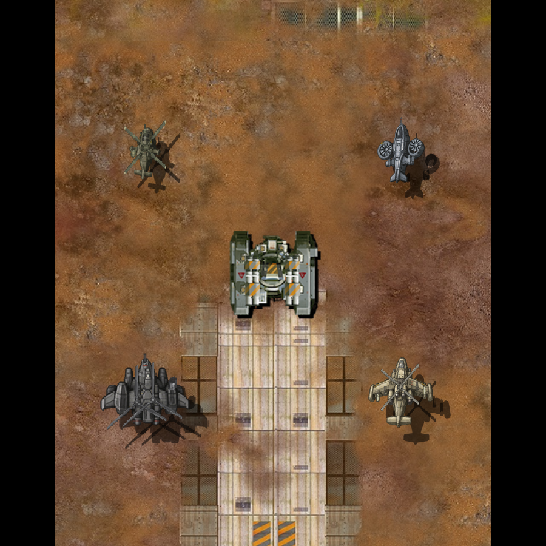
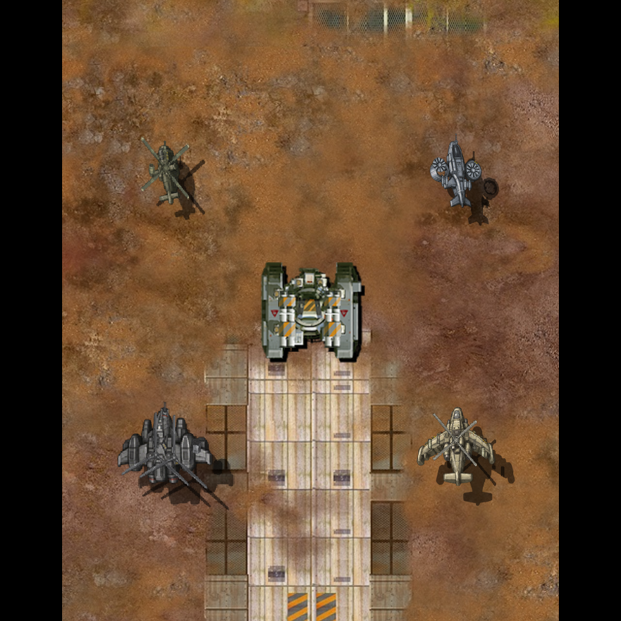

# 헬기 좌우 선회 그림

**후속 결함 — 2026-11-09:** 사용자가 아이폰에서 벨루가 선회 시 날개 모양과 텍스처가 크게 바뀌는 문제를 확인했다. 승인 정면과 각도별 그림의 일관성을 확보하지 못했다. [수정 TODO](../usability-todo.md#md-aircraft-beluga-bank-consistency-01--벨루가-선회-그림의-형상텍스처-불일치)에 기록했다. 아래 기능 검사 결과를 외형 승인이나 결함 해결로 해석하지 않는다.

2026-11-09. 스카웃·샤이엔·벨루가·AH-10의 좌우 선회 그림을 각 6장씩 제작하고 게임에 연결했다. 정면은 기존 승인 그림이다. 기존 정면을 누르는 방식에 더해 새 그림을 다시 누르지 않도록 헬기 몸체의 표시 처리를 바꿨다. 원본 유닛의 이미지·코드·렌더러는 보존했다.

## 그림과 연결

[제작 원본·크롭·균일 배율](../../Art/Aircraft/banking-20261109/manifest.json), [원본 참고 3종과 해시](../../Art/Aircraft/banking-20261109/references.json), [제작 입력과 프롬프트](../../Art/Aircraft/banking-20261109/)를 남겼다. ImageGen으로 새 각도의 측면 장갑·덕트 테두리·날개 두께·가림을 그렸다. 첫 벨루가 시안은 날개가 길어져 적용하지 않았고 다시 제작했다. 생성 결과는 새로운 각도에 대한 그림이며 실제 3D 모델의 정확한 각도 렌더라고 보고하지 않는다.

기체당 7칸짜리 PNG 시트를 사용한다. 첫 칸은 승인 정면 RGBA를 그대로 복사하고, 다음 여섯 칸에는 음의 기울임 3장과 양의 기울임 3장을 넣었다. 원본처럼 MCB의 `tileCount`와 기존 조립·타일 분할 경로로 읽는다. 연결점·층 순서·중앙 위치는 유지했다. 정면 한 칸의 크기는 스카웃 62×39, AH-10 76×112, 샤이엔 110×88, 벨루가 140×131픽셀이다. 투명 여백 추가로 생산 아이콘이나 전장 크기를 바꾸지 않았다.

현재 기울임 입력은 0°, ±8°, ±16°, ±24°의 가까운 단계로 선택한다. 입력 단계 수치와 생성 그림의 정확한 물리적 자세를 혼동하지 않는다. 각 기체의 여섯 그림은 같은 균일 배율로 축소했다. 가로·세로를 따로 늘리지 않았다. 생성 시트에서 알파 16을 넘는 그림 범위에 2픽셀 여유를 붙여 크롭했으며, 크롭 안의 반투명 경계는 유지했다.

[헬기 전용 표시 코드](../../Sources/Core/Simulation/AircraftVisual.hpp)는 몸체의 타일을 선택한다. 몸체 그림과 그림자는 같은 타일을 쓴다. 로터·무장·총구도 같은 기울임 단계를 사용한다. 새 그림 위에 정면을 누르던 변환을 다시 적용하지 않는다. 공통 렌더러나 원본 지상 유닛의 표시 코드는 수정하지 않았다.

## 실제 웹 치트빌드 비교

중앙은 원본 적 탱크, 왼쪽 위는 스카웃, 오른쪽 위는 샤이엔, 왼쪽 아래는 AH-10, 오른쪽 아래는 벨루가다. 실제 World에 배치하고 같은 화면에서 비교했다.

정면 픽셀 보존과 선회 그림 적용을 확인했다. 선회에서 몸체·덕트·날개의 옆면과 다른 가림이 표시된다. 전체 질감과 미감이 원본과 동등하다는 판정이나 사용자 최종 채택을 대신하지 않는다. 벨루가 날개·엔진은 여전히 고정 몸체 그림에 포함되며, AH-10의 로켓·공습 무장은 고정 발사점 노드를 사용한다. 사용하지 않는 별도 부품 파일을 연결한 것으로 보고하지 않는다.

## 검사

- [코어 54개](../evidence/aircraft-repair-20261109/bank-core.txt) 통과. 네 몸체의 7칸, 정면 크기, 단계별 UV, 원래 샘플링 설정과 몸체 재변형 방지 검사를 포함한다.
- [Chrome](../evidence/aircraft-repair-20261109/bank-chrome.json)·[WebKit](../evidence/aircraft-repair-20261109/bank-webkit.json)에서 일곱 단계를 캡처했다. 준비 뒤 140회 전환의 추가 텍스처 업로드는 0회다.
- [실제 전투](../evidence/aircraft-repair-20261109/bank-armament.json)에서 네 기체 Lv.1·10의 발사·피해·회피 효과, 저장 쓰기 0회와 오디오 컨텍스트 추가 생성·종료 없음 조건을 통과했다.
- [원본 보존](../evidence/aircraft-repair-20261109/bank-preservation.json): 보호 파일 2,652개 해시와 원본 유닛 160개 조건의 결과가 그대로다.
- [최적화 PNG 디코드](../evidence/aircraft-repair-20261109/bank-decode.json)와 [정면 도장](../evidence/aircraft-repair-20261109/bank-paint.json)을 검사했다. 7칸 시트도 Apple PNG 최적화 경로를 거친다.

웹 검사 첫 실행에서는 새 빌드 뒤 배포 묶음을 갱신하지 않아 시작 화면을 통과하지 못했다. 묶음을 갱신하고 새 검사 폴더에서 다시 통과했다. 선회 그림 증가에 따른 초기 로딩·GPU 메모리·실기기 프레임 비용은 최종 검사에서 비교한다. 파일 크기를 GPU 메모리나 프레임 비용으로 대체하지 않는다.
