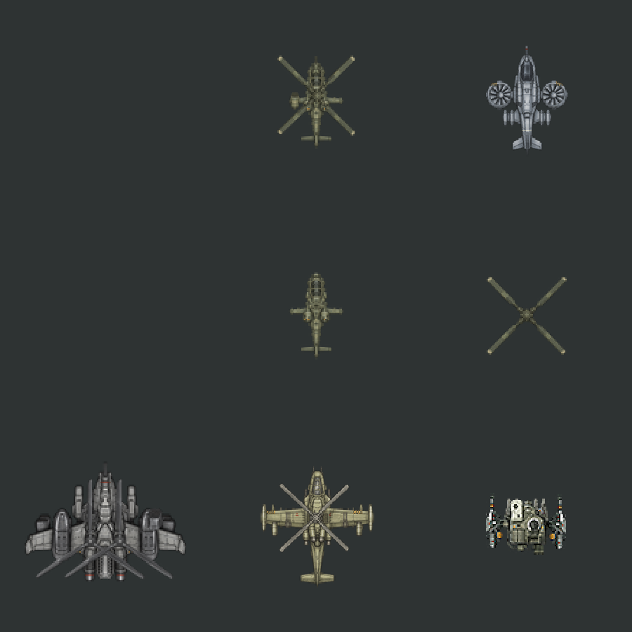
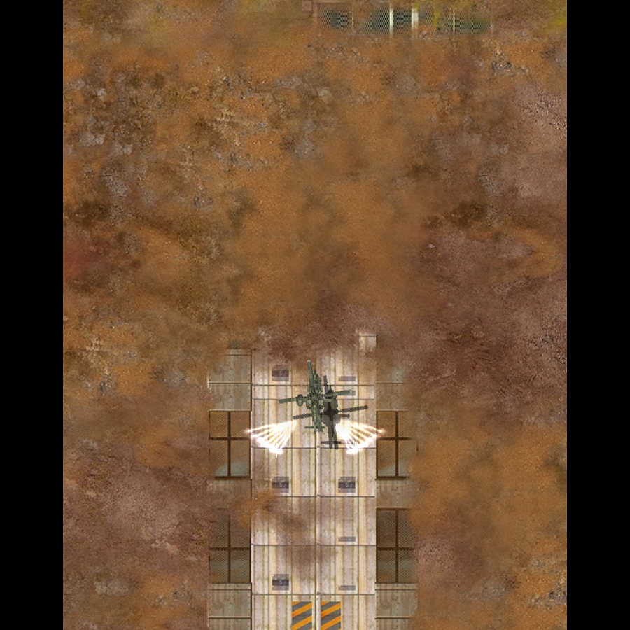

# 헬기 효과·도장과 다음 작업

2026-11-09. 사용자는 아이폰 정식 빌드의 전투감각이 헬기 기획 의도에 약 75% 부합한다고 평가했다. 현재 무장·수치·크기·전투 규칙을 기준으로 보존한다. **헬기 추가를 위해 원작 유닛이 사용하는 코드와 에셋을 수정하지 않는다.** 이번 구현은 채프·플레어와 승인 도장의 적용 방식에 한정한다. 정지·선회·긴급회피 이동은 아래 계획만 작성했으며 구현하지 않았다.

## 채프·플레어

이전 효과의 총 14개는 플레어 6개, 채프 4개, 점화 2개, 연기 2개였다. 실제 긴 궤적은 좌우 3개씩이었다. 수정본은 **플레어 왼쪽 7개·오른쪽 7개**에 기존 보조 효과 8개를 더해 발동당 22개다. 7단계 방출 각도와 짧은 시간차로 부채꼴이 보이도록 했다. 백금색 광점과 기존 저채도 색은 유지했다.

원작 ParticleState·Trail·효과 PNG는 그대로 재사용한다. 헬기 전용 고정 저장 공간은 96→132개로 조정해 기존처럼 완전한 여섯 묶음까지 동시에 표시한다. 용량을 넘는 추가 발동은 시각 효과만 생략한다. 회피 판정·무적·발사·전투 난수는 바꾸지 않는다. DB/파일 기록, 오디오 컨텍스트 생성·폐기, 실행 중 텍스처 재생성은 추가하지 않았다.

## 승인 텍스처·색조 적용

사용자가 실제 아이폰 게임에서 텍스처·색조 미적용을 확인했다. 조사한 소스에는 도장 함수가 Apple·웹·Android 렌더러에 연결돼 있었다. 기존 PNG에는 도장이 없었으며 렌더러가 읽을 때만 색을 처리했다. **기존 설치본에서 미적용으로 보인 원인은 아직 확정하지 못했다.** 함수 연결 확인을 사용자의 실기기 관측에 대한 반증으로 취급하지 않는다.

승인된 주색·도장 계산을 헬기 전용 PNG 28개에 미리 반영했다. 플랫폼에서는 이 PNG를 그대로 읽으며 색을 두 번 처리하지 않는다. 기존 기체의 형상·알파·크기·부품 배치·도장 위치·색 계산은 그대로다. 새 질감이나 디자인을 임의로 만들지 않았다. 원래 헬기 PNG 28개는 `Art/Aircraft/paint-baked-20261109/source`에 보존했다. `tools/bake_aircraft_paint.py`는 이 보존본에서만 다시 만들며 결과를 반복 도색하지 않는다.

스카웃 회녹색, 벨루가 따뜻한 상아색, AH-10 중간 회색, 샤이엔 회청색과 작은 위험 표식·무장 띠를 사용한다. 기존 원작 유닛 PNG는 수정하지 않았다. 이 조치는 앞서 승인된 실제 게임용 도장을 설치 자원에 고정하는 작업이다. 생성 시안의 재묘사된 구조를 새 디자인으로 적용한 것은 아니다.

## 계획 3 — 사거리 내 정지

코드 조사에서 확인한 차이는 다음과 같다.

- 원작 메크·지상 적은 표적과 `moveToTarget` 상태를 사용한다. `World::updatePursuit`는 0.5초 간격으로 거리를 확인하고, 조건이 맞으면 사거리의 80% 안에서 현재 위치를 목적지로 지정한다. 모든 원작 유닛이 발사 직후 무조건 멈추는 구조는 아니다.
- 헬기는 `flightTactics`가 있으면 이 추격·정지 처리를 건너뛴다. `AircraftTactics::destination`은 표적 중심의 12방향 경로를 계속 선택한다. 궤도 반경은 사거리의 72%와 기체별 이동 폭 제한 중 작은 값이다. 표적 주변을 가로지르는 경로가 생길 수 있다.

수정안은 헬기 전용 `AircraftTactics`에서 일반 접근과 전투 위치 유지를 구분하는 것이다. 지정 사거리 안에 들어오면 표적을 향한 전진을 감속해 멈추고, 긴급회피는 그대로 허용한다. 표적이 사거리 밖으로 나가면 접근을 재개한다. 경계에서 반복 출발·정지가 생기지 않도록 정지와 재접근 거리에 작은 차이를 둔다. 정확한 여유 거리는 실제 기체 반경·사거리와 함께 비교해 정한다.

복수 무장 중 짧은 사거리 무장을 쓰려고 적에게 붙는 동작은 막는다. 사용자 지정 기체 사거리를 접근 기준으로 삼고 각 무장은 기존 자신의 발사 조건을 따른다. 원작 WorldTargeting·PlayerSteering·EnemySteering·무기 컨트롤러는 읽기 참조로 보존한다. 네 기체 Lv.1·10, 이동/정지 표적, 사거리 경계 왕복, 표적 사망·재탐색, 회피 중 진입/이탈을 검사한다. 기존 75%의 전투감각과 회피 빈도·생존 시간을 함께 비교한다.

## 계획 4 — 좌우 선회 단계별 에셋

[SHMUP Creator 공식 문서](https://www.shmupcreator.com/doc/?docs=shmupcreator/assets-and-art-creation/animating-sprites)는 중앙의 정면 그림과 좌우 기울임 그림을 홀수 개 프레임으로 구성한다. [Unity 개발자 본인의 제작 사례](https://discussions.unity.com/t/animating-the-player-ship-in-a-vertical-scrolling-shooter/790116)는 정면 1장과 좌우 각 3장, 총 7장을 직접 제작했다. 복귀 중 방향 변경과 조명 때문에 단순 좌우 반전을 피한 요구도 기록돼 있다. 이 사례는 개발 중 작품이며 상용 게임의 확정 제작 사양으로 인용하지 않는다.

3D는 각 각도마다 별도 모델을 복제해야 하는 방식이 아니다. [SHMUP Creator의 3D 기체 설정](https://www.shmupcreator.com/doc/?docs=shmupcreator/objects-and-entities/player)은 모델의 roll·pitch·banking speed를 조절한다. 이를 MachDefense에 옮길 때는 런타임 3D 엔진을 추가하지 않고, 제작 단계에서 각도를 바꿔 렌더한 그림 또는 같은 각도를 그린 스프라이트를 기존 2D 조립 방식으로 사용한다.

초기 제안은 **정면 1 + 좌우 각 3 = 기체당 7단계**, 네 기체 총 28개 자세다. 각도 후보는 0°, ±8°, ±16°, ±24°이며 검수용 제안이다. 최종 수량·각도는 실제 게임 크기에서 구분되는지 확인한 뒤 확정한다. 기수의 평면 회전(yaw)과 몸체의 좌우 기울임(roll)을 구분한다. 단순 그림 회전으로 두 동작을 대체하지 않는다.

승인 정면 몸체를 보존하고 좌우 면·날개·무장 가림·조명을 단계별로 맞춘다. 로터·무장·총구·탄피 배출 위치·그림자도 같은 자세를 따라야 한다. 좌우 대칭 복사로 조명과 비대칭 무장을 뒤집지 않는다. 기존 헬기 `bank` 값에 단계 경계와 작은 전환 여유를 적용하며 원작 유닛 렌더러는 수정하지 않는다. 정면→좌→정면→우, 중도 반전, 사격·회피 동시 동작을 실제 크기와 확대 화면에서 검수한다. 관련 아트는 아직 제작하지 않았다.

## 계획 5 — 긴급회피 가속·감속

현재 코드에도 속도 변화와 도착 전 감속 계산은 있다. 다만 회피 때 목표 속도는 순항의 2.5배이고, 약 6틱 만에 가속한 뒤 목적지 가까이에서 감속한다. 회피 시작점과 전체 경로의 중간 지점을 저장하지 않으므로 사용자가 지정한 ‘전반 가속·후반 감속’은 보장하지 않는다. 회피는 최대 0.45초이며 도착 판정으로 일찍 끝날 수도 있다.

계획은 회피 시작 위치·목적지·총 거리 D·소요 시간 T를 헬기 전용 상태에 저장하고, 직선 경로 진행률을 시간에 따라 계산하는 것이다. 예를 들어 정규화 시간 u=t/T에 대해 전반은 s=2u², 후반은 s=1−2(1−u)²로 두면 중간 위치에서 최고속도 2D/T, 출발·도착 속도 0이 된다. 이는 등가속·등감속 제안이며 실제 헬기 공력 전체를 재현한다는 뜻은 아니다.

D와 T를 유지하면서 이 곡선을 쓰면 최고속도가 현재 상한보다 높아질 수 있다. 최고속도를 유지하려고 T를 늘리면 무적·회피 성능에도 영향을 줄 수 있다. 구현 전에 현재 경로별 거리·도착 시간·최고속도·위험 회피 성공률을 측정해 비교표를 제출한다. 시작 속도가 남아 있는 상태의 연결도 확인한다. 임의로 무적 시간을 연장하지 않는다.

검사는 속도 증가/감소 구간, 경로 50% 지점의 최고속도, 목적지 초과 없음, 화면 경계, 연속 회피, 일시정지·재개, 30/60/120Hz 렌더 조건의 동일한 고정 틱 결과를 포함한다. 원작 AircraftMotion·지상 이동·발사체 계산은 수정하지 않는다.

## 다음 논의

이번 1·2번 수정본과 3·4·5번 계획을 보고서에서 구분한다. 나머지 구현은 이번 작업에 포함하지 않았다. 후속 작업을 마친 뒤 사용자와 헬기 유닛 시안 개선을 다시 논의한다.

## 이번 확인 범위

- 코어 검사 53개 통과. 좌우 각 7개의 플레어 궤적, 수명·상한·일시정지·실제 회피 발동을 확인했다. 이전 구현에서는 14개 궤적 조건이 실패했다.
- 헬기 PNG 28개는 승인 도장 계산 결과와 픽셀 단위로 일치한다. 원본의 알파·크기와 모든 투명 픽셀을 보존했다. 플랫폼의 추가 도색이 없는 것도 확인했다.
- 기준 `5eefc3e`와 비교해 원작 코드·에셋을 포함한 보호 파일 2,662개가 같다. 원작 이동·표적·무장·피격·파티클·렌더러 소스와 게임 수치에는 변경이 없다.
- Chrome·WebKit에서 Lv.1·10의 네 기체 전투, 피해·발사음·회피 효과, 저장 호출 0회, 오디오 컨텍스트 추가 생성·종료 없음 검사를 통과했다. 아래 성능 수치는 데스크톱 웹 검사이며 아이폰 프레임 측정을 대신하지 않는다.
- 아이폰 정식 Release 앱을 다시 빌드·서명·설치했다. 설치 자원의 헬기 텍스처 28개 해시를 수정본과 대조했다. 실제 전투 화면에서 네 기체와 부채꼴 플레어를 확인했다. 설치 전후 저장은 접속 시각·체크섬만 달랐으며, 정상 디코드와 진척·유닛·크레딧 보존을 확인했다. 개인 저장·기기 정보·서명 정보는 로컬에만 보관한다.

[코어 검사](../evidence/aircraft-followup-20261109/core-tests.txt) · [도장 픽셀 검사](../evidence/aircraft-followup-20261109/baked-audit.json) · [원작 보존](../evidence/aircraft-followup-20261109/preservation.json) · [아이폰 빌드 자원 검사](../evidence/aircraft-followup-20261109/bundle-audit.json)

### 웹 프레임 측정

40기·100기에서 각각 효과 끔/켬 600프레임을 측정했다. 별도 측정의 40기 조건과 마지막 100기 재측정은 p99 약 16.8ms, 25ms 초과 0회였다. 추가 텍스처 업로드 0회, WASM 메모리 유지, 저장 0회를 확인했다.

초기 측정에는 빌드·다른 브라우저 실행이 겹쳐 효과를 끈 조건에도 p99 50~51ms 지연이 있었다. 이후 측정에서도 100기 효과 켬에 p99 50ms·25ms 초과 19회가 한 번 남았다. 해당 지연 원인은 확정하지 않았고 결과를 보존했다. 다른 화면 검사 없이 반복한 마지막 100기 끔/켬 측정은 모두 p99 16.8ms였다. 이를 모든 기기에서 프레임 드롭이 없다는 보장으로 확대하지 않는다. 아이폰 대량 동시 발동의 정량 측정은 남아 있다.

[Chrome 전투·초기 측정](../evidence/aircraft-followup-20261109/web-chrome.json) · [WebKit 전투·초기 측정](../evidence/aircraft-followup-20261109/web-webkit.json) · [별도 측정](../evidence/aircraft-followup-20261109/web-isolated.json) · [100기 재측정](../evidence/aircraft-followup-20261109/web-100-repeat.json)

### 실제 웹 렌더

아래 그림은 수정본 게임 렌더러에서 캡처했다. 플레어 장면은 확인을 위해 한 기체를 고정하고 실제 게임 효과를 발동한 장면이다.

