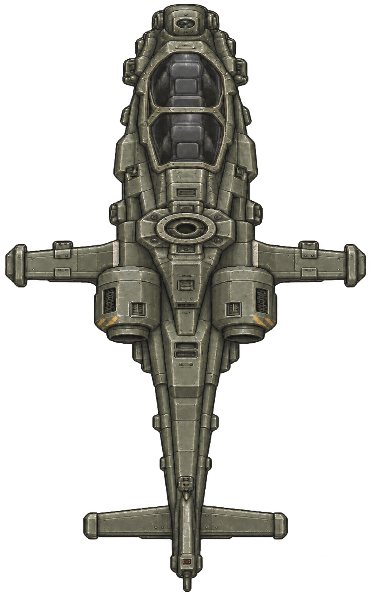
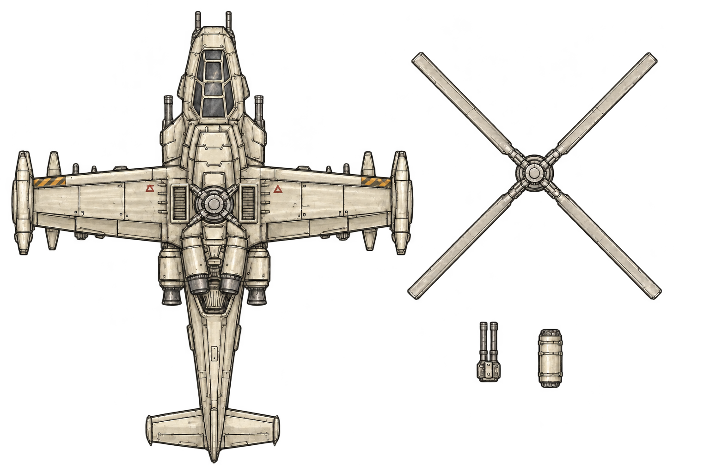
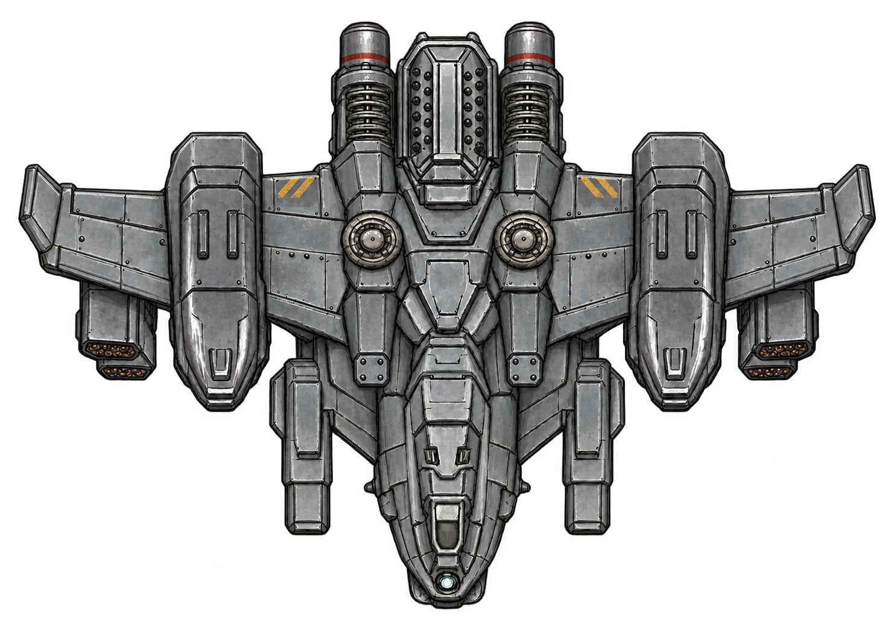
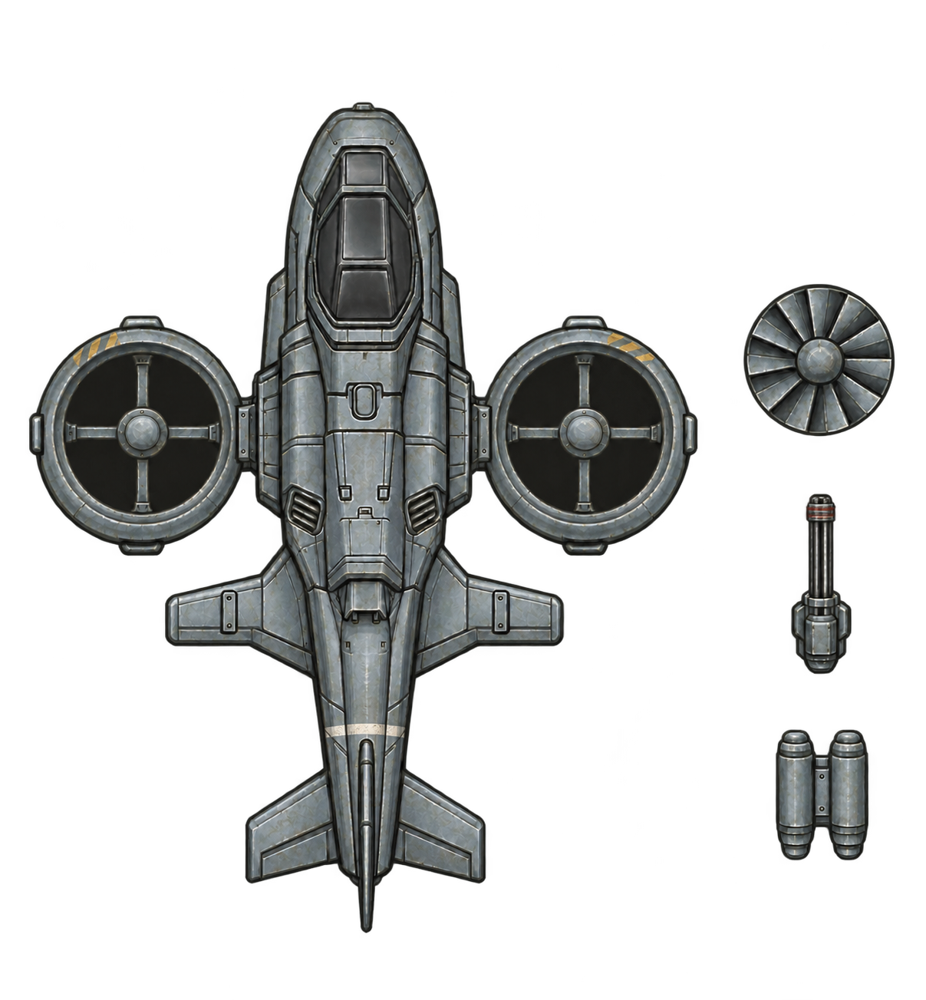
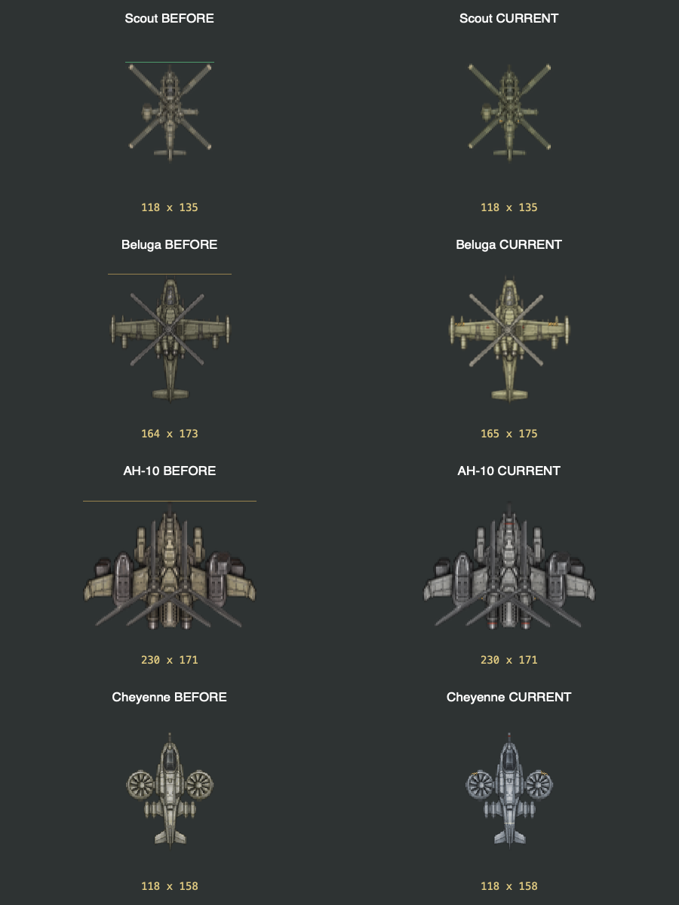
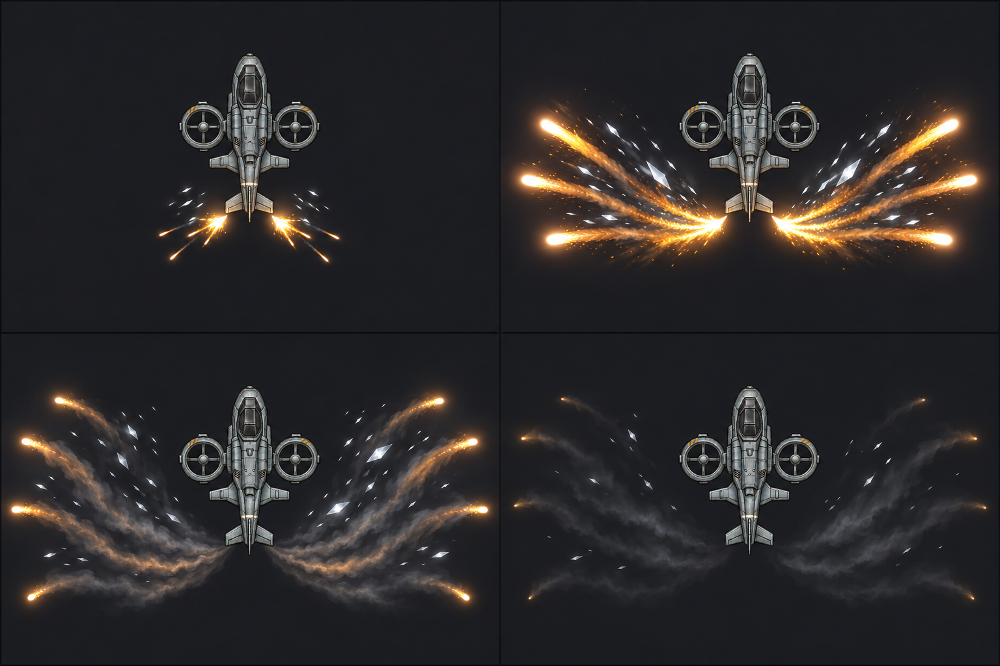

# 헬기 4종 도장과 채프·플레어 계획

2026-11-08. 샤이엔의 회청색 주색과 헬기 4종의 작은 도장을 웹 치트빌드에 적용했다. 승인된 기체 크기·비율·조립·알파는 유지했다. 채프·플레어는 계획과 시안을 준비했으며 게임 실행 코드에는 아직 넣지 않았다. 게임 main·운영 PWA·기기 앱은 배포하지 않았다.

## 도장 적용

| 기체 | 주색 | 적용한 도장 | 원작 참조 |
|---|---|---|---|
| 스카웃 | 회녹색 | 엔진 덮개 가장자리의 작은 사선, 날개 뿌리의 짧은 밝은 띠 | E_Tank30_Body의 제한된 사선 영역, E_Tank32_Wpn의 무장 표식 |
| 벨루가 | 따뜻한 상아색 | 날개 가장자리의 짧은 사선과 날개 뿌리의 작은 적갈색 삼각형 | E_Tank30_Body의 가장자리 사선·삼각형 |
| AH-10 | 중간 회색 | 무장 주변의 작은 사선과 포신 하우징의 적갈색 띠 | E_Tank32_Wpn의 사선, E_Turret14_Wpn의 포신 강조 |
| 샤이엔 | 차가운 회청색 | 덕트 가장자리의 작은 사선, 꼬리의 밝은 띠, 기관포의 적갈색 띠 | 같은 원작의 가장자리 표식·포신 띠 |

부품 하나 전체를 다른 색으로 칠하는 처리는 제외했다. 초기 AH-10 색조 처리에서 남던 보랏빛을 줄여 회색으로 맞췄고, 샤이엔도 청색이 과하지 않게 채도를 낮췄다. 원작 122개 이미지와 58종 조립 연결은 [참조 자료](enemy-paint-20261108/README.md)에 있다.

아래 생성 그림은 도장 위치를 검토한 시안이다. 생성 과정에서 생긴 미세한 구조·패널 재묘사를 게임에 설치하지 않았다. 게임은 승인된 PNG를 그대로 읽고 텍스처 준비 때 주색과 지정한 작은 영역의 색만 처리한다. 생성 시안의 표식을 게임 해상도에 맞게 단순화했으며, 실제 결과는 다음 웹 비교에 표시했다.

## 실제 웹 치트빌드 비교

같은 2배 월드 배율과 로터 각도로 비교했다. 왼쪽은 승인 형상의 도색 전 캡처이고 오른쪽은 이번 공통 렌더러 출력이다. 스카웃은 118×135px, AH-10은 230×171px, 샤이엔은 118×158px로 측정됐다. 벨루가는 배경과 다른 RGB 픽셀을 세는 방식에서 164×173→165×175px로 잡혔다. 밝아진 반투명 가장자리 픽셀이 배경과 구분되기 시작한 차이이며, PNG 크기·모든 알파·조립 배율은 그대로다. 이 차이를 숨기기 위해 알파를 지우거나 기체를 축소하지 않았다.

도장 영역은 스카웃 몸체 8픽셀, 벨루가 몸체 88픽셀, AH-10 몸체 33픽셀, 샤이엔 몸체 51픽셀이다. 작은 스카웃에서는 사선의 개별 선보다 작은 도장 색 덩어리로 읽힌다. 별도 샤이엔 기관포 3픽셀과 AH-10 캐논 8픽셀에도 띠를 적용했다. 수치는 PNG 원본 해상도 기준이며 화면 확대 픽셀 수와 다르다.

- [텍스처 검사](../evidence/aircraft-markings-20261108/texture-audit.json): 원작 텍스처 992개 처리 전후 동일. 헬기 28개 모두 알파 동일. 네 몸체의 도장 영역이 불투명 영역의 12.5% 미만임을 검사했다.
- [웹 실측](../evidence/aircraft-markings-20261108/machdefense-aircraft-markings-four-bounds-20261108.json): 실제 렌더러에서 배경과 다른 픽셀 경계 측정.
- [웹 전투](../evidence/aircraft-markings-20261108/machdefense-aircraft-markings-four-combat-20261108.json): 일시정지·이동·개체·피해·사운드·장면 쓰기 0·추가 저장 0·준비 후 추가 텍스처 업로드 0, 8항목 통과.
- [C++ 검사](../evidence/aircraft-markings-20261108/core-tests.txt): 관련 9개 통과. Apple·Android는 같은 준비 함수를 사용하지만 이번 도색의 네이티브 실기기 검사는 하지 않았다.

원본 `Resources`와 `AircraftModels.hpp`는 승인 기준 `16d230c` 대비 변경하지 않았다. 색조 처리와 도장은 [AircraftPaint.hpp](../../Sources/Core/Presentation/AircraftPaint.hpp), [AircraftMarkings.hpp](../../Sources/Core/Presentation/AircraftMarkings.hpp)에 있다. 기존 원작 스프라이트와 효과 코드에는 변경을 넣지 않았다.

## 채프·플레어 확대 시안

2026-11-09 갱신.

사용자는 Ace Combat 8, 할리우드 영화, Love, Death + Robots의 「Lucky 13」처럼 현실성보다 크게 터지는 시각적 연출을 요청했다. 이전의 작은 두 광점 시안에서 **기체 폭 약 3배의 부채꼴 방출, 굵고 긴 백금색 잔광, 은색 채프 묶음**으로 수정했다. 기체 크기·색·디자인의 변경안은 아니다.

왼쪽 위부터 점화, 최대 방출, 확산, 소멸이다. 6~8개 큰 광점과 휘어진 긴 꼬리가 양옆으로 벌어진다. 플레어는 따뜻한 백금색, 채프는 차가운 은백색으로 구분한다. 중앙 몸체는 읽히도록 남긴다. 이 그림은 생성 시안이며 실제 게임 구현 화면이나 입자 수 실측 자료가 아니다.

[이전 작은 시안](../../Art/Aircraft/countermeasures-20261108/storyboard-v1.png)은 비교 기록으로 보존한다. 이전의 플레어 2개·총 10개 제안은 아래 확대안으로 대체한다.

### 참조 자료와 적용 방향

- [Ace Combat 8 공식 Walkthrough](https://www.bandainamcoent.com/games/ace-combat-8/walkthrough)는 채프·플레어를 회피 수단으로 명시하고 자유로운 기동과 아케이드 전투를 설명한다. 여기서는 회피 발동을 즉시 알아볼 큰 빛의 묶음을 설계 방향으로 삼았다. 이 작품의 내부 입자 구현이나 수치를 조사했다고 주장하지 않는다.
- [Top Gun: Maverick 공식 GIF 모음](https://giphy.com/topgun/top-gun-maverick)과 [Movieclips의 미사일 회피 장면](https://www.youtube.com/watch?v=3nwBwJiyQ_g)을 영화 참고 링크로 남겼다. 긴 궤적과 강한 밝기 대비를 우리 탑다운 시안의 큰 부채꼴로 옮기는 제안이다.
- [Sony Pictures Imageworks의 Lucky 13 제작 자료](https://www.imageworks.com/our-craft/feature-animation/movies/love-death-robots-lucky-13)는 기체·애니메이션·조명·합성 제작과 공식 분해 영상을 제공한다. 사용자가 지정한 SF 수송기 연출을 참고 대상으로 삼았다. 공개 정지화면만으로 해당 장면의 정확한 방출 개수·시간이나 제작 방식을 확정하지 않았다.

세 작품의 장면을 그대로 복제하지 않고, 사용자가 지정한 크고 화려한 연출을 현재 헬기의 탑다운 화풍에 맞춘 시안이다. 위 링크에서 확인한 사실과 아래 구현 제안을 구분한다.

### 크게 보이게 만드는 방법

| 요소 | 확대안 | 첫 구현 때 비교할 값 |
|---|---|---|
| 전체 외곽 | 뒤쪽에서 양옆으로 펼쳐지는 2개의 넓은 부채꼴 | 최대 폭: 기체 외곽 폭의 2.5~3배. 꼬리 길이: 몸체 길이의 0.8~1.2배 |
| 플레어 | 밝은 핵과 굵은 꼬리를 한 장에 합친 스프라이트를 회전·확대·감쇠 | 6~8장, 수명 0.7~0.9초. 0.06~0.1초 간격의 두 묶음 방출을 기존 틱으로 처리 |
| 채프 | 여러 은백색 조각을 한 타일에 그린 묶음 | 좌우 2장, 수명 0.7~1초. 개별 조각 수만큼 객체를 만들지 않음 |
| 점화 | 좌우 배출점의 짧은 밝기 상승 | 최대 2장, 0.08~0.12초. 화면 전체 번쩍임 없음 |
| 연기 | 큰 꼬리를 따라 옅게 남는 곡선 | 최대 2장, 0.6~0.8초. 불꽃·채프의 가독성을 해치면 먼저 줄임 |
| 동시 출력 | 핵·후광·잔광을 가급적 같은 텍스처에 합침 | 최대 14장/발동 초안. 전역 활성 96개를 시작점으로 계측하고 확정 |

화려함은 넓은 방출 각도, 길이, 밝기의 짧은 정점과 잔광으로 만든다. 작은 불꽃 수백 개, 실시간 조명, 화면 전체 블룸, 물리 시뮬레이션은 이 시안 구현에 필요하지 않다. 기존 `Efx_Fire`·`Efx_Smoke` 타일을 먼저 비교하고, 굵은 곡선과 채프 묶음이 표현되지 않는 부분만 헬기 전용의 작은 사전 제작 텍스처로 보완한다. 실제 소스·스프라이트 연결 전에는 구현 성능을 확정하지 않는다.

픽셀을 크게 그리면 객체 수가 같아도 겹쳐 그리는 비용이 늘어난다. 따라서 40·100기 검사에서 GPU 프레임 시간, 화면을 덮는 반투명 면적, 블렌드 호출과 드로콜을 함께 측정한다. 큰 투명 사각형의 빈 공간은 타일 경계를 좁혀 줄인다. 효과 포화 때 기존 포연·탄피·폭발과 기체를 가리지 않도록 출력 우선순위를 정한다. 전역 상한 96은 승인된 최종 성능 수치가 아니다.

기체별 방출 위치는 뒤쪽 좌우 엔진·동체 끝에서 시작한다. 무장·로터·몸체 구조는 유지한다. 긴 잔광이 남아도 기존 회피 종료·무적·피해·유도 규칙은 바뀌지 않는다. 새 효과는 발동을 보여주는 시각 표현이며, 별도 공격이나 피해 판정을 만들지 않는다.

## 기존 코드와 연결할 위치

| 기존 코드 | 확인한 동작 | 계획 |
|---|---|---|
| [AircraftTactics.hpp](../../Sources/Core/Simulation/AircraftTactics.hpp) | 회피 시작 시 `dodgeCount` 증가. 최대 0.45초, 도착하면 일찍 종료. 재사용 대기 0.25~0.5초 | 회피 전후 `dodgeCount`가 달라질 때 한 번만 시각 효과 요청. 회피 중 매 틱 반복 생성 금지 |
| [WorldMovement.cpp](../../Sources/Core/Simulation/WorldMovement.cpp) | 기존 고정 틱에서 회피 갱신 | 시각 효과 요청만 연결. 새 타이머·스레드·스케줄러 금지 |
| [Projectile.hpp / ParticleState](../../Sources/Core/Simulation/Projectile.hpp) | 위치·속도·회전·알파·수명 상태 보유 | 이 상태와 기존 이동·감쇠·스프라이트 계산을 재사용 |
| [Projectile.cpp](../../Sources/Core/Simulation/Projectile.cpp) | `tick`·`sprite`, 256칸 `ParticlePool`, 사용 가능 칸 없으면 `nullptr` | 원작 풀을 변경하지 않고 별도 풀 인스턴스에 시각 효과만 보관. 활성 96개 제한을 먼저 시험 |
| [WorldPresentation.cpp](../../Sources/Core/Presentation/WorldPresentation.cpp) | 기존 입자를 공통 Frame으로 제출 | 기존 월드 좌표와 렌더 경로에 붙임. 기체·로터와 가림 순서를 별도로 확인 |

별도 풀도 같은 `ParticleState`와 `ParticlePool` 구현을 사용한다. 원작 발사·폭발 효과의 256칸을 채프가 차지하지 않게 한다. 한 번 준비한 메모리를 계속 재사용하며 프레임마다 컨테이너를 새로 만들지 않는다. 새 풀의 생성자와 `acquire`에 시각 효과 전용 `DarwinRandom` 인스턴스를 전달한다. 두 함수 모두 난수를 매개변수로 받으므로 원작 풀 코드를 바꾸지 않고 전투·회피·드롭 난수 순서를 보존할 수 있다. 같은 회피 이벤트를 중복 등록하지 않는다. 두 묶음의 시간차는 그 이벤트에 저장한 시작 시각으로 처리한다. 상한에 도달하면 낮은 우선순위의 연기·채프를 생략하고 원작 효과는 유지한다.

플레어 광점과 연기는 `Efx_Fire.png`·`Efx_Smoke.png`에서 맞는 타일을 먼저 시험한다. 채프는 기존 `BulletShell.png`가 금속 조각으로 읽히는지 먼저 비교한다. 탄피처럼만 보이면 작은 은회색 조각 자원을 별도로 제안한다. 원작 PNG나 원작 탄피의 움직임 설정을 채프 때문에 바꾸지 않는다.

## 프레임·저장·사운드 보존 조건

사용자 지시: 채프·플레어 때문에 원작 시각 처리 코드를 왜곡하거나 프레임드롭·크래시를 만드는 처리를 넣지 않는다. 아래는 구현 전 조건이며, 이번에 성능 검사를 끝냈다는 뜻이 아니다.

- 발동·입자·프레임마다 DB·저장 파일·로그를 쓰지 않는다. 전투 중 추가 쓰기 0회를 검사한다. 저장 직렬화에도 입자를 넣지 않는다.
- 이번 시각 효과에는 새 소리를 추가하지 않는다. 사운드 컨텍스트 생성·삭제·재시작을 넣지 않는다. 기존 오디오 생명주기와 효과음 재사용을 보존한다.
- 텍스처·입자 저장 공간은 장면 준비 때 확보한다. 따뜻해진 상태의 텍스처 생성·업로드 0회, 효과 갱신 중 추가 힙 할당 0회를 목표로 계측한다.
- 원작 입자 이동·감쇠·알파·블렌드 처리, 발사·주퇴·탄피 모듈을 수정해 새 효과에 맞추지 않는다. 필요한 연결은 헬기 시각 효과 범위로 제한한다.
- 개체별 OS 타이머·스레드·매 프레임 네트워크 호출을 만들지 않는다. 일시정지·재개·파괴·장면 종료는 기존 게임 틱과 자원 생명주기를 따른다.
- 같은 입력·난수·기체 수에서 효과 켬/끔을 비교한다. 4종 각 1대, 혼합 40대·100대와 반복 생성·파괴 조건에서 평균·p95·p99 프레임 시간, 최고 활성 입자, 추가 할당·업로드·쓰기, 메모리 잔류와 크래시를 측정한다.
- 풀 포화 때 원작 포연·탄피·폭발이 사라지지 않는지 확인한다. 효과 유무에 따라 HP·회피 횟수·적 스폰·전투 난수·저장이 달라지지 않아야 한다.
- 웹 검사에 더해 iOS·Android에서 실제 프로파일링한다. 실측 전에는 프레임 비용이 없거나 크래시가 없다고 단정하지 않는다. 기준보다 악화되면 수량·수명·잔연을 줄이고 다시 비교한다.

## 무장 발사 효과의 사전 확인

현재 [AircraftModels.hpp](../../Sources/Core/Simulation/AircraftModels.hpp)는 헬기 파츠를 원작 무장 정의에 연결한다. 스카웃 기관포는 `E_Turret_Wpn_02`, 벨루가 기관포와 AH-10 캐논은 `E_Tank31_Wpn`, 샤이엔 기관포는 `P_Wpn_HMG_01`을 참조한다. 이름이나 그림만으로 실제 무기 종류를 확정하지 않고 무장 데이터와 함께 대조해야 한다.

[WorldCombat.cpp](../../Sources/Core/Simulation/WorldCombat.cpp)는 발사 이벤트에서 공통 `Efx_Fire.png`를 생성하고, 직접 피해형 무장의 탄피에 `BulletShell.png`를 사용한다. [WeaponController.cpp](../../Sources/Core/Simulation/WeaponController.cpp)는 공통 주퇴를 반환하고 `WorldCombat`이 무기 파츠 위치에 적용한다. 따라서 원작 공통 경로가 이미 있으며, 헬기별 실제 무장·배출 위치·선회 중 총구 정렬의 전수 대조가 남았다. 이번 도장 작업에서 이 원작 모듈을 수정하지 않았다.

[생성 프롬프트·파일 해시](../../Art/Aircraft/paint-v2-20261108/manifest.json). 내장 이미지 생성 도구를 사용했다. 최초 도색 3종 시안과 오류 기록 등 기존 자료는 보존한다.

## 플레어 채도 조정 — 2026-11-09

사용자 지시에 따라 큰 부채꼴·밝은 중심·은색 채프를 유지하고 노랑·빨강 채도를 낮췄다. [v3 시안](../../Art/Aircraft/countermeasures-20261108/storyboard-v3-muted.png). v2 원본은 보존한다. 게임 구현과 실전 성능 확인은 별도 단계다.

## 게임 효과 연결 — 2026-11-09

회피 시작 횟수가 증가할 때 기존 ParticleState와 Trail로 플레어 6개·은색 채프 반짝임 4개·점화광 2개·연기 2개를 표시한다. 원작 Efx_Fire·Efx_Trail01·Efx_Smoke를 재사용한다. 궤적 저장 공간은 World 생성 때 확보하고 반복해서 쓴다. 전투 난수와 원작 입자 256개 풀은 사용하지 않는다. 전체 효과 저장은 96개이며, 14개짜리 묶음 6개까지만 동시에 수용한다. 일시정지에는 효과도 멈춘다. 저장 호출과 오디오 생성·삭제는 추가하지 않았다.

[관련 검사 11개](../evidence/aircraft-implementation-20261109/countermeasure-tests.txt)와 [40·100기 동시 발동 코어 측정](../evidence/aircraft-implementation-20261109/countermeasure-stress.txt)을 통과했다. 이 수치는 렌더 GPU 측정을 포함하지 않는다. 웹 치트 실전 검사는 무장 연결 후 수행한다.
