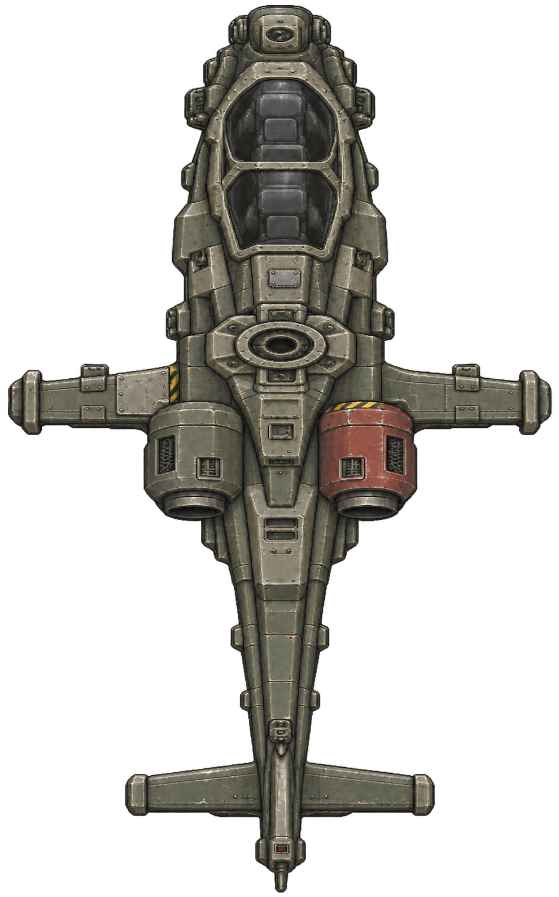
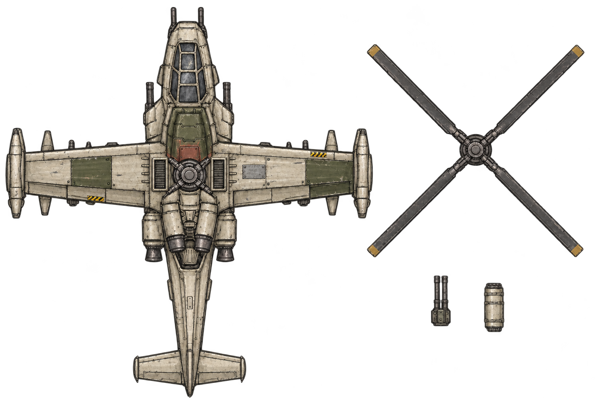
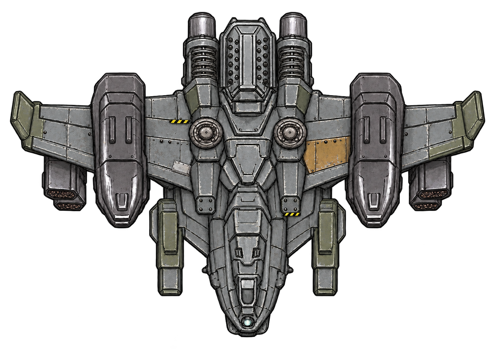

# 헬기 3종 도색 시안 — 2026-11-08

후속 지시: 사용자는 세 기체의 주색 변경을 채택하고 부품 하나 전체를 다른 색으로 칠하는 처리는 제외했다. 샤이엔도 색조 변경 대상이다. 아래 내용과 이미지는 최초 시안 기록이며, 교체 부품 도색과 샤이엔 제외 문구는 현재 적용 지시가 아니다. [헬기 4종 수정용 원작 도장 참조](enemy-paint-20261108/README.md)를 마련했다. 세 기체 주색은 `1d26f8d`, 샤이엔 주색은 `0638ce9`에 커밋했다. 이후 네 기체의 작은 도장과 실제 웹 비교를 [후속 보고서](aircraft-markings-countermeasures-20261108.md)에 기록했다. 아래의 미적용·채택 전 설명은 최초 시안 작성 시점의 기록이다.

스카웃의 현재 비율과 묘사는 `16d230c`에 보존했다. 사용자 승인과 파일 해시는 `93a9847`에 추가했다. 이번에는 **스카웃·벨루가·AH-10의 도색 시안 3개**를 만들었다. 현행 게임 PNG·조립·크기·수치와 샤이엔은 그대로다.

## 도색 방향

한 기체에 한 주색을 두고, 몇몇 기존 패널을 다른 색의 교체 부품처럼 처리한다. 작은 노랑·검정 위험 표식, 철판의 경계·리벳·국소 마모로 보수 흔적을 표현한다. 돌출물이나 새 구조를 더해 외곽을 바꾸지 않는다.

| 기체 | 주색 | 교체·보수 표현 | 위험 표식 |
|---|---|---|---|
| 스카웃 | 회녹색 | 한쪽 엔진 덮개를 적갈색으로 교체한 느낌. 반대편 날개 패널에 밝은 철판 | 엔진 덮개와 날개 뿌리에 짧은 띠 |
| 벨루가 | 따뜻한 상아색 | 날개와 동체의 일부는 짙은 녹색. 작은 적갈색 점검 덮개와 회색 보수 철판 | 날개 앞·뒤 가장자리의 좁은 구간 |
| AH-10 | 중간 회색 | 소수 올리브색 덮개, 한쪽 황토색 패널, 작은 밝은 철판 | 정비 패널 가장자리 두 곳 |

주색은 넓은 면을 연결하고, 이색 부품은 패널 단위로 끊는다. 좌우를 전부 대칭으로 칠하지 않는다. 조종석·통풍구·패널 틈의 어두운 값과 금속 모서리의 밝은 값은 유지한다. 로터가 덮는 중앙부에만 표식을 몰지 않는다.

## 원작 참조

MachDefense 원작 `P_Body_01`, `E_Tank_Body_01`, `E_Tank32_Body`를 세 생성 요청에 모두 직접 제공했다. 작은 메크의 이색 금속, 적 탱크의 적갈색 주색, 대형 탱크의 밝은 장갑·녹색 부품·작은 표식 배치를 참고했다. 이 참조를 헬기 형태의 교체 기준으로 사용하지 않았다.

[참조·입력·출력 해시](../../Art/Aircraft/paint-20261108/manifest.json)

## 스카웃

짧고 통통한 승인 몸체를 입력으로 사용했다. 한쪽 적갈색 엔진 덮개와 반대쪽 밝은 날개 철판이 가장 먼저 구분되는 시안이다. 노랑·검정 표식은 두 군데에 제한했다. 전체를 새로 어둡게 칠하지 않고 기존 회녹색 금속의 층을 유지하는 방향이다.

[현재 보존본](../../Art/Aircraft/parts/scout-ah1z-20261108/body-v2-proportions.png) · [생성 프롬프트](../../Art/Aircraft/paint-20261108/scout-prompt.txt)

## 벨루가

상아색 날개에 녹색 교체 패널을 섞었다. 중앙의 적갈색 덮개, 작은 회색 철판, 일부 날개 가장자리 표식을 더했다. 부품 시트의 로터 끝에도 옅은 황토색을 제안했다. 로터의 형상·길이 변경안은 아니다.

[현재 보존본](../../Art/Aircraft/parts/user-20261108/beluga-sheet-v1.png) · [생성 프롬프트](../../Art/Aircraft/paint-20261108/beluga-prompt.txt)

## AH-10

회색 장갑의 큰 면을 유지하면서 한쪽 황토색 패널과 반대쪽 작은 밝은 보수 철판으로 비대칭을 만들었다. 기존 두 측면 포드의 어두운 명암은 유지했다. 황토색은 넓은 패널 하나에만 모았다.

[현재 보존본](../../Art/Aircraft/parts/user-20261108/ah10-body-v3.png) · [생성 프롬프트](../../Art/Aircraft/paint-20261108/ah10-prompt.txt)

## 적용 순서

1. **보존 기준:** 승인된 몸체·로터·무장 PNG, 알파 외곽, 조립 배율·연결점·총구를 유지한다. [스카웃 승인 기록](../../Art/Aircraft/runtime/scout-approved-20261108.json)을 기준으로 삼는다.
2. **도장 영역:** 주색, 교체 패널, 보수 철판, 위험 표식을 따로 지정한다. 기존 패널 경계를 따라 표면 색을 옮기며 조종석·기계 구조·마모 묘사를 재설계하지 않는다.
3. **작은 크기 비교:** 보고서에서 현재 몸체와 시안 몸체를 같은 폭으로 축소해 본다. 넓은 주색과 이색 부품이 읽히는지 먼저 확인한다. 1~2픽셀로 사라지는 표식은 불필요하게 늘리지 않는다.
4. **게임 연결:** 채택한 도색을 보존본에 반영한 뒤 알파·외곽·연결점을 대조한다. 샤이엔은 파일 해시로 보존 여부를 확인한다.
5. **웹 치트빌드 검사:** 원작 머신건 메크·적 탱크·현재 네 헬기를 같은 배율로 배치한다. 로터 가림, 선회, 총구·사격, 그림자, 생산 아이콘을 확인한다. 그 결과로 게임 적용 보고서를 갱신한다.

## 이번 확인과 남은 차이

세 그림은 내장 이미지 생성 도구로 만든 **도색 방향 시안**이다. 현재 게임의 스카웃 몸체 78×124px와 전체 118×135px는 유지된다. 이번 생성 결과를 Resources에 덮어쓰지 않았다. `Resources`, `Sources`, `Tests`는 `16d230c`와 차이가 없다.

생성 도구가 일부 작은 패널·마모를 다시 묘사했고, 그림 외곽도 원본과 픽셀 단위로 일치하지 않는다. 특히 스카웃과 벨루가의 시안을 통째로 새 몸체로 적용하면 승인된 묘사가 달라질 수 있다. **후속 적용에서는 이 시안의 색 배치를 보존본에 옮기고, 현재 형상과 묘사를 유지한다.** 이번 보고서의 축소 비교는 도색 검토용이며 실제 게임 적용 캡처가 아니다. 새 도색의 전투·기기 검사는 아직 하지 않았다.

보고서에는 현재 보존본과 도색 시안, 원작 참조, 작은 크기 비교를 함께 제공한다. 새 도색은 아직 채택 전이다.
