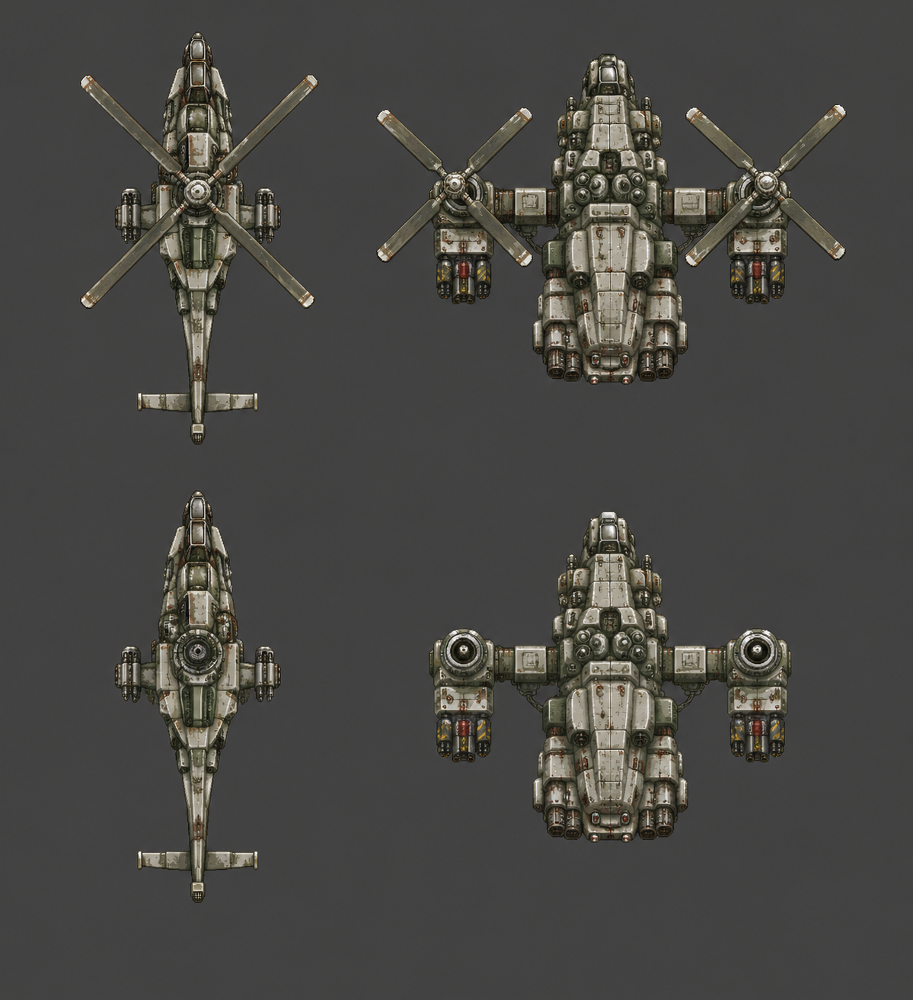

# 헬기·VTOL 형태 참고와 계열 설계

사용자 지시: 원작의 탱크·장갑차·대형탱크처럼 공중유닛도 디자인과 무장 조합을 여러 계열로 확장한다. 아래 계열은 설계안이다. 수량·해금·가격·성능은 확정하지 않았다. 같은 기체를 확대하거나 색만 바꾸는 방식으로 계열을 채우지 않는다.

## 형태 참고 목록

| 사용자 참고 | 형태를 볼 부분 | 자료 |
|---|---|---|
| 아머드코어6 첫 스테이지 헬기 보스 | 넓고 두꺼운 동체, 좌우 회전익과 무장 지지부 | [첫 보스 화면](https://images.mein-mmo.de/medien/2023/08/Armored-Core-6-HC-Helicopter-1024x576.jpg), [공식 갤러리](https://www.armoredcore.net/gallery.html) |
| 엔드워 미국 진영 헬기 | 길고 좁은 동체, 각진 조종석, 로터·꼬리·짧은 무장 날개 | [AH-80 공식 홍보 그림 보관본](https://www.mobygames.com/game/39531/tom-clancys-endwar/promo/group-52150/image-453391/) |
| C&C 오르카 모델들 전체 | 작품별 전투형·폭격형·수송형·캐리올·지휘형의 동체와 추진기 차이 | [계열 목록](https://cnc.fandom.com/wiki/Orca_aircraft), [EA 폭격형 소개](https://www.ea.com/games/battlefield/news/new-unit-showcase-orca-bomber) |
| 스타크래프트2 밴시 | 좌우 터보팬과 중앙 동체, 무장과 팬의 분리 | [Blizzard 설명](https://news.blizzard.com/en-us/article/16280610/new-terran-tech-schematics) |
| 에일리언2 수송선 | 긴 화물 동체, 접히는 무장 구조와 추진기 | [UD-4 Cheyenne 공식 라이선스 모형](https://www.toynk.com/products/eaglemoss-alien-predator-collection-ud-4-cheyenne-dropship-xl-edition) |
| 아바타1 대형 건쉽 | 넓은 중무장 동체·여러 추진부 | [C-21 Dragon 공식 자료](https://www.avatar.com/pandorapedia/c-21-dragon-assault-ship) |
| 아바타1 소형 건쉽 | 두 덕트와 좁은 기체·무장 날개 | [Scorpion 공식 자료](https://www.avatar.com/pandorapedia/scorpion-gunship) |

오르카의 전체 범위는 작품별 원본 등장형을 목록화하며 확인한다. Tiberian Dawn/Remastered·Tiberian Sun/Firestorm·Renegade·Tiberium Wars/Kane's Wrath·후속 모바일 등장형과 미사용 콘셉트는 구분한다. ZOCOM 등 파생형도 별도 기록한다. 위 목록을 찾았다는 사실만으로 모든 모델의 그림 대조를 마쳤다고 하지 않는다.

## 계열 설계안

| 계열 | 형태 후보 | 기존 무장 재사용 후보 | 구별할 구조 |
|---|---|---|---|
| 경량 공격 헬기 | EndWar | 기관총 또는 로켓 | 긴 꼬리·좁은 동체·중앙 로터 |
| 중형 덕트 건쉽 | Scorpion·Banshee | 쌍열 기관포 또는 미사일 | 짧은 동체·좌우 덕트·하부 포가 |
| 중장갑 건쉽 | AC6·Dragon | 기관포+미사일 | 넓은 동체·분리된 다중 무장·여러 회전익 |
| 소형 VTOL | Orca 전투형 | 미사일 또는 기존 에너지 무장 | 기수·추진기·무장 포드의 간격 |
| 대형 VTOL | Orca 폭격형 | 기존 폭탄·유탄 계열 | 넓은 폭·중앙 무장 공간·쌍발 구조 |
| 수송기형 동체 | Aliens·Orca 수송/Carryall | 기존 방어 무장 | 긴 동체·화물 공간·무장 날개 |

수송 기능·은폐·새 탄도·새 보스 규칙을 참고 기체만 보고 추가하지 않는다. 위 무장은 게임의 기존 발사·피해·음향을 연결할 후보이며 실제 배치는 후속 설계에서 정한다. 아군·적군은 기존 두 진영의 원작 팔레트와 장갑 구성을 따로 적용한다.

## 화풍과 부품 검사

`P_Body_34`, `PB_Tanker_05`, `E_Tank_Body_05`의 원본 PNG를 색·재질 기준으로 사용했다. 작고 끊긴 밝은 금속선, 어두운 접합부, 불규칙한 회녹색 중간톤, 접합부 주변의 흙빛 마모를 비교한다. 균일한 흰 페인트 벗겨짐·굵은 외곽선·매끈한 3D 광택을 넣지 않는다.

각 계열은 몸체·무장·로터/덕트·연결점·총구·그림자·좌우 기울임 그림을 따로 기록한다. 로터 회전과 곡선 이동, 기존 스폰 보존 요구는 [구현 계획](aircraft-plan-20261107.md)을 따른다. Unity 전용 크기 규칙이나 PBR 재질 규칙을 이 게임에 옮기지 않는다.

## 두 번째 시안

왼쪽은 EndWar 형태를 참고한 경량형, 오른쪽은 AC6 형태를 참고한 중량형이다. 아래는 로터를 분리한 몸체다. 첫 시안의 굵고 균일한 흰 벗겨짐을 줄이고 접합부 마모와 중간톤을 추가했다. 생성 그림에는 아직 큰 크기에서 매끈한 음영이 남는다. 실제 게임 크기·원작 에셋을 보고서에 함께 표시한다. 게임 적용·도트 일치·부품 연결 검증을 마친 상태는 아니다.

다른 참고 계열도 이 두 기체의 변형만으로 처리하지 않는다. 원작 질감 검수 후 각 계열의 실루엣과 무장 구성을 별도로 만든다.
