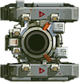
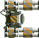

# 헬기 크기와 원작 부품 조립

[공중유닛 제작 계획](aircraft-plan-20261107.md) · [TODO 27](../usability-todo.md)

사용자는 두 번째 시안의 화풍을 채택했다. 소형 헬기는 빨간 적 장갑차, 중량형 헬기는 40번대 후반부터 나오는 초대형 적 탱크와 같은 체급으로 만든다.

## 기준 유닛

| 대상 | 원작 데이터 | 첫 등장 | 몸체·무장 그림 범위 | 그림자 포함 |
|---|---|---:|---:|---:|
| 빨간 소형 장갑차 후보 | `E_Tank_01` | 미션 1 | 57×32 | 61×36 |
| 초대형 적 탱크 | `E_Tank_32` | 미션 47 | 100×105 | 104×109 |

단위는 `deviceScale=1`, 몸체·무장 각도 0에서 원작 스프라이트의 픽셀이다. 실제 화면의 픽셀 수나 충돌 반경이 아니다. 투명 여백을 제외한 몸체·무장의 합집합을 측정했다. 그림자 때문에 체급을 크게 잡지 않도록 본체와 분리했다. 소형 후보는 빨간 차체를 확인해 선정했으며 사용자에게 데이터 이름을 직접 확인받은 상태는 아니다.

소형 몸체: 
소형 무장: 

중량형 몸체: 
중량형 무장: 

비슷한 빨간 몸체의 `E_Tank_07`은 미션 5부터 나오고 조립 범위는 63×42다. 함께 측정 파일에 보존했다. `E_Tank_21`은 미션 24부터 등장하므로, 40번대 후반 첫 등장이라는 사용자 설명에 맞는 중량형 기준으로 택하지 않았다.

## 측정 방법

`tools/aircraft_scale_probe.cpp`는 제품의 `BattleModels::parse`, `configureTiles`, `appendSprites`를 직접 호출한다. 원본 `PartsInfo.mcb`, `MachInfo.mcb`, `PartsList.tsv`, `TileList.tsv`로 Frame을 만들었다. 별도 조립 공식을 만들어 크기를 추정하지 않았다.

재실행 명령:

```sh
clang++ -std=c++20 -I Sources tools/aircraft_scale_probe.cpp Sources/Core/Simulation/MachineModels.cpp Sources/Core/Presentation/MachineSprites.cpp Sources/Core/Data/Chunk.cpp Sources/Core/Data/DataTable.cpp -o /tmp/md-aircraft-scale
/tmp/md-aircraft-scale Resources/RawData
```

- [실제 Frame의 부품 위치·원본 영역](aircraft-scale-20261107/frames.json)
- [알파 범위·조립 범위·파일 SHA-256](aircraft-scale-20261107/measurements.json)
- 소비 코드: `Sources/Core/Simulation/MachineModels.cpp`, `Sources/Core/Presentation/MachineSprites.cpp`

## 원작 연결점

소형 차체는 연결점 1 `(9,-1)`에 무장을 붙인다. 무장에는 부착 기준점 `(-4.5,0.5)`와 총구 `(15.5,0.5)`가 있다. 초대형 차체는 연결점 1 `(-4,-1)`에 무장을 붙이며, 무장에는 부착 기준점과 총구 네 개가 있다. 실제 소비 코드의 좌표 절삭·배율·회전 순서를 그대로 사용한다.

헬기도 같은 부모·자식 부품 구조로 만든다. 몸체에 무장과 로터 연결점을 두고, 무장의 총구는 발사 위치로 쓴다. 로터는 몸체 연결점에 고정한 채 자체 각도로 회전한다. 원작의 본체·그림자 출력 순서를 사용한다.

## 제작과 확인

1. 채택한 시안에서 소형의 몸체·무장·중앙 로터, 중량형의 몸체·무장·좌우 로터를 분리해 제작한다.
2. 원작 조립 데이터와 같은 방식으로 부착점·총구·층 순서를 정의한다. 로터를 포함한 전체 길이·폭과 회전 중 최대 범위를 기준 유닛 옆에서 비교한다.
3. 길이·폭은 같은 배율을 쓴다. 목표 체급에 맞추기 위해 기체를 가로·세로로 따로 늘리지 않는다. 비례가 맞지 않으면 부품 배치를 수정한다.
4. 웹 치트에서 원작 기준 유닛과 새 기체를 같은 화면에 놓는다. 실제 표시 크기·확대 화면·좌우 기울임·로터 회전·총구·사격·피격·파괴를 확인한다.

현재 완료한 것은 화풍 채택 기록과 기준 유닛 측정이다. 신규 헬기의 런타임 에셋·조립·전투 검사는 아직 완료하지 않았다.

## 부품 조립 시험

몸체와 별도 로터 그림을 만든 뒤 제품의 `BattleModels::pose`와 `appendSprites`에 연결했다. `tools/aircraft_assembly_probe.cpp`가 소형 로터 1개·중량형 로터 2개를 72개 각도로 출력한다. [출력 Frame](aircraft-scale-20261107/assembly.json)과 [브라우저 검사](aircraft-scale-20261107/browser-check.json)를 보존했다. 보고서에서 회전 정지·재개와 1·3·5배 표시를 제공한다.

[그림 범위 측정](aircraft-scale-20261107/assembled-bounds.json): 소형은 회전 전체에서 최대 폭 30.30·길이 56.60, 중량형은 최대 폭 102.94·길이 66.86이다. 앞을 위로 맞춘 원작 기준 유닛의 범위는 각각 32×57, 105×100이다. 넓고 짧은 중량형의 원래 비례를 보존했다. 높이를 탱크와 같게 만들려고 기체를 늘리지 않았다.

신규 그림에 매우 낮은 알파의 잔여 픽셀이 있어 위 신규 측정에는 알파 16/255 이상을 사용했다. 원작 측정은 알파 1/255 이상이다. 신규 원본의 잔여 픽셀 제거와 게임용 텍스처 해상도 정리는 아직 남았다. 이번 생성물의 무장은 몸체에 고정되어 있다. 별도 무장 부품·총구·기울임·전투 연결은 완료하지 않았다. 이 부품 그림을 Resources나 운영 앱에 반영하지 않았다.
