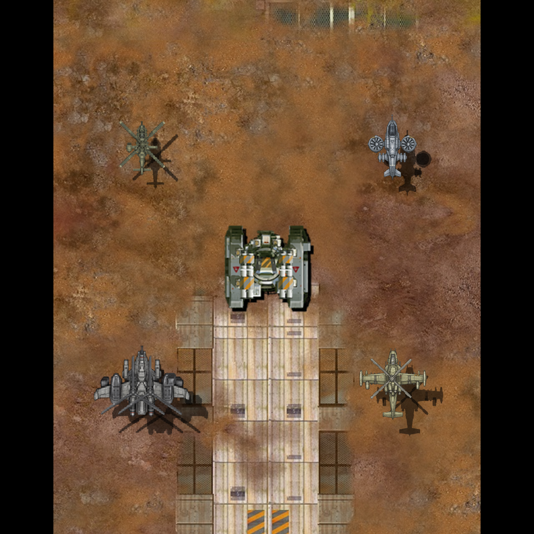

# 헬기 작업 현황과 이동 복구

2026-11-09. 잘못 변경한 헬기 이동을 복구해 아이폰 정식 앱에 다시 설치했다. 벨루가 선회 그림은 승인된 기체와 날개·형상·텍스처가 달라지는 구현 오류가 남아 있다. 최신 사용자 평가에서 샤이엔 선회가 가장 자연스럽고, 벨루가와 스카웃은 재작업 대상으로 지정됐다. 표적 밀착 방지 수정과 전체 성능 비교도 아직 끝나지 않았다.

## 이동 변경과 복구

요구는 지상 유닛의 정지 조건을 조사해 헬기가 표적에 달라붙는 현상을 막는 것이었다. Codex는 이를 사거리 안 정지로 확대하고 긴급회피 속도 곡선까지 바꿨다. 기존 헬기의 선회·회피와 전투감각을 보존하지 못한 변경이다. 탱크·메크 소스를 그대로 복사한 것은 아니지만, 헬기 전용 이동에 지상 유닛식 정지를 넣었다.

`e80f2a2`의 사거리 정지와 `1c10585`의 회피 속도 변경을 철회했다. 복구 커밋은 `8ba888f`다. `AircraftTactics.hpp`는 이전 아이폰 확인본 `38903e4`와 바이트 단위로 같다. 12방향 선회, 기체별 위상·방향·전환 시간, 관성·제동·기수 회전, 긴급회피·무적·재사용 대기를 복구했다. 에셋·정의파일 변경은 유지했다.

[복구 검사](../evidence/aircraft-repair-20261109/movement-restore-checks.json)에서 코어 54개, Chrome·WebKit 무장·회피 검사가 통과했다. 긴급회피 64조건의 궤적 출력은 변경 전 기록과 완전히 같다. 보호 파일 2,652개 해시와 원본 유닛 160조건의 위치·HP·렌더 명령·음원 호출·저장 결과도 같다. 이 검사를 모든 플레이 상황의 무오류 보장으로 확대하지 않는다.

## 아이폰 설치 상태

Xcode에서 기존 서명 경로로 Release 복구본을 빌드했다. 서명·검사 플러그인 없음·선회 텍스처 유지를 확인한 뒤 아이폰에 덮어 설치하고 실행했다. 설치 직전과 직후의 저장 42,496바이트가 완전히 같다. [설치 확인](../evidence/aircraft-repair-20261109/movement-restore-iphone.json). 사용자 플레이를 위해 추가 기기 조작은 중단했다.

처음 새 버전을 빌드할 때 CLI 서명에서 `errSecInternalComponent` 오류가 발생했다. Xcode 빌드로 서명해 설치했다. 키체인 권한이나 게임 소스를 바꿔 서명을 우회하지 않았다. 서명용 로컬 설정은 빌드 뒤 원래 파일로 복원했다.

## 벨루가·스카웃 선회 재작업

Codex는 승인된 벨루가와 날개·형상·텍스처가 다른 선회 그림을 만들어 실제 게임에 적용했다. 승인 디자인 보존 조건을 어긴 구현 오류다. 이를 단순히 ‘충분히 검증하지 않았다’고 표현해 문제를 축소한 것도 잘못이다. 정정 커밋은 `01b9b29`다.

`d8ab16d`에서 네 기체에 선회 그림을 6장씩 생성하고 정면을 포함한 7칸 시트를 연결했다. 정면 픽셀 보존·타일 선택·렌더 동작 검사를 통과했지만, 그 검사는 같은 기체의 날개·부품·텍스처가 유지된다는 검사가 아니었다. 선회 그림 적용을 외형 승인으로 취급하지 않는다.

아래는 실제 웹 치트빌드의 정면·왼쪽 끝 단계·오른쪽 끝 단계가 순서대로 반복되는 비교다. 원래 세 캡처를 픽셀 변경 없이 무손실 WebP로 묶었다. 중앙은 원본 적 탱크, 왼쪽 위는 스카웃, 오른쪽 위는 샤이엔, 왼쪽 아래는 AH-10, 오른쪽 아래는 벨루가다. **현재 결함을 포함한 적용 상태이며 승인 시안이 아니다.**

`MD-AIRCRAFT-BELUGA-BANK-CONSISTENCY-01`에 벨루가 오류를, `MD-AIRCRAFT-SCOUT-BANK-CONSISTENCY-01`에 스카웃·벨루가 재작업 지시를 기록했다. 샤이엔의 현재 선회 표현은 비교 기준으로 보존하며 함께 수정하지 않는다. 승인된 정면을 기준으로 날개 윤곽·비율, 엔진·로터·무장 위치, 부품 수·접합부, 색조·도장·텍스처를 각 선회 단계와 대조한다. 같은 기체의 투영·가림·명암만 달라져야 한다. 실제 웹과 아이폰의 연속 전환 검사가 남았다. 이번 오류 기록 작업에서 그림을 다시 바꾸지는 않았다.

## 파일·정의 수정 상태

| 항목 | 적용·확인 | 남은 범위 |
|---|---|---|
| 헬기 로직 조사 `6fe458b` | 정의부터 생성·전투·저장·파괴까지 관련 소스 30개 정적 대조 | 모든 플랫폼의 실제 출력·성능 동등성은 미확인 |
| MCB 정의 `a04b02b` | 파츠 23개·기본 기체 4개를 QChunk 형식의 파일로 준비하고 기존 추가 자원 로더에 연결 | 원본 제작용 레이어·도구가 확보된 것은 아님 |
| 헬기 PNG 최적화 | 29개를 Apple PNG 최적화 경로로 준비. 실제 stb 디코더에서 크기·알파·불투명 RGB 대조 | 반투명 RGB의 정수 반올림 차이 존재. 원본 CoreGraphics 전체 경로 동등성은 미확인 |
| 선회 그림 `d8ab16d` | 24장 생성·게임 연결, 기존 정면 픽셀 유지 | 벨루가 형상·텍스처 오류. 전체 미감·부품 일관성 승인 미완료 |
| 이동 복구 `8ba888f` | 이전 확인본 이동 코드와 동일, 코어·웹 검사·아이폰 재설치 | 표적 밀착 방지 수정은 미완료 |

벨루가의 날개·엔진은 여전히 고정 몸체 그림에 포함돼 있다. AH-10 로켓·공습 무장은 고정 발사점 노드를 사용한다. 미연결 별도 부품을 연결한 것처럼 보고하지 않는다. 원본 유닛의 소스·이미지·표·MCB와 플랫폼 공통 렌더러는 이번 수정 대상에서 제외했고 해시 대조로 보존을 확인했다.

## 표적 밀착 원인

복구한 기존 경로를 휴대폰·태블릿 좌표, 4종, 난수 시작값 32개, 조건당 1,200틱으로 조사했다. 표적 반대편 선회 지점을 향한 직선 이동이 표적 중심을 지나가는 경우를 재현했다. 선회 반경이 사거리보다 작게 제한되는 조건도 있다. [측정 출력](../evidence/aircraft-repair-20261109/proximity-before.txt).

| 휴대폰 좌표·Lv.1 | 사거리 | 선회 반경 | 관측한 최소 중심 거리 |
|---|---:|---:|---:|
| 스카웃 | 150 | 64 | 약 0 |
| AH-10 | 225 | 54.4 | 4.640 |
| 샤이엔 | 140 | 54.4 | 0.175 |
| 벨루가 | 255 | 32 | 2.191 |

이 결과는 고정 표적과 기존 이동 계산의 재현값이다. 모든 실제 전투의 최소 거리라는 뜻은 아니다. 후속 수정은 선회·회피·속도·회전 수치를 유지하면서 표적 중심을 가로지르는 접근 목적지를 처리하는 범위로 좁힌다. 지상 유닛식 정지와 새 회피 속도 곡선을 다시 적용하지 않는다. 아직 해당 수정 코드를 게임에 넣지 않았다.

## 남은 확인

- 벨루가·스카웃 선회 그림 재작업. 승인 형상·도장 보존과 실제 전환 검수. 샤이엔 현행 표현 유지.
- 기존 선회·회피를 유지하는 표적 밀착 방지 수정과 회귀 검사.
- 실제 설치본의 초기 로딩·CPU·GPU·메모리·프레임 분리 계측, 1·4·40·100기 효과 켬/끔 비교.
- 파츠 분리·조립과 원본 대비 질감의 남은 차이 확인.

수정 전후 웹 성능 비교는 잘못 바꾼 이동을 복구하면서 중단했다. 중간 측정에서 수정 전 빌드에도 긴 프레임이 나타났으며, 전체 반복 비교가 끝나지 않아 성능 향상이나 프레임 저하 없음으로 판정하지 않는다. 웹 결과를 아이폰·Android·Tauri 실기기 성능 결과로 대체하지 않는다. 게임 main·운영 PWA에는 이번 수정본을 배포하지 않았다.
