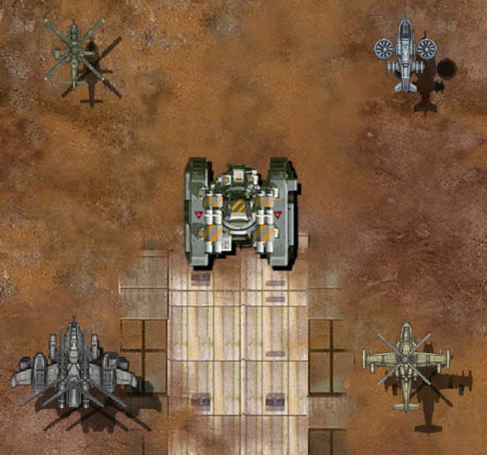

# 헬기 도색·질감·입체감 개선 과제

2026-11-09. 스카웃·벨루가 선회 수정본을 아이폰 정식 Release 앱으로 설치했다. 다음 과제는 승인 형상·크기·주색과 움직임을 유지하면서 원작 유닛의 장갑 면, 접합부, 도장과 파츠 조립에 맞춰 표면 묘사를 개선하는 것이다. 이 문서는 현재 상태와 작업 계획이다. 새 도색이나 파츠 변경을 게임에 적용한 결과가 아니다.

## 아이폰 설치 결과

- 설치 소스는 `9e97637`이다. 스카웃 `5d6b872`, 벨루가 `e9c95ba`의 선회 그림을 포함한다.
- Xcode의 기존 Release 구성으로 빌드했다. 서명 검증을 통과했고 XCTest 플러그인이 없다. 네 몸체 자원의 SHA가 현재 게임 자원과 같다.
- 설치 직전과 직후 저장 42,496바이트가 동일하다. 무선 설치와 실행에 성공했고 실제 기기 화면에서 스테이지 선택 화면을 확인했다.
- 최초 빌드는 서명 팀 값이 없어 실패했다. 기존 서명 팀을 로컬 빌드에만 지정했고 빌드 후 프로젝트 파일을 원상복구했다. 키체인 권한은 변경하지 않았다.
- 사용자가 직접 플레이할 수 있도록 기기를 더 조작하지 않았다. 이번 설치본에서 네 기체의 실전 선회를 직접 검사한 것으로 기록하지 않는다. 사용자 실기기 평가와 성능 측정은 남았다.

[설치·저장·자원·서명 확인](../evidence/aircraft-iphone-banks-20261109/install.json). 게임 main·운영 PWA에는 이번 빌드를 배포하지 않았다.

## 현재 적용된 것과 남은 것

| 항목 | 현재 확인한 상태 | 이번 개선 과제 |
|---|---|---|
| 주색·작은 도장 | 스카웃 회녹색, 벨루가 따뜻한 상아색, AH-10 회색, 샤이엔 회청색. 작은 사선·띠·삼각형을 자원에 반영 | 실제 게임 크기의 가독성, 정면과 선회 단계의 같은 위치·색 계열 유지 |
| 좌우 선회 | 네 몸체가 정면+좌우 6단계 타일을 사용. 스카웃·벨루가를 후속 수정 | 현재 확인한 형상을 기준으로 표면만 개선. 샤이엔의 자연스러운 선회와 AH-10 형상을 함께 다시 그리지 않음 |
| 파일·정의 | 헬기 PNG 29개에 Apple PNG 최적화 적용. 파츠 23개·기본 기체 4개를 MCB 정의로 준비 | 제작 원본→준비 자원→앱 번들→실제 표시의 대응 검사 유지 |
| 파츠·그림자 | 스카웃 4개, 샤이엔·벨루가 6개, AH-10 표시 파츠 6개. 공통 소켓·층·그림자 경로 사용 | 몸체에 합쳐진 부위와 비표시 무장 노드를 정리하고 실제 그림·발사점 대응 확인 |
| 장갑 면·접합부 | 원작 그림에는 넓은 면의 명암, 어두운 측면, 밝은 가장자리와 접합부 묘사가 있음 | 헬기의 작은 선·표면 무늬가 면의 두께와 겹침으로 읽히는지 비교하고 보완 |

[현재 웹 비교](beluga-bank-correction-20261109.md), [원작 도장 자료](enemy-paint-20261108/README.md), [실제 조립 조사](aircraft-depth-20261109.md)를 기준으로 한다. 과거 조사 문서의 ‘선회 그림 없음’은 당시 상태다. 현재는 선회 타일을 사용하므로 이를 미구현으로 되돌려 기록하지 않는다.

현재 적용한 선회 그림의 비교다. 새 도색·질감 개선 시안이나 아이폰 캡처가 아니다.

## 원작에서 가져올 표현

원작 도장 자료 122개와 실제 조립 연결 58종은 이미 확보돼 있다. 이번에 탱크·포탑 비교판과 현재 헬기 조립 캡처를 다시 대조했다. 아래는 그림에서 관찰한 표현과 적용 계획이다. 원작자의 제작 도구나 편집 레이어 수를 추정해 확정한 내용이 아니다.

| 원작 참조 | 그림에서 확인한 표현 | 헬기에서 대조할 부분 |
|---|---|---|
| `E_Tank30_Body` | 가장자리에 제한한 노랑·검정 사선, 작은 붉은 삼각형, 장갑판의 밝은 테두리와 어두운 측면 | 날개 뿌리·정비 덮개의 작은 도장. 전체 날개나 부품을 이색으로 칠하지 않음 |
| `E_Tank32_Body`·`E_Tank32_Wpn` | 차체와 포탑의 겹침, 무장 덮개 사선, 포신·하우징의 큰 명암 구분 | 무장 받침·발사관 주변의 가림과 두께. 실제 연결한 무장에만 강조 배치 |
| `E_Turret14_Wpn`·`E_Turret16_Wpn` | 반복되는 포신 끝의 짧은 적색 띠와 밝은 금속면 | 기관포·캐논의 짧은 강조 띠. 발사 효과와 포신 윤곽을 가리지 않게 제한 |
| 머신건 메크의 `P_Body_02`·`P_Body_18`, HMG 조립 | 몸체·발·무장을 분리하고 소켓과 층 순서로 조립 | 헬기의 부품 경계, 독립 무장·회전부, 그림자와 총구 위치 대조 |

[탱크 도장 비교판](enemy-paint-20261108/sheet-2.png) · [포탑 무장 비교판](enemy-paint-20261108/sheet-4.png) · [파츠·조립 출력](../evidence/aircraft-followup-20261109/depth-probe.txt).

## 세 가지 작업

**도색:** 현재 주색을 유지하고 작은 위험 표식·무장 띠·정비 흔적의 위치와 면적을 정리한다. 보수 철판은 같은 계열의 밝기·마모 차이와 판 가장자리로 표현한다. 부품 하나 전체를 임의의 다른 색으로 바꾸는 안은 제외한다. 정면에만 표식을 넣고 선회 때 사라지거나 다른 곳으로 옮겨지는 일이 없도록 7단계 위치를 함께 관리한다.

**질감:** 축소 후 사라지는 가는 선과 얼룩을 늘리는 대신 장갑의 큰 면, 패널 경계, 금속 가장자리가 실제 표시 크기에서 구분되는지 확인한다. 제작 원본 확대, 실행 자원의 1배 픽셀, 같은 월드 배율의 조립 화면을 각각 비교한다. 원작 전체의 필터·색 처리·알파 처리를 바꾸지 않고 헬기 제작 자원 안에서 수정한다.

**입체감:** 장갑 윗면과 옆면의 밝기, 덮개가 본체를 가리는 부분, 로터 지지부·무장 받침·날개 뿌리의 접합부를 그린다. 지면 그림자는 기존 조립 경로를 유지한다. 몸체 그림에 바닥 그림자를 굽거나 새 조명 셰이더를 추가하지 않는다. 현재 확인한 공통 경로는 파츠 텍스처와 색 합성, 파츠별 그림자를 사용한다. 부품 사이의 표면 음영을 자동으로 만드는 셰이더가 있다는 근거는 없다.

## 기체별 수정 범위

| 기체 | 표면 개선 범위 | 파츠·조립에서 먼저 확인할 것 | 보존할 것 |
|---|---|---|---|
| 스카웃 | 엔진 덮개·조종석·로터 지지부의 면 구분. 작은 사선과 날개 뿌리 띠가 실제 크기에서 읽히도록 정리 | 기관포·미사일·로터가 몸체를 가리는 위치. 작은 텍스처에서 이중 윤곽이 생기지 않는지 확인 | 짧고 넓은 동체, 승인 폭·길이, 회녹색, 현재 좌우 선회 단계 |
| 벨루가 | 넓은 날개의 장갑 면과 뿌리, 엔진과 몸체의 접합부. 기존 사선·삼각형의 단계별 대응 | `ATransportWingL/R`·`ATransportEngine`은 정의·그림이 있으나 현재 조립 트리에는 없음. 몸체에 그려진 부위를 제거하지 않고 별도 부품을 중복해서 얹지 않음. 분리 범위·연결점·가림 순서를 먼저 도식화 | 직선 날개, 동체 비례, 엔진 수·배치, 상아색 계열, 새 선회 형상 |
| AH-10 | 큰 장갑판의 측면·틈, 무장 받침과 포신 하우징의 두께. 작은 사선·적갈색 띠 정리 | 로켓·공습 미사일 노드는 현재 비표시 발사점. 사용자가 지정한 5종 무장을 실제 에셋 부위와 일대일로 대응시켜 파츠 정의·그림·총구를 함께 확인 | 크기·회색 주색, 5종 무장·발사 위치·수치, 현재 선회 형상 |
| 샤이엔 | 덕트 테두리·기관포 받침의 명암과 작은 도장의 가독성을 비교 | 현재 자연스러운 선회를 비교 기준으로 유지. 덕트·팬·기관포·미사일의 기존 겹침과 가림을 확인 | 회청색 주색, 현행 외곽·덕트와 선회 단계. 다른 기체 개선을 이유로 동반 변경하지 않음 |

벨루가와 AH-10의 남은 파츠 작업은 표면 수정 전에 범위를 확정한다. 최종 분리는 원작 부품 정의·소켓·층 순서·그림자·발사 절차에 연결한다. 현행 정의를 실제 사용하지 않으면서 연결됐다고 표시하지 않는다. 원작 유닛의 소스와 에셋은 변경하지 않는다.

## 작업 순서와 완료 기준

1. **현재 설치본을 기준으로 고정한다.** 기체별 정면·7단계 선회, 원본 크기·주색·파츠 배치와 사용자 실기기 관찰을 연결한다. 크기는 투명 캔버스가 아닌 스프라이트의 상하좌우 끝으로 측정한다.
2. **부위별 수정표를 만든다.** 각 부위에 원작 참조, 바꿀 명암·도장, 보존할 윤곽·알파·연결점, 필요한 파츠 분리를 적는다. 4종을 한 번에 새 디자인으로 생성하지 않는다.
3. **스카웃부터 한 기체씩 수정한다.** 정면과 선회에 같은 표면 묘사를 적용한다. 생성 그림·준비 자원·실제 조립을 같은 크기로 비교하고 관련 검사 후 커밋한다. 이어 벨루가, AH-10, 샤이엔 순으로 처리하되 샤이엔의 현행 선회는 유지한다.
4. **원작 절차로 자원을 준비한다.** 제작 원본·파츠·MCB·PNG 최적화·앱 번들의 해시와 실제 소비 경로를 기록한다. 실행 중 텍스처 재생성·업로드나 프레임별 저장·오디오 컨텍스트 생성은 추가하지 않는다.
5. **표시와 기능을 따로 확인한다.** 정지·이동·좌우 선회·조준·사격·회피에서 외곽, 표식, 총구, 로터, 그림자를 비교한다. 무장·수치·기존 이동과 원본 보호 파일이 유지되는지 검사한다. 기능 검사 통과를 미술 검수 완료로 쓰지 않는다.
6. **수정본을 기기에 올리고 보고한다.** 저장을 보존하고 실제 아이폰 표시를 확인한다. 텍스처 크기·드로콜·추가 업로드·CPU/GPU 프레임·메모리는 수정 전후 같은 조건으로 비교한다. 성능 미측정을 ‘프레임 저하 없음’으로 기록하지 않는다.

현재까지 실행한 범위는 선회 수정본의 아이폰 설치와 위 과제 정리다. 새로운 도색·질감·입체감 수정, 남은 파츠 분리, 표적 밀착 방지와 성능 측정은 아직 실행하지 않았다. 기존 이동·회피·무장·레벨 수치를 이 미술 과제에 섞어 바꾸지 않는다.
