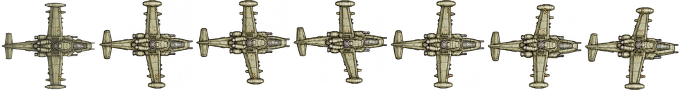
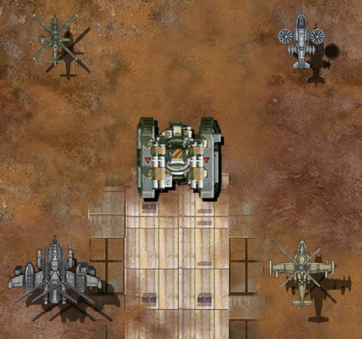

# 벨루가 좌우 선회 수정

2026-11-09. 벨루가의 좌우 선회 그림 6장을 다시 만들고 웹 치트빌드에서 확인했다. 스카웃은 `5d6b872`에서 먼저 커밋했다. 이번 게임 자원 변경은 벨루가 몸체 PNG 하나다. 정면, 다른 세 헬기, 원본 유닛과 이동 코드를 보존했다. 아이폰 설치와 사용자 시각 확인은 남았다.

## 그림과 조립

이전 벨루가 선회 그림에는 양쪽 날개가 뒤로 꺾여 기체가 앞뒤로 숙이는 듯 보이는 문제가 있었다. 재작업 초반에는 날개가 짧아진 도색 시안을 형상 참고로 선택하는 오류도 있었다. 실제 제작 원본인 `Art/Aircraft/parts/user-20261108/beluga-sheet-v1.png`의 몸체로 참조를 교체했다.

새 그림은 기수·꼬리 방향을 유지하고 좌우 선회에 따른 날개의 투영, 측면 노출과 가림을 그렸다. 중간 웹 시안에서 과도한 날개 축소와 밝기 차이, 무장 위치 불일치를 발견해 다시 수정했다. 기존 무장 연결점의 선회 변환에 맞춰 그림의 날개 위치를 고쳤다. 연결점이나 공통 렌더러를 바꾸지 않았다.

[최종 제작 그림](../../Art/Aircraft/banking-correction-20261109/beluga-authoritative-06.png), [실제 제작 원본 참조](../../Art/Aircraft/banking-correction-20261109/beluga-authoritative-reference.png), [날개·색조 수정 지시](../../Art/Aircraft/banking-correction-20261109/beluga-tone-span-prompt.txt), [무장 위치 대조 후 수정 지시](../../Art/Aircraft/banking-correction-20261109/beluga-mount-prompt.txt)를 보존했다. 내장 이미지 생성 도구를 사용했다. 이전 시안과 검사 화면은 로컬에 보존했고 [교체 기록](../evidence/beluga-bank-correction-20261109/superseded.json)에 해시를 남겼다.

기존 색 준비 함수를 재사용하고, 기존 위험 표식·작은 삼각형의 좌우 위치를 그려진 날개 폭에 맞춰 제작 단계에서 투영했다. 새 무늬나 부품 전체를 다른 색으로 칠하는 처리는 추가하지 않았다. 정면에는 이 처리를 반복하지 않고 기존 픽셀을 그대로 복사했다. 새 그림의 명암은 생성 그림에 포함돼 있으며, 정면과 모든 색 픽셀이 같다는 뜻은 아니다.

저장 그림의 기수는 오른쪽이다. 왼쪽부터 정면, 왼쪽 3단계, 오른쪽 3단계다. 타일 140×131, 전체 980×131로 기존 크기를 유지했다. 정면의 그림 영역과 픽셀도 동일하다. 각 그림은 같은 배율로 축소하고 기존 로터 연결점에 맞췄다. 비균일 늘이기는 하지 않았다. [포장 정의](../../Art/Aircraft/banking-correction-20261109/recipe.json), [크기·연결점 기록](../../Art/Aircraft/banking-correction-20261109/manifest.json).

각도 숫자는 게임의 단계 선택에 대응하는 제작 지시다. 실제 3D 모델에서 측정한 각도나 모든 부품의 오차가 0이라는 뜻은 아니다. 선회에 따른 명암과 작은 세부 묘사의 최종 시각 검수는 남았다.

MCB 정의·타일 수·소켓·무장·로터·발사 효과는 그대로다. 준비 PNG를 기존 Apple PNG 최적화 경로로 처리했다. 실행 중 텍스처 생성·업로드나 DB 기록 경로를 추가하지 않았다. 벨루가 날개·엔진의 별도 파츠 분리는 이번 작업에 포함하지 않았다.

## 실제 웹 비교와 검사

중앙은 원본 적 탱크다. 왼쪽 위 스카웃, 오른쪽 위 샤이엔, 왼쪽 아래 AH-10, 오른쪽 아래 벨루가다. 정면→왼쪽 끝→오른쪽 끝을 반복한다. 실제 게임 캡처에서 다섯 유닛을 포함하는 영역을 잘라 표시했다. 픽셀을 늘이거나 색을 바꾸지 않았다.

- Chrome·WebKit에서 정면과 좌우 6단계 전환, 예열 후 추가 텍스처 업로드 0회와 스크립트 오류 0건을 확인했다. [Chrome](../evidence/beluga-bank-correction-20261109/chrome-banking.json), [WebKit](../evidence/beluga-bank-correction-20261109/webkit-banking.json).
- 두 브라우저의 Lv.1·10 무장·사격·회피·효과 검사와 추가 저장 없음, 오디오 컨텍스트 수 유지 검사가 통과했다. 성능 측정은 제외한 실행이다. [Chrome 전투](../evidence/beluga-bank-correction-20261109/chrome-combat.json), [WebKit 전투](../evidence/beluga-bank-correction-20261109/webkit-combat.json).
- 관련 코어 검사 `Aircraft`·`AircraftHandling` 2개가 통과했다. [실행 기록](../evidence/beluga-bank-correction-20261109/core.txt). 변경하지 않은 나머지 소스의 기존 검사 결과는 재사용했다.
- 이전 스카웃 커밋의 화면과 비교해 정면 전체 화면의 픽셀 차이는 0이다. 7단계 모두 벨루가 영역 밖의 픽셀 차이도 0이다. 원본 보호 파일 2,652개 해시는 동일하고, `Sources` 변경은 없다. 이동 파일은 `38903e4`와 바이트가 같다. [보존 검사](../evidence/beluga-bank-correction-20261109/preservation.json).
- 텍스처의 크기와 기존 GPU 준비 크기 1024×256은 같다. RGBA8 한 텍스처의 계산상 공간은 수정 전후 1,048,576바이트다. 전체 성능이나 실제 GPU 사용량을 측정한 결과는 아니다.

아이폰은 기존 이동 복구본이 설치돼 있다. 이번 그림으로 다시 설치하지 않았고 게임 main·운영 PWA도 배포하지 않았다. 후속 작업은 두 기체의 실기기 선회 확인, 도색·질감·입체감, 남은 파츠 조립, 기존 움직임을 유지한 표적 밀착 방지, 실제 성능 검사다. 샤이엔·AH-10을 이번 재작업에 함께 바꾸지 않는다.
