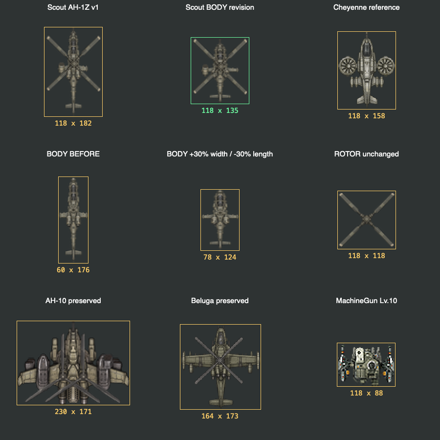
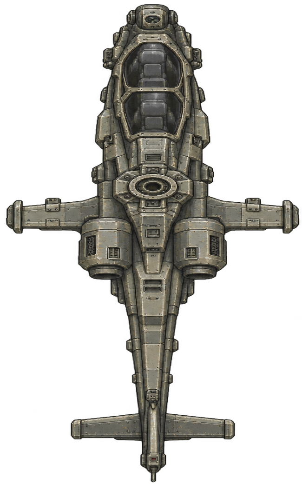
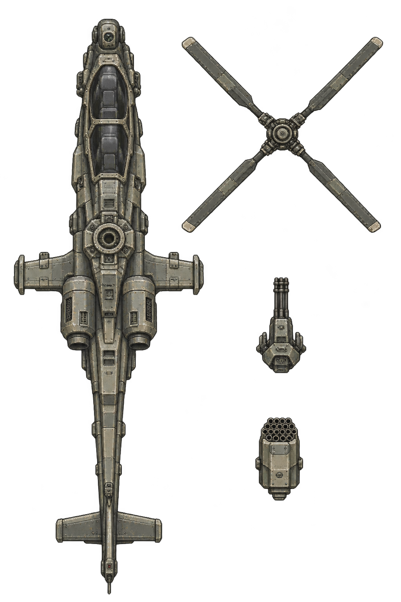

# 스카웃 AH-1Z 시안과 몸체 비율 수정 — 2026-11-08

AH-1Z를 바탕으로 스카웃을 만들고, 후속 지시에 따라 **스카웃 몸체만 넓고 짧게 수정했다.** 현재 색조·장갑 조형을 유지한 같은 그림을 사용했다. 샤이엔·벨루가·AH-10은 변경하지 않았다.

## 웹 치트빌드 비교

첫 행은 AH-1Z 초안·몸체 수정안·샤이엔이다. 둘째 행은 로터를 제외한 몸체 전후와 보존한 로터다. 셋째 행은 AH-10·벨루가·머신건 메크 Lv.10이다. 초안은 직전 Safari 게임 캡처이며, 수정안과 비교 기체는 이번 웹 치트빌드의 실제 게임 렌더러 출력이다.

북쪽 방향·로터 각도 0·월드 2배율에서 투명 여백과 그림자를 제외한 전체 외곽 사각형을 측정했다.

| 대상 | 변경 전 폭×길이 | 변경 후 폭×길이 | 결과 |
|---|---:|---:|---|
| 스카웃 **몸체만** | 60×176px | **78×124px** | 폭 +30%. 길이 목표 123.2px에 대한 반올림 +0.8px |
| 스카웃 전체 조립 | 118×182px | **118×135px** | 로터 포함 폭 유지, 전체 길이 감소 |
| 스카웃 로터 | 118×118px | 118×118px | PNG 바이트·크기 유지 |
| 샤이엔 | 118×158px | 118×158px | 유지 |
| 벨루가 | 164×173px | 164×173px | 유지 |
| AH-10 | 230×171px | 230×171px | 유지 |

몸체의 가로·세로에 서로 다른 비율을 적용한 것은 이번 사용자의 명시적 지시다. 첫 AH-1Z 초안의 몸체 PNG는 동쪽 방향 88×30px였고, 수정본은 62×39px다. 고해상도 생성 원본에서 한 번 축소해 포장했다. 로터·기관총·로켓 포드 그림은 초안의 파일 바이트를 그대로 유지했다. 몸체에 붙는 축·무장 연결점만 몸체의 새 비율에 맞춰 이동했다.

로터가 회전하면 전체 외곽 사각형은 달라진다. 위 수치는 앞선 크기 비교와 같은 고정 자세의 실측이며 회전 중 최대 폭을 뜻하지 않는다. 360개 로터 각도의 알파 외곽 계산도 별도로 보존했다.

## 도안과 부품

위 그림은 새로 그린 기체가 아니라 생성 원본 몸체를 요청한 비율로 바꾼 확대 보기다. 직렬 조종석·양옆 엔진·짧은 날개·긴 꼬리의 구성을 유지하면서 더 통통하고 짧게 만들었다. 회녹색·따뜻한 회색 금속, 어두운 패널 틈, 짧고 밝은 모서리와 마모 표현을 유지했다.

AH-1Z의 형태는 [Bell 공식 제품 자료](https://www.bellflight.com/products/bell-ah-1z), 4엽 로터는 [NAVAIR 설명](https://www.navair.navy.mil/product/AH-1Z-Viper)을 참조했다. 각진 장갑판·엔진 덮개·접합부는 맥디펜스 메크를 참고한 미래 개수 시안이다.

원작 P_Body_01·05·34와 기존 헬기 3종의 실제 게임 조립 화면을 첫 생성 입력으로 사용했다. 몸체·로터·기관총·로켓 포드를 분리했다. 현재 스카웃의 기관총 1개·로켓 포드 1개와 발사 동작은 유지했다.

이 시트는 **몸체 비율 수정 전 생성 원본**이다. 최종 몸체는 위 확대 보기와 웹 비교의 가운데 기체를 따른다.

## 확인한 결과

- 다른 세 헬기 이미지 22개의 SHA-256과 조립 설정이 그대로다. 스카웃 로터·기관총·로켓 포드 PNG도 초안과 바이트가 같다.
- 생산·강화·HP·사거리·피해·이동·회피 테이블을 변경하지 않았다. 앞서 작성한 1~10레벨 수치안도 이번 아트 작업에서 적용하지 않았다.
- 항공기·캠페인·회피·HUD 관련 C++ 검사 8개 통과. Safari 실제 World의 일시정지·이동·피해·발사음 검사 통과. 전투 중 추가 저장·준비 후 추가 텍스처 업로드는 0회다.
- 웹 묶음의 스카웃 PNG 4개는 현재 Resources 파일 바이트와 일치한다. 초안에서 발견한 몸체 크롭 안의 별도 로터 조각은 부품 분리 단계에서 제거했다.

이번 결과는 작업 브랜치와 보고서의 검수 시안이다. 게임 main·운영 PWA·실기기 앱에는 배포하지 않았다. 최종 미감 채택은 아직 받지 않았다.

## 몸체 편집 도구 응답

첫 부품 시트 생성은 성공했다. 후속 몸체 비율 편집 요청에는 이미지 도구가 HTTP 400, `moderation_blocked`, `violence`, 입력 단계 오류를 반환했다. 해당 그림의 구체적인 차단 근거는 응답에 없었다. 새 편집 이미지는 생성되지 않았다. 요청한 가로·세로 비율은 기존 생성 원본의 게임용 포장 단계에서 적용했다.

[오류 전문](../../Art/Aircraft/parts/scout-ah1z-20261108/body-v2-imagegen-error.json) · [첫 생성 프롬프트](../../Art/Aircraft/parts/scout-ah1z-20261108/prompt.txt) · [몸체 편집 요청 프롬프트](../../Art/Aircraft/parts/scout-ah1z-20261108/body-v2-prompt.txt)

## 자료

[외곽 실측](../evidence/scout-ah1z-20261108/bounds.json) · [몸체 수정 보존 검사](../evidence/scout-ah1z-20261108/body-v2-preservation.json) · [Safari 전투 검사](../evidence/scout-ah1z-20261108/combat-safari.json) · [C++ 검사](../evidence/scout-ah1z-20261108/core-tests.txt) · [회전 중 외곽 계산](../evidence/scout-ah1z-20261108/rotor-bounds.json) · [원본·참조 해시](../../Art/Aircraft/parts/scout-ah1z-20261108/references.json) · [크롭·비율·연결점](../../Art/Aircraft/parts/scout-ah1z-20261108/runtime.json) · [포장 코드](../../tools/pack_scout_ah1z.sh)

## 추가한 투두

- **MD-TITLE-ART-03:** 웹 Tap to Start의 원작 일러스트 비율 손상·좌우 왜곡을 조사하고 시정한다. iOS·Android·PWA·Tauri를 각각 대조한다. 원인 확인·수정은 미실행이다.
- **MD-README-ORDER-01:** 「헤비멕1과는 다른 위화감」 단락을 README 맨 아래에서 조금 위인 하단부로 내린다. 본문·링크·한영 제공은 보존한다. 실제 이동은 미실행이다.

두 과제는 [현행 투두](../usability-todo.md)에 등록했다.
