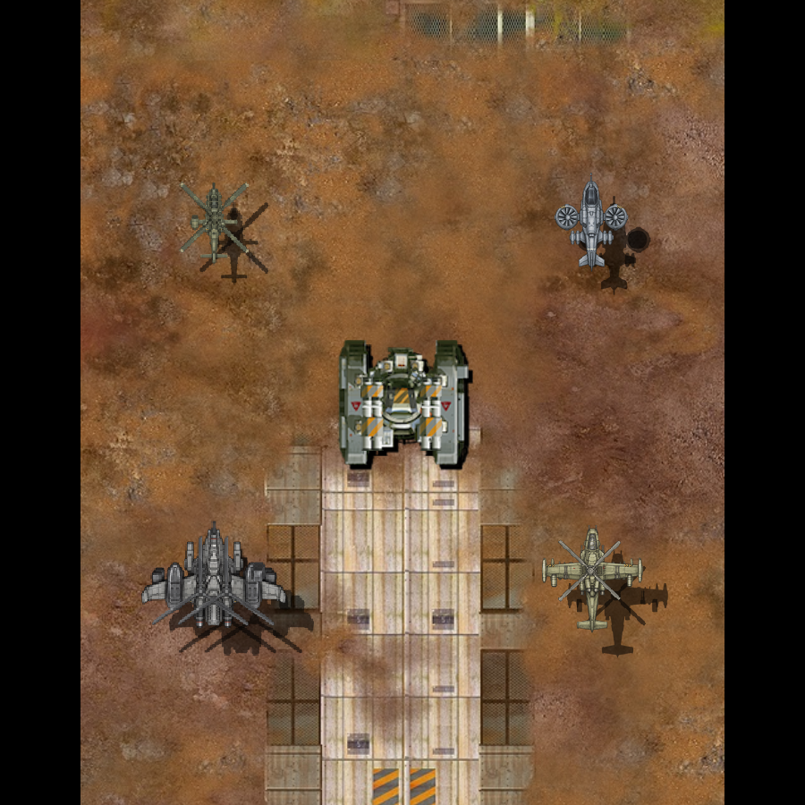

# 스카웃 좌우 선회 수정

2026-11-09. 스카웃 몸체의 좌우 선회 그림 6장을 다시 만들고 웹 치트빌드에 연결했다. 정면과 좌우 끝 단계를 직접 비교했다. 벨루가·샤이엔·AH-10과 이동 코드는 바꾸지 않았다. 아이폰 설치와 사용자 시각 확인은 아직 하지 않았다. 벨루가 재작업도 미완료다.

## 바꾼 그림과 보존 범위

이전 그림은 선회 단계에서 기수·꼬리의 각도까지 달라져 앞뒤로 숙이거나 드는 듯 보였다. 이번에는 기수가 위를 향하는 고정 시점에서 좌우 측면의 노출과 가림을 그렸다. 제작 뒤 기존 자원의 기수 방향으로 90도 돌려 포장했다. 기수·꼬리를 함께 화면 안에서 회전시키는 방법은 쓰지 않았다.

기존 승인 스카웃의 정면 형상과 주색, 고해상도 도장 자료를 입력으로 사용했다. 첫 생성본은 승인 비례보다 좁아 채택하지 않았다. [두 번째 생성본](../../Art/Aircraft/banking-correction-20261109/scout-candidate-02.png)에 기존 `prepareAircraftPaint` 색 준비를 적용했다. 새 도장 위치나 런타임 색 처리를 추가하지 않았다. 기존 정면은 색 준비를 다시 적용하지 않고 픽셀 그대로 복사했다.

[제작 지시](../../Art/Aircraft/banking-correction-20261109/scout-prompt.txt), [비례 수정 지시](../../Art/Aircraft/banking-correction-20261109/scout-prompt-02.txt), [포장 정의](../../Art/Aircraft/banking-correction-20261109/recipe.json), [크기·연결점 측정](../../Art/Aircraft/banking-correction-20261109/manifest.json)을 보존했다. 내장 이미지 생성 도구를 사용했다. 각도의 숫자는 게임의 선회 단계에 대응한 제작 지시이며, 실제 3D 모델에서 측정한 각도라고 주장하지 않는다.

정면의 그림 영역은 62×39 그대로다. 선회 측면이 잘리지 않도록 캔버스에 투명 여백을 앞뒤 1픽셀·좌우 4픽셀씩 더해 타일은 64×47이 됐다. 이는 화면의 기수가 위를 향할 때의 방향이며, 저장 PNG에서는 좌우 1픽셀·상하 4픽셀이다. 정면 웹 화면은 동일하고, [생산 아이콘의 외곽과 축소 비율](../evidence/aircraft-bank-correction-20261109/preview-bounds.txt)도 동일하다. 비균일 늘이기를 하지 않았다. 여섯 그림은 같은 축소 배율을 사용한다. 외곽 중심으로 매번 위치를 바꾸지 않고 기존 로터 연결점에 맞췄다. 수동 측정한 생성 그림의 로터 중심과 정수 배치의 차이는 출력 텍스처 기준 0.5픽셀 이하다. 이것을 모든 부품의 정렬 오차 수치로 확대하지 않는다.

기존 MCB 파츠·소켓·무장 정의는 동일하다. 준비 PNG를 Apple `pngcrush -iphone -f 0`으로 최적화해 기존 로더와 렌더러가 읽는다. 실행 중 그림을 만들거나 DB를 기록하는 경로는 추가하지 않았다. 실제 게임 자원 변경은 `ALightBody.png` 하나다.

## 실제 웹 비교

중앙은 원본 적 탱크다. 스카웃은 왼쪽 위, 샤이엔은 오른쪽 위, AH-10은 왼쪽 아래, 벨루가는 오른쪽 아래다. 정면→왼쪽 끝 단계→오른쪽 끝 단계를 반복한다. 벨루가의 기존 결함도 그대로 보인다. 이 그림을 4종 수정 완료나 사용자 승인으로 표시하지 않는다.

[픽셀·파일 보존 검사](../evidence/aircraft-bank-correction-20261109/preservation.json)에서 정면 화면은 기존 캡처와 픽셀 차이가 0이었다. 좌우 끝 단계에서도 스카웃 영역 밖의 픽셀 차이는 0이었다. 원본 보호 파일 2,652개 해시가 같고 `Sources` 변경은 없다. 이동 파일은 기존 확인본 `38903e4`와 바이트가 같다.

## 검사 결과와 남은 일

- 코어 전체 검사에서 53개가 통과했고 기존 캔버스 폭을 고정한 항목 하나가 실패했다. 최종 투명 여백에 맞춰 캔버스 검사값을 수정했다. 그림 영역 보존은 별도 픽셀 비교로 확인했다. 최종 `Aircraft`·`AircraftHandling` 2개 재검사가 통과했다. [첫 기록](../evidence/aircraft-bank-correction-20261109/core-initial.txt), [최종 관련 검사](../evidence/aircraft-bank-correction-20261109/core-final.txt).
- Chrome·WebKit의 선회 7단계 전환과 예열 후 추가 텍스처 업로드 0회, 스크립트 오류 0건을 확인했다. [Chrome](../evidence/aircraft-bank-correction-20261109/chrome-banking-final.json), [WebKit](../evidence/aircraft-bank-correction-20261109/webkit-banking-final.json).
- Chrome·WebKit 무장·사격·회피·효과·저장·오디오 관련 검사가 통과했다. 최종 포장으로 전투 검사도 다시 실행했다. [Chrome 전투](../evidence/aircraft-bank-correction-20261109/chrome-combat-final.json), [WebKit 전투](../evidence/aircraft-bank-correction-20261109/webkit-combat-final.json).
- 기존 GPU 준비 방식의 2의 거듭제곱 크기는 수정 전후 모두 512×64다. RGBA8 한 텍스처의 계산상 공간은 131,072바이트로 같다. 전체 GPU 메모리나 실제 프레임 성능을 측정한 결과는 아니다.

아이폰 정식 빌드 설치·직접 선회 확인, 최종 시각 검수와 실기기 성능 비교는 남았다. 게임 main·운영 PWA에는 배포하지 않았다. 벨루가 새 시안은 날개 비례·도장·시점 보존 조건을 충족하지 못해 적용하지 않았다. 실패 결과는 로컬에 보존했고 [미채택 기록](../evidence/aircraft-bank-correction-20261109/unselected.json)에 구분했다.
