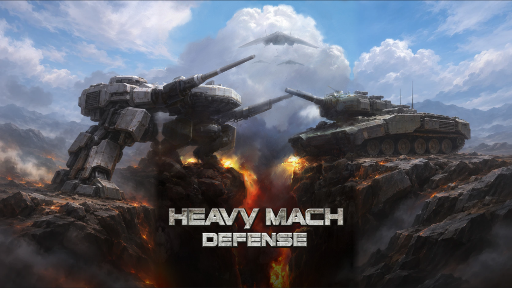
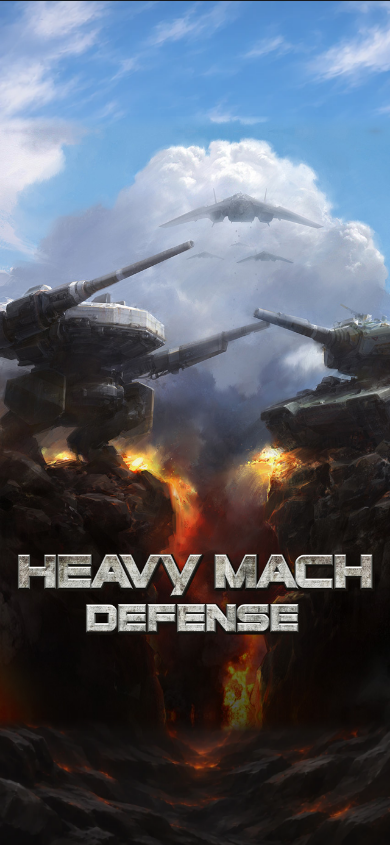

# 타이틀 외곽 합성 시안

2026-11-09. 원본 `Title.jpg`와 새 외곽 그림을 한 화면에 배치한 검수용 시안이다. [합성 보고서](https://heavymach-dev-report-20261025.hiphopxy.chatgpt.site/md-title-composite-20261109/)에서 원본 영역 표시·경계 연결 전후·화면 비율 전환·합성 PNG 저장을 제공한다. 게임 코드와 자원, 헬기 구현은 변경하지 않았다.

## 가로 웹

1600×900 기준 원본은 중앙 600×900, 좌우 외곽은 각각 500픽셀이다. 1280×800과 2560×1440도 보고서에서 선택한다. 생성 그림의 중앙 기체·글자를 가리고 원본 JPG를 그대로 그린다. 원본 바깥 12논리단위에 가장자리 일부를 반사해 투명도를 줄이며 연결했다. 원본 내부는 연결 처리에 사용하지 않는다.

좌우 생성 영역의 기체 후방·장갑·지면은 검수 대상이다. 원본 중앙 픽셀이 보존됐다는 검사로 새 외곽 기계 구조나 화풍까지 승인됐다고 판단하지 않는다. 넓은 화면에서는 중앙과 외곽의 명암 차이가 일부 드러난다.

## 세로 폰

390×844 기준 원본은 390×585, 상하 외곽은 각각 약 129.5픽셀이다. 첫 생성·합성에서 위 구름이 수평으로 끊기고 아래 바위·불빛이 다른 장면처럼 보여 상하 외곽을 다시 그렸다. 첫 생성 PNG와 두 번째 PNG를 모두 보존했다. 게시 시안은 두 번째 그림의 바깥 부분만 쓴다.

## 검사와 제작 기록

Chrome·WebKit에서 가로 3크기와 세로 합성을 검사했다. 각 엔진의 같은 크기·같은 필터로 원본만 그린 대조군과 비교했을 때 중앙 내부 색 채널 차이는 0이다. 경계 1픽셀은 이 중앙 내부 비교에서 제외했다. 원본 영역 표시·연결 전환·가로 PNG 다운로드를 실행했고, 390픽셀 페이지에서 가로 넘침이 없었다. [검사 수치](../evidence/title-composite-20261109/check.json).

브라우저 Canvas 합성 시안이며 게임 GPU나 설치형 PWA·네이티브 앱 검사가 아니다. 생성 이미지 전체를 원본으로 교체하거나 시안 확인을 제품 반영으로 기록하지 않는다.

- 제작: 내장 image_gen, 가로 1회·세로 2회. [프롬프트](title-composite-20261109/prompts.md).
- 입력·출력: [파일 해시와 배치](title-composite-20261109/manifest.json). 원본 JPG는 바이트 그대로 게시하고 새 그림만 보고용 WebP 품질 90으로 압축했다.
- 생성 PNG: `title-composite-20261109/generated-wide.png`, `generated-tall.png`, `generated-tall-v2.png`.
- 합성: [보고서 전용 코드](title-composite-20261109/composite.js). 실제 게임 Core는 수정하지 않았다.
- 화면 인계용 브라우저 열기는 연결 호스트 부재로 실패했다. 로컬 보고서의 Chrome·WebKit 검사와 별개이며, 게시 URL로 직접 열 수 있다.

게시 용량 제한을 맞추기 위해 기존 보고용 WebP 86개를 무손실 재압축해 853,638바이트를 줄였다. 모든 파일의 RGBA 픽셀·크기·메타데이터를 보존했고 URL은 유지했다. [대조 기록](../evidence/title-composite-20261109/report-repack.json). 게임 에셋에는 적용하지 않았다.
