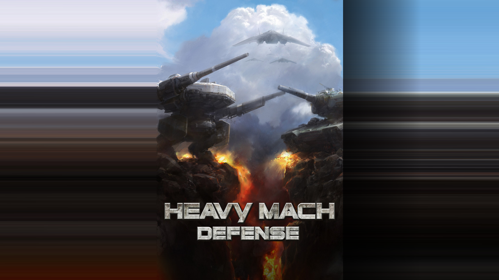
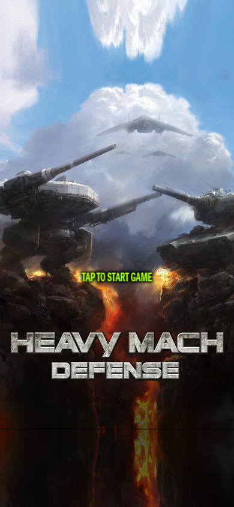

# Tap to Start 화면 왜곡 조사와 수정계획

2026-11-09. 조사 기준 `614a6e4`. 사용자 요청: PWA와 네이티브 폰의 Tap to Start 문제를 파악하고, 특히 맥미니 웹에서 심한 원인을 찾아 수정계획을 만든다.

## 확인한 원인

공통 `Menu::expandFrame()`이 원본 타이틀의 좌우 **1픽셀 열을 여백 전체로 늘린다.** 상단 64픽셀과 하단 120픽셀은 뒤집어서 상하 여백에 그린다. 넓은 웹 창에서는 좌우 색 줄이 길게 늘어나고, 세로 폰 화면에서는 구름과 불길이 반사·확대되어 반복된다. [소비 코드](../../Sources/Core/Presentation/Menu.cpp), [실제 프레임의 자르기·배치·반전 값](../evidence/title-audit-20261109/native-frame-geometry.json).

중앙 원본 `Title.jpg`는 640×960이며 논리 좌표 320×480으로 균등하게 표시된다. 중앙 기체와 글자의 가로세로 배율이 달라지는 증거는 이번 재현에서 나오지 않았다. 화면 바깥쪽을 추가로 채우는 부분의 왜곡은 확인했다. 원본 파일을 다시 그린 것이 아니라, 원본의 가장자리를 잘라 늘리고 뒤집는 코드가 현재 화면을 만든다.

| 화면 크기(CSS px) | 중앙 원본 표시 | 좌우 채움 합계 | 화면 폭에서 좌우 채움 비율 |
|---|---|---|---|
| 320×480 | 320×480 | 0 | 0% |
| 390×844 | 390×585 | 0 | 0%; 상하 약 129.5px씩 반전 채움 |
| 820×1180 | 약 786.7×1180 | 약 33.3px | 약 4.1% |
| 1280×800 | 약 533.3×800 | 약 746.7px | 약 58.3% |
| 1600×900 | 600×900 | 1000px | 62.5% |
| 2560×1440 | 960×1440 | 1600px | 62.5% |

1600×900에서는 원본의 좌우 1픽셀이 각각 화면 500픽셀로 늘어난다. 2560×1440에서는 각각 800픽셀이다. 맥미니의 연산 성능이 원인이라는 증거는 없으며, 화면이 넓을수록 이 배치 방식이 더 크게 드러난다.

## 지시와 구현이 어긋난 경위

1. 11월 5일 화면 확장 때 원본의 가장자리를 늘리고 반사하는 처리를 사용했다.
2. 11월 6일 `33ee2cc`에서 별도 외곽 그림 후보를 `TitleBackdrop.hpp`로 연결했다. 사용자는 가로 시안의 메크·탱크 변형을 기각했고 원본 형태·비율 보존을 요구했다.
3. 11월 7일 `46226cc`에서 후보 호출과 제품 자원을 제거하면서 **기존 1픽셀 늘이기·반전 처리를 다시 넣었다.** 후보 제거는 수행했지만 이미 지적받은 표시 결함을 되살렸다. 이 타이틀 변경은 레벨 확장·생산 목록 스크롤 커밋에 함께 들어갔다.
4. `MD-TITLE-IPAD-02`, 타이틀 외곽 그림 기록, 11월 8일 `MD-TITLE-ART-03`에 같은 결함과 보존 조건이 누적됐다. 실제 타이틀 코드는 고치지 않은 채 후속 작업을 진행했다.
5. 현행 자동검사는 320×480 중앙 그림이 존재하고 생성 그림을 쓰지 않으며 터치로 다음 화면에 가는지만 확인한다. 1픽셀 확대나 반전 조각을 금지하지 않는다. 이번에 **결함이 보이는 상태 그대로 기존 웹 검사 5조건이 모두 통과했다.** [기존 검사 결과](../evidence/title-audit-20261109/existing-test-result.json), [검사 코드](../../Web/tests/title-layout.mjs).

지시 내용이 서로 모순되어 생긴 것으로 확인되지 않았다. Codex가 기각 후보를 제거하면서 결함 있는 이전 처리를 복구했고, 최신 보존 지시를 실제 코드와 검사 조건으로 연결하지 않은 것이 확인된 작업상의 문제다. `TitleBackdrop.hpp`는 파일로 남아 있지만 현재 `Menu.cpp`에서 호출하지 않는다. 후보가 파일로 남은 것과 실제 화면에서 사용되는 것은 다르다.

## 플랫폼별 확인 범위

공통 경로는 `GameSession::resize` → `FrameLayout` → `Menu::expandFrame` → 각 플랫폼 렌더러다. 웹/PWA만의 타이틀 그림 코드와 네이티브 전용 타이틀 그림 코드가 따로 있는 구조가 아니다.

| 대상 | 이번에 확인한 내용 | 이번에 직접 확인하지 않은 범위 |
|---|---|---|
| 운영 웹 | `87ea3cfe8a8dc249`. Chrome·WebKit에서 6개 창 크기 모두 실행·캡처. 위 왜곡 재현 | 사용자가 열어 둔 기존 탭과 그 탭의 캐시 상태 |
| 로컬 치트 웹 | `f9c149c09cf5f2dc`. 같은 두 엔진·6개 크기에서 같은 타이틀 배치 | 새 게임 빌드를 만든 검사는 아님 |
| 설치형 PWA | 일반 웹과 같은 app.js·Wasm·공통 타이틀 경로 확인. 새 브라우저 컨텍스트에서도 문제 재현 | 실제 폰의 설치형 PWA 실행, 주소창·안전 영역·설치 캐시 상태 |
| iOS·Android | 같은 공통 Menu와 FrameLayout을 소비. iOS는 bounds·safeAreaInsets, Android는 surface/density·insets를 전달. 현재 Menu는 마지막 아이폰 설치 기록의 `4dcf273`과 바이트 동일 | 이번 과제에서 실기기 앱을 실행하거나 교체하지 않음 |
| Tauri | 같은 웹 산출물을 소비하는 경로 | 이번 과제에서 설치된 앱 화면 미확인 |

이번 캡처는 Chrome·WebKit × 운영·로컬 × 6개 크기 = **24조건**이다. 모두 타이틀→슬롯 화면 전환이 되고 저장 쓰기는 0회다. 이 기능 성공은 시각 결함 해결을 뜻하지 않는다. [캡처 수치와 소스 해시](../evidence/title-audit-20261109/summary.json), [Chrome](../evidence/title-audit-20261109/chromium-capture.json), [WebKit](../evidence/title-audit-20261109/webkit-capture.json).

현재 공통 Menu를 Mac용 진단 실행 파일로 별도 컴파일해 7개 화면·안전 영역 조건의 source/destination/flip 값을 추출했다. 390×844에서 상단 59·하단 34 안전 영역을 넣어도 반전 채움은 유지되고 위아래 배치만 달라진다. 이 값은 예시 안전 영역이며 실제 사용자 폰에서 측정한 수치가 아니다.

웹 실행 전의 PLAY IN BROWSER 화면은 별도 HTML 런처다. 런처의 `background: ... center/cover`는 비율을 유지하면서 원본을 잘라 표시한다. 게임 안 Tap to Start의 늘이기·반전과 다른 처리다. 네이티브 OS 시작 화면도 게임 안 타이틀과 구분해 후속 확인한다.

## 수정계획

### 1. 현행 요구를 하나로 정리

`MD-TITLE-ART-03`을 현재 수정 항목으로 사용하고 iPad 왜곡·이전 타이틀 후보 기록을 여기에 연결한다. 원본 형태·비율·구도 보존, 1픽셀 늘이기 금지, 반전·반복 채움 금지, 기각 후보 재사용 금지를 검사 조건으로 옮긴다. 과거 기록은 보존하되 과거 구현 계획을 다시 실행하지 않는다.

### 2. 공통 타이틀 분기 수정

`Menu::expandFrame()`의 `Title.jpg` 분기에서 원본을 온전한 한 장으로 중앙에 균등 배율 표시하도록 변경한다. 기존의 1픽셀 좌우 조각과 상하 반전 조각은 생성하지 않는다. `FrameLayout` 전체 배율이나 플랫폼 렌더러를 바꿔 타이틀만 보정하지 않는다. 슬롯·미션 메뉴의 금속판 처리, 전투·HUD·입력·저장·오디오는 유지한다.

원본 비율을 온전히 보존하면 화면 비율에 따라 바깥 공간이 남는다. **1차 수정안은 그 공간에 기존 프레임의 검정 배경을 그대로 표시하는 방식**이다. 아직 구현·채택한 디자인이 아니다. 화면 전체를 그림으로 채우는 최종안은 원본 중앙을 고정한 별도 외곽 그림 검수로 다룬다. 원본 중앙을 확대해 자르거나 원본의 기체·글자를 바꾸는 것으로 빈 공간을 감추지 않는다.

### 3. 외곽 그림의 제작·채택 분리

전체 화면 일러스트가 필요한 경우 가로·세로 외곽만 제작한다. 중앙 원본의 해시·표시 영역을 고정하고 메크·탱크·비행기·글자·부품을 바꾸지 않는다. HeavyMach1의 채택 외곽 제작·연결 기록과 대조한다. 보고용 시안과 제품 자원을 분리하고, 채택된 외곽만 한 공통 배치 규칙으로 연결한다. 현재 기각된 Wide/Tall 후보는 제품에 연결하지 않는다. 이번 조사는 새 그림 생성이나 기존 후보 승인을 포함하지 않는다.

### 4. 결함을 잡는 검사로 보강

- 원본 타이틀 파일 해시를 고정한다. 전체 source rect를 사용하는 중앙 그림 1개, `flipX=false`, `flipY=false`, 가로세로 동일 배율을 확인한다.
- 타이틀 원본의 1픽셀 폭 조각과 반전 조각을 금지한다. 기존 검사의 중앙 그림 존재 여부만으로 통과시키지 않는다.
- 320×480, 390×844, 820×1180, 1280×800, 1600×900, 2560×1440에서 전체 화면과 원본 대응 영역을 나란히 확인한다. 창 확대·축소, DPR 1·2, 세로·가로 및 안전 영역도 검사한다.
- Tap to Start의 위치·깜박임·효과음, 터치→문 전환→슬롯 진입을 확인한다. 메뉴와 전투 진입의 이전 화면을 비교하고 저장 쓰기·음향 컨텍스트·프레임 비용의 불필요한 증가가 없는지 확인한다.
- 폰 비율의 데스크톱 WebKit 캡처를 iPhone 실기기 검증으로 기록하지 않는다.

### 5. 같은 수정본을 플랫폼별로 확인

웹 치트의 전후 비교를 먼저 끝낸다. 같은 Core·자원을 사용하는 iPhone·Android 빌드와 설치형 PWA에서 실제 화면을 확인한다. 기존 앱·PWA 저장은 보존한다. 운영 PWA는 기존 업데이트 절차로 새 버전·자원 해시·저장 보존을 확인하며, 사용자 캐시 전체 삭제를 해결책으로 삼지 않는다. Tauri도 웹과 같은 수정 자원인지 확인한다.

수정·관련 검사·커밋은 한 묶음으로 진행한다. 외곽 미술을 추가하면 별도 검수·커밋으로 남긴다. feature→develop→main 순서와 실제 설치·운영 배포 결과를 각각 기록한다.

## 현재 완료 범위

원인·변경 이력·운영 및 로컬 재현·기존 검사 누락 확인과 수정계획 작성까지다. 게임 코드·원본 이미지·폰 설치 앱·운영 게임은 변경하지 않았다. 헬기 작업 보류는 유지한다.
