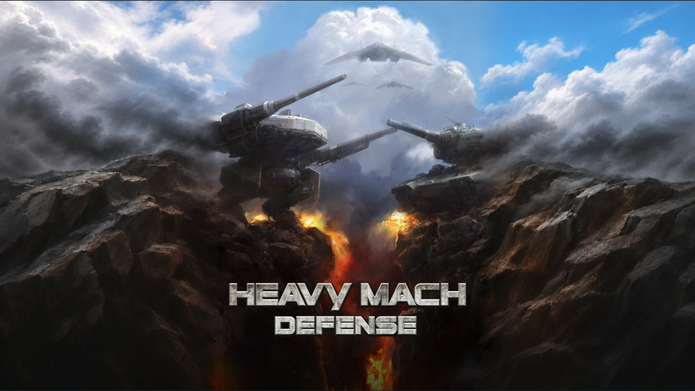

# 가로 타이틀 — 벼랑·하늘·구름 연결

2026-11-10. 원본 타이틀의 좌우에 이어지는 자연물 배경을 생성하고 원본 JPG와 합성했다. [보고서](https://heavymach-dev-report-20261025.hiphopxy.chatgpt.site/md-title-composite-20261109/)에서 원본 영역 표시, 가로 경계 연결 전후, 가로 화면 크기 변경과 PNG 저장을 할 수 있다. 게임 적용 전 시안이다.

원본 전체를 같은 비율로 중앙에 배치했다. 중앙 기체·글자·암벽·하늘은 원본 파일에서 가져온다. 새 외곽에는 가까운 어두운 벼랑, 구름과 연기를 배치했다. 생성 배경에서 모든 기계 형상과 문자를 제거했으며 그 배경의 중앙은 사용하지 않는다. 앞선 두 생성 후보는 기체 조각이 원본 밖에 남아 제외했다.

원본 바깥의 생성 그림만 색을 조정해 접합부의 명암 단차를 줄였다. 경계에서 멀어질수록 보정량을 줄이고 세로 방향 평균 범위를 넓혔다. 원본 기체 조각을 반사하거나 늘이지 않는다. 1600×900 합성에서 보정 범위는 원본 양옆 각각 117픽셀이다. 이 처리는 보고서 Canvas에서만 실행한다. 게임에 넣을 렌더링 구현이나 성능 검증은 이번 범위에 포함하지 않았다.

HeavyMach1의 `docs/menu-art-extension-20261025.md`, `docs/menu-joins-20261025.md`와 `HMGameView.mm`, `HMGLRenderer.mm`를 대조했다. 원본을 별도 표시하고 외곽과 접합부를 연결하는 순서를 참고했다. HeavyMach1의 검은 패딩 방지 처리와 이번 외곽 색 연결은 구분한다. MachDefense에 해당 소스를 복사하지 않았다.

## 확인한 범위

- Chrome·WebKit에서 1600×900, 1280×800, 2560×1440을 검사했다. 원본 사각형 내부의 RGBA 채널 차이는 모두 0이다. 기존 검사와 같이 가장자리 1픽셀은 비교에서 제외한다. 원본 JPG 파일 해시는 그대로다.
- 가로·세로 연결 전환, 원본 영역 표시, PNG 저장, 390px 페이지에서 가로 넘침 없음을 확인했다. JavaScript 오류는 없었다. [검사 결과](../evidence/title-joins-20261110/check.json).
- 채택된 세로의 이미지 파일·배치·연결 코드를 유지했다. 이전 세로 캡처와 이번 캡처는 두 브라우저 각각에서 RGBA가 같다. [보존 결과](../evidence/title-joins-20261110/preserved.json).
- 합성 화면을 직접 확인해 외곽에 추가 기체가 없는 것과 이전의 직선 명암 경계가 줄어든 것을 확인했다. 이번 가로 시안의 사용자 채택과 게임 적용은 아직이다.

[생성 프롬프트](title-joins-20261110/prompt.md), [파일 명세](title-joins-20261110/manifest.json), [보고서 합성 코드](title-joins-20261110/composite.js)를 보존했다. 원본·게임 코드·Resources·헬기·운영 앱은 변경하지 않았다.
