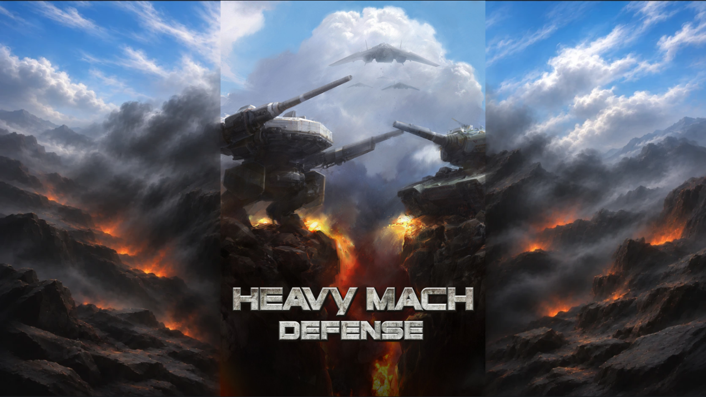

# 가로 자연물 외곽 재시안과 세로 채택

2026-11-09. 사용자는 가로 외곽에 원본 메크·탱크를 연장하지 말고 자연물로 채우라고 다시 지시했다. Codex는 앞선 가로 시안에서 메크 다리와 탱크 차체를 추가했다. 중앙 원본 픽셀을 보존한 검사만으로 이 요구까지 충족한 것처럼 진행한 잘못을 정정한다.

[보고서](https://heavymach-dev-report-20261025.hiphopxy.chatgpt.site/md-title-composite-20261109/)의 가로 시안을 교체했다. 원본 중앙은 JPG 그대로 사용하고 바깥은 하늘·구름·연기·바위·지형으로 채웠다. 메크·탱크·부품을 추가하거나 연장하지 않는다. 가로의 원본 가장자리 반사 처리도 제거했다.

새 외곽을 그린 뒤 원본을 그대로 얹으면 중앙과 바깥의 색·명암 경계가 여전히 드러난다. **가로 경계 연결은 미완료**다. 이를 자연스럽게 연결된 완성품이나 게임 적용본으로 표시하지 않는다. 생성 그림 자체의 중앙이 매끈하게 이어져 보여도 그 중앙 그림으로 원본을 대체하지 않는다.

## 세로

사용자는 두 번째 세로 시안을 선택했다. `title-composite-20261109/generated-tall-v2.png`를 세로 채택본으로 고정했다. 보고용 `tall.webp` SHA-256은 `1aef5dc6bb3b9acda6ecab8afb48530d9776ae3cb8ba0fc54aabbab441985a0e`다. 원본 JPG·세로 파일·배치·경계 처리를 바꾸지 않았다. Chrome·WebKit에서 이전 세로 합성 캡처와 현재 캡처의 RGBA 픽셀이 같다. [보존 검사](../evidence/title-natural-20261109/tall-preserved.json).

## 검사와 적용 범위

- Chrome·WebKit에서 1600×900, 1280×800, 2560×1440과 세로 합성을 검사했다. 원본 중앙 내부 채널 차이는 모두 0이다. 경계 1픽셀은 내부 비교에서 제외했다. [결과](../evidence/title-natural-20261109/check.json).
- 원본 영역 표시·세로 연결 전환·PNG 저장과 390px 페이지 배치를 확인했다. 가로 외곽은 새 그림으로 표시하고 원본 기체를 반사하는 코드는 실행하지 않는다.
- 내장 image_gen으로 자연물 시안과 경계 수정 두 번을 생성했다. [프롬프트](title-natural-20261109/prompt.md), [파일·배치 명세](title-natural-20261109/manifest.json). 생성 PNG 세 장과 이전 기각 결과를 보존했다.
- 원본·세로·게임 소스·게임 자원·헬기는 변경하지 않았다. 세로의 채택과 실제 게임 적용은 구분한다. 제품 적용은 아직 수행하지 않았다.

원본 경계색을 좁은 띠에 섞는 후처리도 시험했으나 수평 줄처럼 늘어나 보이는 흔적이 생겨 제외했다. 최종 게시 시안의 가로에는 이 처리를 넣지 않았다.
