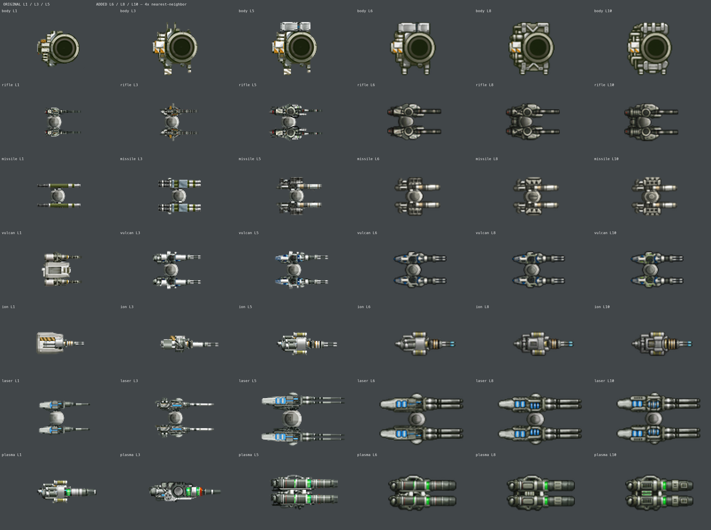

# 신규 포탑과 원작의 색·도트 대조

2026-11-07. 사용자가 라이플·발칸 등 신규 포탑이 원작보다 어둡고 임의로 해석한 화풍이라고 지적했다. 게임에서 읽는 PNG 70개를 비교했다. 원작 1–5레벨 35개는 보존 원본의 CgBI를 기존 절차로 RGBA 변환한 픽셀과 같았다. 추가 6–10레벨 35개가 이번 비교 대상이다.

## 확인한 차이

지적한 어두운 색조가 실제 파일에 있다. 라이플·발칸·이온·레이저·플라즈마와 공용 몸체 모두 원작 최종 단계보다 어둡다. 미사일의 평균 밝기 차이는 작지만 금속 면과 경계 표현은 다르다.

| 대상 | 원작 Lv.5 평균 밝기 | 추가 Lv.6–10 평균 밝기 | 밝기 변화 | 원작 밝은 픽셀 비중 | 추가 밝은 픽셀 비중 |
|---|---:|---:|---:|---:|---:|
| 공용 몸체 | 104.0 | 93.1 | -10.5% | 24.1% | 18.0% |
| 라이플 | 100.9 | 75.6 | -25.1% | 20.6% | 8.3% |
| 미사일 | 107.5 | 103.6 | -3.5% | 22.0% | 18.2% |
| 발칸 | 116.0 | 90.3 | -22.1% | 26.1% | 11.8% |
| 이온 | 132.9 | 96.5 | -27.4% | 33.4% | 13.1% |
| 레이저 | 117.4 | 97.7 | -16.8% | 26.8% | 18.0% |
| 플라즈마 | 108.1 | 87.0 | -19.5% | 19.7% | 9.8% |

밝기는 알파 224 이상인 픽셀의 sRGB 값에 `0.2126R + 0.7152G + 0.0722B`를 적용한 0–255 비교값이다. 밝은 픽셀은 160 이상이다. 추가 단계는 각 단계 측정값의 평균이다. 이 숫자만 맞춘다고 같은 화풍이 되는 것은 아니다. [70개 파일·해시·측정값](measurements.json).

## 형태와 도트

- **라이플:** 원작의 가는 포신은 밝은 금속 조각과 어두운 틈이 짧게 교차한다. 추가 부품은 굵고 어두운 긴 관처럼 보인다. 뒤쪽 회전부도 검은 링과 둥근 음영이 넓다. 전체 길이·폭이 같아도 내부 부품 비례는 달라졌다.
- **발칸:** 밝은 은색 장갑과 얇은 총열이 넓은 검은 경계·둥근 장갑으로 바뀌었다. 밝은 면의 비중이 26.1%에서 11.8%로 줄었다. Lv.10에는 원작 최종 단계의 청색과 다른 황록색 강조가 보인다.
- **이온·레이저·플라즈마:** 넓은 음영과 균일한 테두리가 남았다. 이온은 밝은 회색 몸통이 크게 어두워졌다. 레이저는 청색 발광이 상대적으로 두드러지고 플라즈마는 둥근 배관 표현이 강해졌다.
- **미사일·공용 몸체:** 미사일도 각진 밝은 면보다 둥근 관과 테두리가 두드러진다. 공용 몸체의 안쪽 링과 장갑 경계도 더 어둡고 균일하다.

원작은 짧은 밝은 픽셀 덩어리와 어두운 틈이 기계의 면을 구분한다. 추가 부품에는 생성 그림의 부드러운 굴곡 음영과 두꺼운 어두운 경계가 축소 후에도 남았다. 캔버스·총구·회전 중심 검사는 통과했지만 색·도트까지 맞추지는 못했다.

## 다시 만들 기준

같은 계열 원작 3·4·5레벨에서 은색·회녹색·그림자·강조색을 먼저 채집한다. 포신 굵기, 장갑 면적, 밝은 픽셀 덩어리의 위치와 틈의 폭을 따로 비교한다. 전체를 일괄 밝게 하면 검은 틈까지 회색이 되므로 부품별로 명암을 다시 구성한다. 원작에 없는 강조색과 두꺼운 외곽선을 넣지 않는다.

몸체·무장을 원본 픽셀 크기와 확대본으로 보고 조립본에서도 비교한다. 길이·폭·연결점 검사와 색·명암·내부 부품 굵기 검사를 각각 수행한다. 수정 시안과 실제 게임 화면을 함께 제시한다. 이번에는 대조와 수정 기준을 작성했으며 게임 PNG는 바꾸지 않았다.
